# MandiLens — Chart Gallery

Every SVG chart the pipeline has produced, grouped by analysis family,
newest first within each family. Regenerate with
`python3 tools/build_chart_gallery.py`.

## Daily price trends

### price_trends_2026-10-24.svg (2026-10-24)

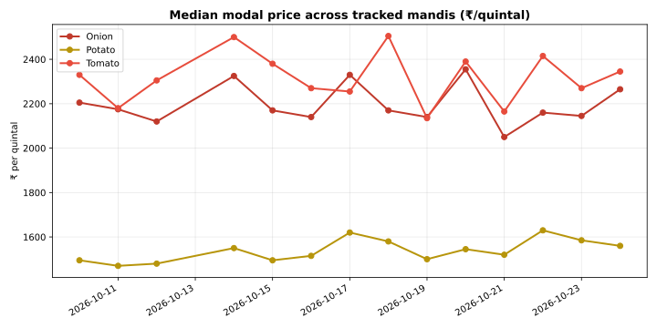

### price_trends_2026-10-23.svg (2026-10-23)

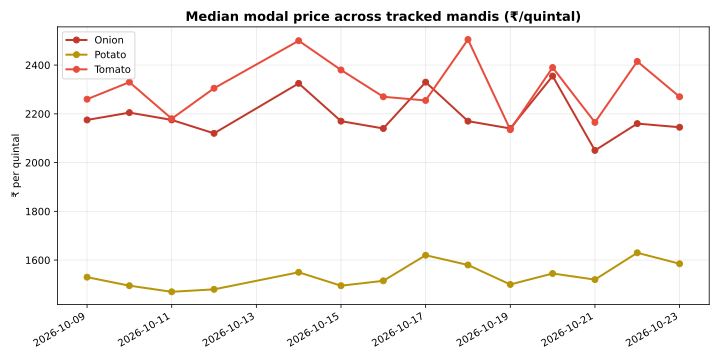

### price_trends_2026-10-22.svg (2026-10-22)

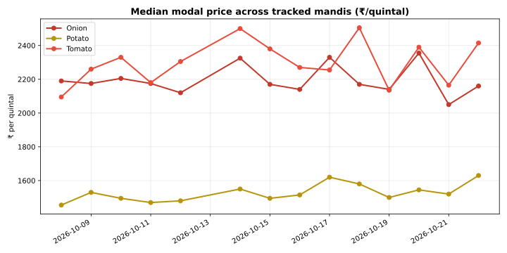

### price_trends_2026-10-21.svg (2026-10-21)

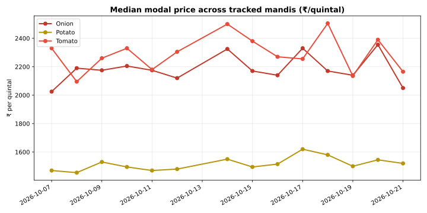

### price_trends_2026-10-20.svg (2026-10-20)

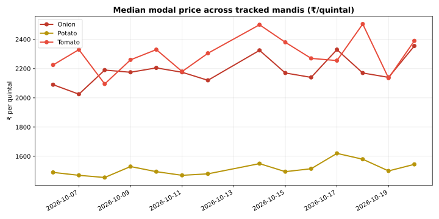

### price_trends_2026-10-19.svg (2026-10-19)

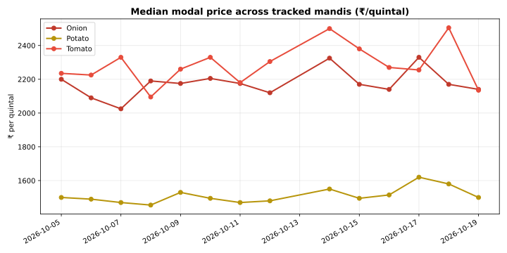

### price_trends_2026-10-18.svg (2026-10-18)

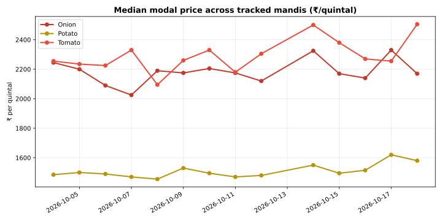

### price_trends_2026-10-17.svg (2026-10-17)

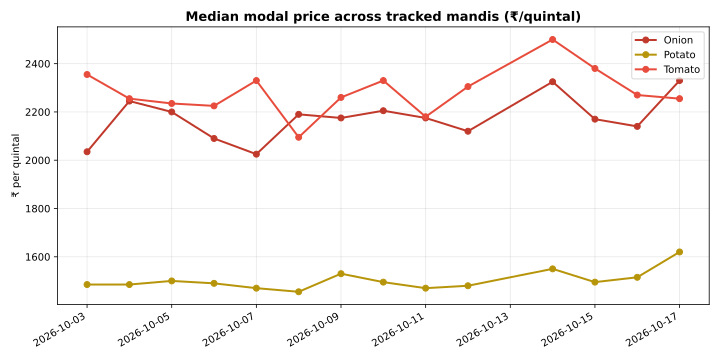

### price_trends_2026-10-16.svg (2026-10-16)

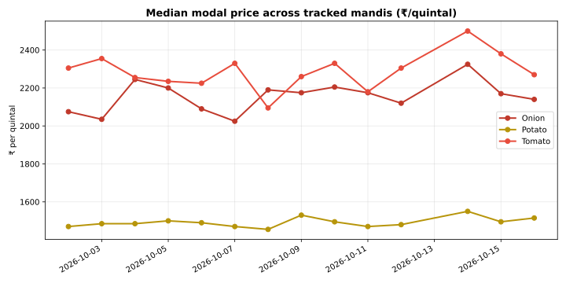

### price_trends_2026-10-15.svg (2026-10-15)

### price_trends_2026-10-14.svg (2026-10-14)

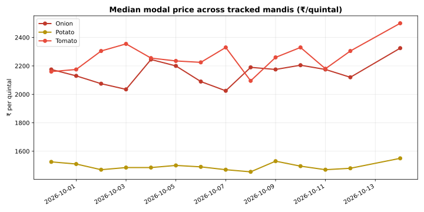

### price_trends_2026-10-12.svg (2026-10-12)

## Daily top movers

### top_movers_2026-10-24.svg (2026-10-24)

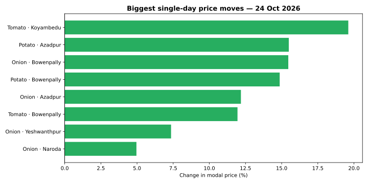

### top_movers_2026-10-23.svg (2026-10-23)

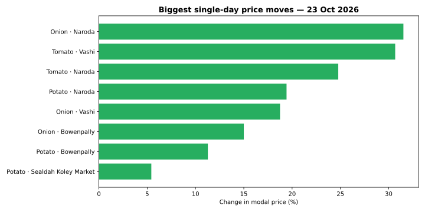

### top_movers_2026-10-22.svg (2026-10-22)

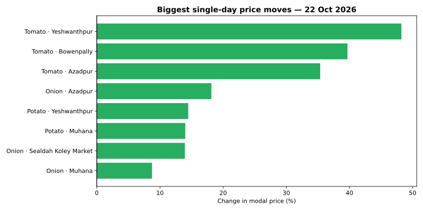

### top_movers_2026-10-21.svg (2026-10-21)

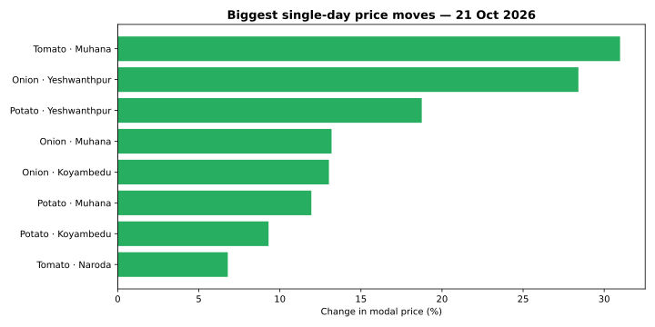

### top_movers_2026-10-20.svg (2026-10-20)

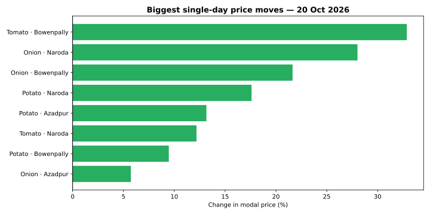

### top_movers_2026-10-19.svg (2026-10-19)

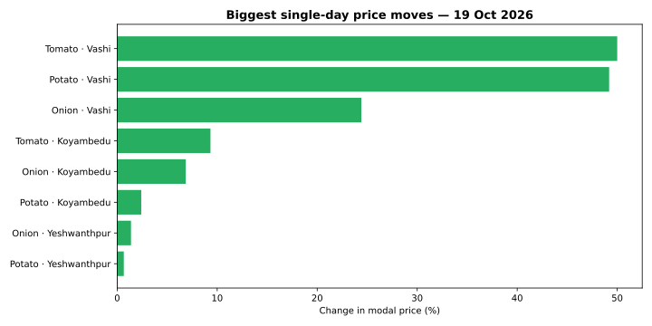

### top_movers_2026-10-18.svg (2026-10-18)

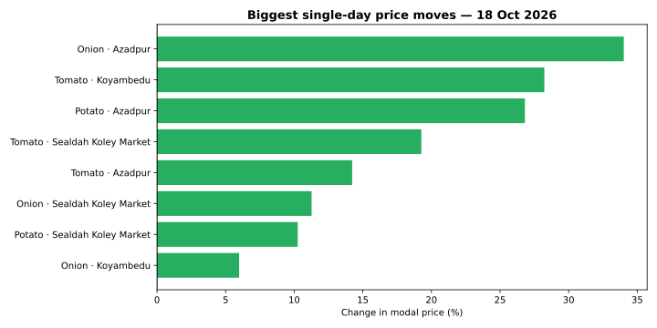

### top_movers_2026-10-17.svg (2026-10-17)

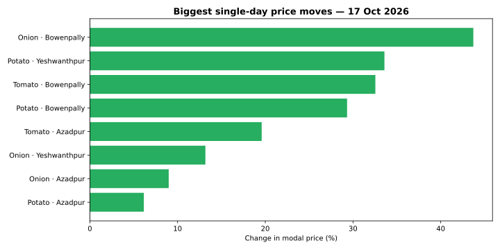

### top_movers_2026-10-16.svg (2026-10-16)

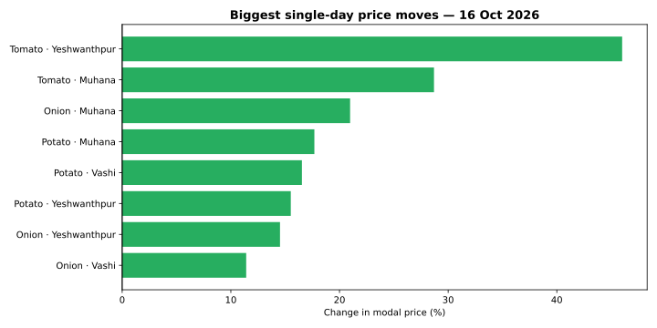

### top_movers_2026-10-15.svg (2026-10-15)

### top_movers_2026-10-14.svg (2026-10-14)

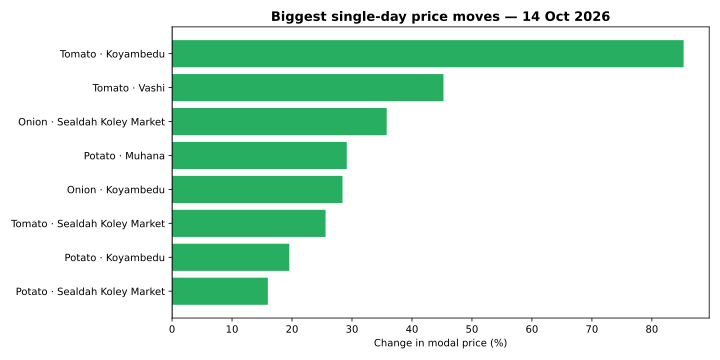

### top_movers_2026-10-12.svg (2026-10-12)

## Animated price trend (Day 13)

### price_trend_animated_2026-10-23.svg (2026-10-23)

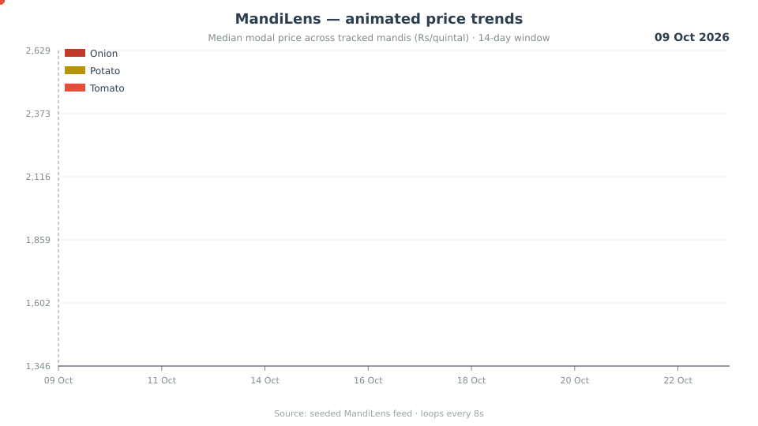

## Outlier-detection rules (Day 8)

### outlier_rules_2026-10-18.svg (2026-10-18)

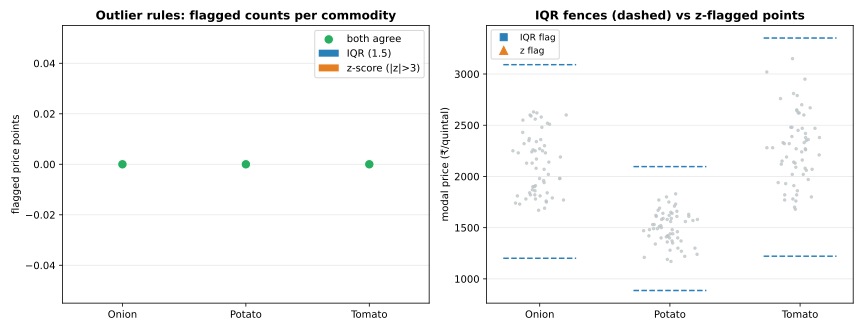

## Commodity volatility index (Day 9)

### volatility_index_2026-10-19.svg (2026-10-19)

## MSP gap analysis (Day 10)

### msp_gap_2026-10-20.svg (2026-10-20)

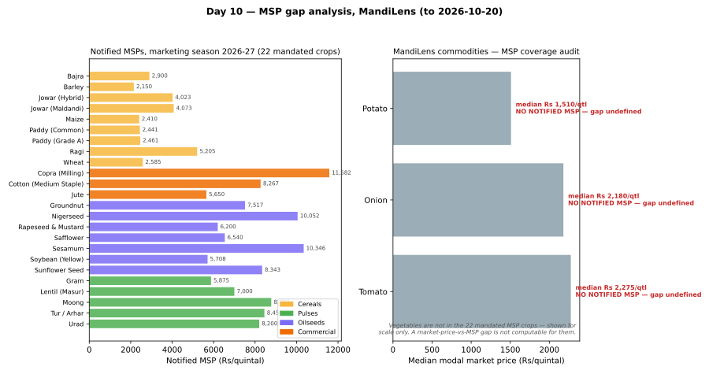

## Arrival vs price dynamics (Day 11)

### arrival_price_dynamics_2026-10-21.svg (2026-10-21)

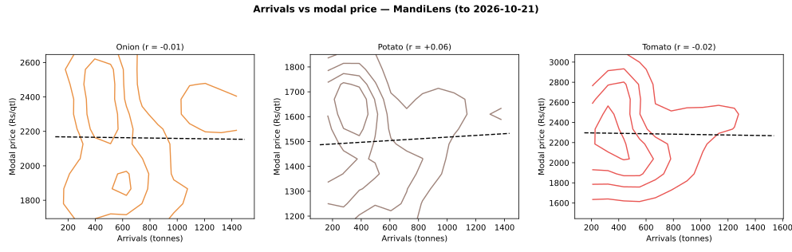

## Weekday effects (Day 12)

### weekday_effects_2026-10-22.svg (2026-10-22)

## Arrival-date gaps (Day 5)

### arrival_gaps_2026-10-15.svg (2026-10-15)

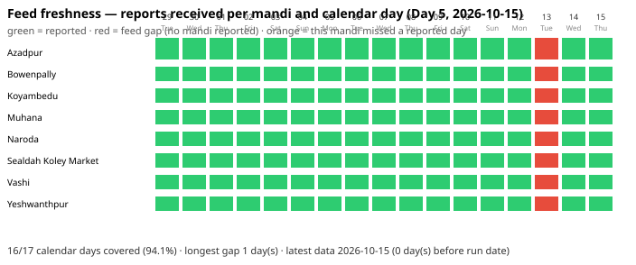

## Variety & grade premiums (Day 6)

### variety_premiums_2026-10-16.svg (2026-10-16)

## Geographic spread heatmap (Day 4)

### state_heatmap_2026-10-14.svg (2026-10-14)

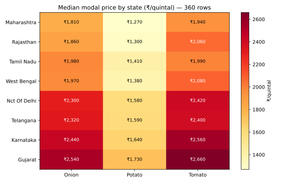

## Price distributions (Day 3)

### distributions_2026-10-12.svg (2026-10-12)

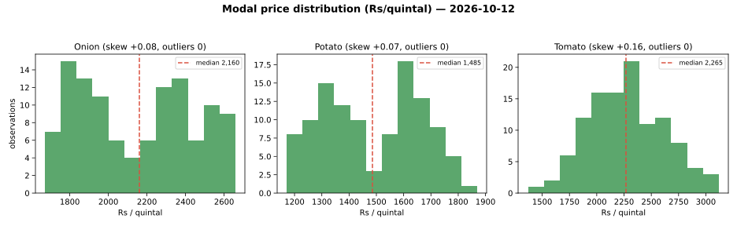

## Week-1 EDA distributions (Day 7)

### eda_distributions_2026-10-17.svg (2026-10-17)

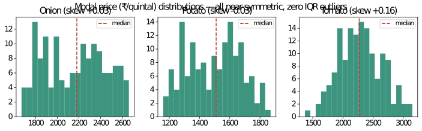

## Week-1 EDA rows per day (Day 7)

### eda_rows_per_day_2026-10-17.svg (2026-10-17)

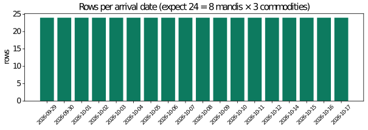

## Missing-data coverage matrix (Day 2)

### coverage_matrix_2026-10-12.svg (2026-10-12)

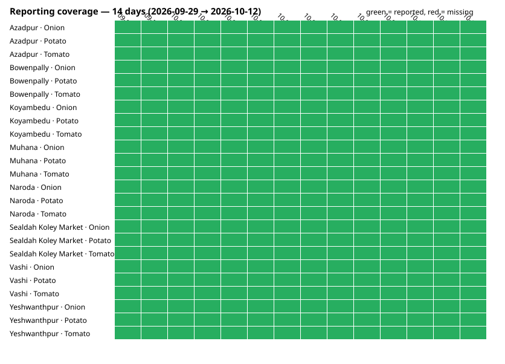
