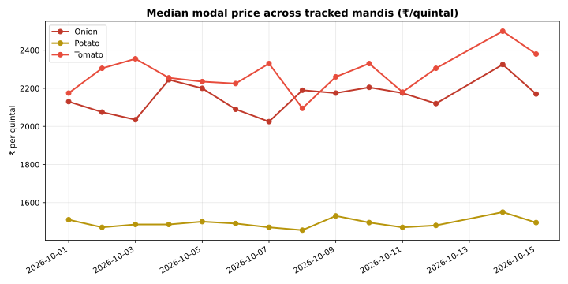
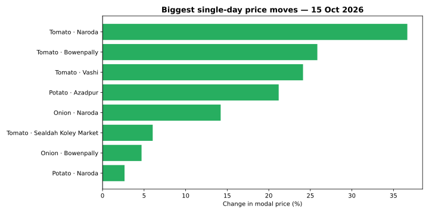

# 🥬 MandiLens

**My daily data-science build — analytics of Indian agri-commodity prices, from the government's own published tables.**


Hi, I'm Siddharth — an aspiring data scientist, learning in public. Every day I take
the latest commodity prices and arrivals from the Government of India's
[Agmarknet portal](https://agmarknet.gov.in) (published public tables — no API key
needed), clean the data with pandas, and publish a fresh analysis with charts.
Over 30 days this repo grows from a data pipeline into price forecasts and an
interactive dashboard — one commit every day.

**Currently tracking:** 24 commodities across 5 groups — cereals, fibre crops,
oil seeds, pulses, and vegetables (including Onion, Potato, Tomato) — with daily
prices, arrival volumes, and MSP.

<!-- DAILY-UPDATE:START -->
*Day 4 — 15 Oct 2026*  
*Currently working with seeded sample data while I wire up the live feed.*





📄 [Full daily log](reports/daily/2026-10-15.md)
<!-- DAILY-UPDATE:END -->

## 📁 Project structure

```
mandilens/
├── src/
│   ├── fetch_prices.py   # pull daily prices from data.gov.in (Agmarknet API)
│   ├── clean.py          # tidy + deduplicate into one analysis-ready CSV
│   ├── analyze.py        # movers, cheapest/costliest mandis, insight of the day
│   ├── visualize.py      # regenerate trend + movers charts
│   └── run_daily.py      # orchestrates the whole 7 PM job (+ updates this README)
├── tools/
│   └── make_sample.py    # generates labelled sample data (until live API key is set)
├── data/
│   ├── raw/              # one CSV per day, as fetched
│   └── processed/        # cleaned master dataset
├── reports/daily/        # one markdown report per day
├── charts/               # regenerated daily
├── notebooks/            # exploration notebooks (week 1+)
├── ROADMAP.md            # the 30-day build plan
└── requirements.txt
```

## 🚀 Run it yourself

```bash
pip install -r requirements.txt

# live data (free key: https://data.gov.in -> My Account -> API Key Management)
export MANDILENS_DATA_GOV_KEY="your-key-here"

# ...or generate labelled sample data instead:
python tools/make_sample.py 14

# run the full daily pipeline:
python src/run_daily.py
```

## 🗺️ Roadmap

The [30-day roadmap](ROADMAP.md) takes this from pipeline → EDA → visualizations →
forecasting models → interactive dashboard, one committed step per day.

## 📜 License

MIT — data © Government of India (Open Government Data License).
