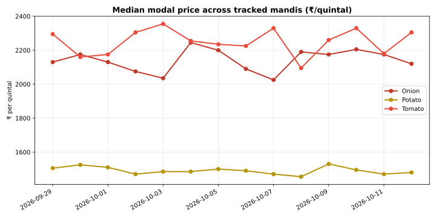
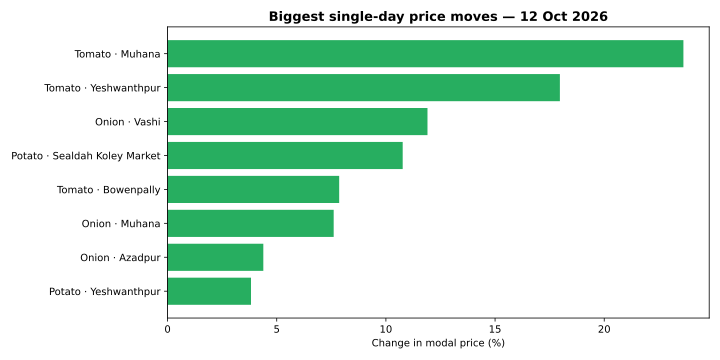

# 🥬 MandiLens

**Daily analytics of Indian mandi (wholesale market) vegetable prices — a living data-science project.**


Every day at 7 PM IST, an automated job pulls the latest mandi prices from the
Government of India's [data.gov.in](https://data.gov.in) Agmarknet feed, cleans them,
and publishes a fresh report + charts right here. Over 30 days this repo grows from a
data pipeline into price forecasts and an interactive dashboard.

**Currently tracking:** Onion, Potato, Tomato across 8 major mandis
(Azadpur Delhi, Vashi Mumbai, Koyambedu Chennai, Sealdah Kolkata, Yeshwanthpur Bengaluru,
Bowenpally Hyderabad, Naroda Ahmedabad, Muhana Jaipur).

<!-- DAILY-UPDATE:START -->
*Last run: 12 Oct 2026*  
*Data source: seeded sample data — set MANDILENS_DATA_GOV_KEY for the live feed*





📄 [Full daily report](reports/daily/2026-10-12.md)
<!-- DAILY-UPDATE:END -->

## 📁 Project structure

```
mandilens/
├── src/
│   ├── fetch_prices.py   # pull daily prices from data.gov.in (Agmarknet API)
│   ├── clean.py          # tidy + deduplicate into one analysis-ready CSV
│   ├── analyze.py        # movers, cheapest/costliest mandis, insight of the day
│   ├── visualize.py      # regenerate trend + movers charts
│   └── run_daily.py      # orchestrates the whole 7 PM job (+ updates this README)
├── tools/
│   └── make_sample.py    # generates labelled sample data (until live API key is set)
├── data/
│   ├── raw/              # one CSV per day, as fetched
│   └── processed/        # cleaned master dataset
├── reports/daily/        # one markdown report per day
├── charts/               # regenerated daily
├── notebooks/            # exploration notebooks (week 1+)
├── ROADMAP.md            # the 30-day build plan
└── requirements.txt
```

## 🚀 Run it yourself

```bash
pip install -r requirements.txt

# live data (free key: https://data.gov.in -> My Account -> API Key Management)
export MANDILENS_DATA_GOV_KEY="your-key-here"

# ...or generate labelled sample data instead:
python tools/make_sample.py 14

# run the full daily pipeline:
python src/run_daily.py
```

## 🗺️ Roadmap

The [30-day roadmap](ROADMAP.md) takes this from pipeline → EDA → visualizations →
forecasting models → interactive dashboard, one committed step per day.

## 📜 License

MIT — data © Government of India (Open Government Data License).
