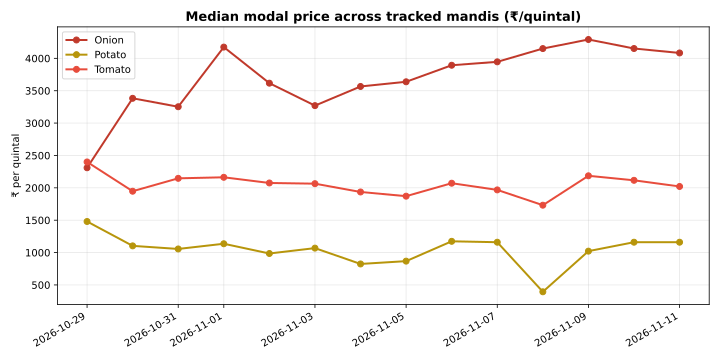
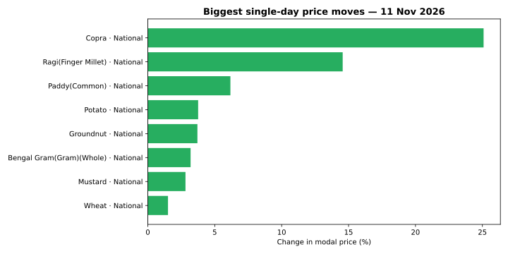

# 🥬 MandiLens

**My daily data-science build — analytics of Indian agri-commodity prices, from the government's own published tables.**


Hi, I'm Siddharth — an aspiring data scientist, learning in public. Every day I take
the latest commodity prices and arrivals from the Government of India's
[Agmarknet portal](https://agmarknet.gov.in) (published public tables — no API key
needed), clean the data with pandas, and publish a fresh analysis with charts.
Over 30 days this repo grows from a data pipeline into price forecasts and an
interactive dashboard — one commit every day.

**Currently tracking:** 26 commodities across 9 markets — 8 mandis (Azadpur,
Vashi, Koyambedu, Sealdah, Yeshwanthpur, Bowenpally, Naroda, Muhana) plus the
National benchmark from the government's portal tables (the portal itself
publishes 24 commodities across 5 groups — cereals, fibre crops, oil seeds,
pulses, and vegetables, including Onion, Potato, Tomato) — with daily prices,
arrival volumes, and MSP. **Dataset:** 1,026 rows, 29 Sep – 07 Nov 2026
(updated 09 Nov 2026).

**Data freshness:** the portal feed is currently 2 days behind (latest
07 Nov) and the per-mandi sample feed stopped at 29 Oct — see the
[data-quality badge](charts/data_quality_badge_2026-11-09.svg) in each daily
log. Every report states its source, so portal vs sample data is never
ambiguous.

<!-- DAILY-UPDATE:START -->
*Day 34 — 13 Nov 2026*  
*Prices taken from the government's published Agmarknet portal tables — no API key involved.*





📄 [Full daily log](reports/daily/2026-11-13.md)
<!-- DAILY-UPDATE:END -->

## 📁 Project structure

```
mandilens/
├── src/
│   ├── BROWSER_FETCH_BRIEF.md  # exact format for the daily keyless portal pull
│   ├── parse_browser_extract.py# normalize the portal table into data/raw/
│   ├── fetch_prices.py         # optional data.gov.in API fallback (needs a key)
│   ├── clean.py                # tidy + deduplicate into one analysis-ready CSV
│   ├── analyze.py              # movers, cheapest/costliest mandis, insight of the day
│   ├── visualize.py            # regenerate trend + movers charts (SVG + PNG)
│   ├── data_quality_badge.py   # feed-freshness monitor (FRESH / STALE / CRITICAL)
│   ├── forecast_table.py       # 7-day OLS forecasts appended to every daily report
│   ├── forecast_accuracy.py    # rolling forecast-accuracy dashboard
│   ├── rolling_features.py     # lag / moving-average features (Day 15)
│   ├── linear_regression.py    # OLS on lag features, per commodity (Day 17)
│   ├── random_forest.py        # random-forest regressor + importances (Day 19)
│   ├── dashboard.py            # Streamlit interactive commodity explorer (Day 25)
│   └── run_daily.py            # orchestrates the whole 7 PM job (+ updates this README)
├── tools/
│   ├── make_sample.py          # generates labelled sample data (seeded, reproducible)
│   └── build_chart_gallery.py  # regenerates CHART_GALLERY.md from charts/
├── data/
│   ├── raw/                    # one CSV per day, as fetched (portal since 30 Oct 2026)
│   ├── processed/              # cleaned master dataset + per-day analysis tables
│   └── README.md               # source, method, layout, columns
├── reports/
│   ├── daily/                  # one markdown report per day
│   └── day*.md                 # one write-up per roadmap day
├── charts/                     # regenerated daily (SVG; PNG kept local only)
├── notebooks/                  # exploration notebooks (week 1+)
├── CHART_GALLERY.md            # every chart, grouped by analysis family
├── ROADMAP.md                  # the 30-day build plan
└── requirements.txt
```

## 🚀 Run it yourself

```bash
pip install -r requirements.txt

# live data, keyless (the default): read the published Agmarknet portal table
# (see src/BROWSER_FETCH_BRIEF.md) and normalize it:
python3 src/parse_browser_extract.py /tmp/extract_YYYY-MM-DD.txt

# ...or pull from the data.gov.in Agmarknet API instead (free key:
# https://data.gov.in -> My Account -> API Key Management):
export MANDILENS_DATA_GOV_KEY="your-key-here"

# ...or generate labelled sample data instead:
python tools/make_sample.py 14

# run the full daily pipeline:
python src/run_daily.py

# explore interactively (Day 25):
streamlit run src/dashboard.py
```

## 📊 What the 30 days found (so far)

- **Champion model:** plain OLS on lag1/lag2/lag3 — overall MAE ₹207/qtl on the
  held-out week, beating MA3, persistence and random forest
  ([Day 21 summary](reports/day21_week3_summary.md)).
- **Volatility ranking:** Potato most stable, Tomato most volatile
  ([Day 9](reports/day9_commodity_volatility_index.md)).
- **Three honest nulls** (expected on sample data): arrival↔price correlation
  ≈ 0, no weekday effect, variety/grade premiums ≈ 0.
- **Full write-up:** [Day 27 project write-up](reports/day27_project_writeup.md)
  — methods, findings, and 9 numbered limits (led by: most findings still rest
  on seeded sample data).
- **Every chart:** [CHART_GALLERY.md](CHART_GALLERY.md) (84 SVGs, 27 families).

## 🗺️ Roadmap

The [30-day roadmap](ROADMAP.md) takes this from pipeline → EDA → visualizations →
forecasting models → interactive dashboard, one committed step per day.
Currently on Day 28 of 30.

## 📜 License

MIT — data © Government of India (Open Government Data License).
