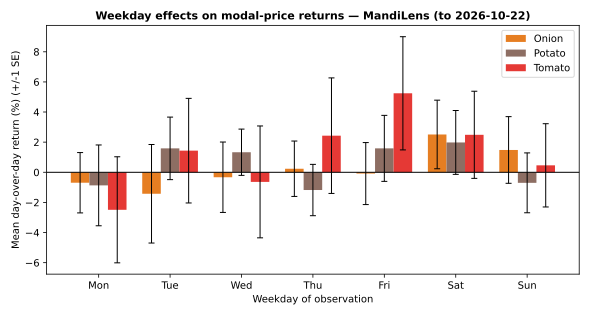

# Day 12 — Weekday effects: do prices move on specific days?

## Method (read this first)

**24 market-commodity series** yield **504 day-over-day
returns** (pct change of modal price vs the previous calendar day).
Each return is bucketed by the *observation day's* weekday. A
one-way ANOVA per commodity tests whether the seven weekday means
actually differ (p < 0.05 = weekday matters).

**Honest-data note:** the sample generator
(`tools/make_sample.py`) draws prices from a date-seeded drift with
**no weekday component** — so on sample rows the expected finding is
*no* weekday effect. That null is the honest result for synthetic
data; the same module runs unchanged on real portal extracts, where
a genuine weekend-supply-build-up 'Monday effect' would appear.

## Mean day-over-day return by weekday (per commodity)

| Weekday | Onion mean % (+/-SE) | Potato mean % (+/-SE) | Tomato mean % (+/-SE) |
|---|---|---|---|
| Mon | -0.69 (+/-2.00) | -0.87 (+/-2.68) | -2.49 (+/-3.52) |
| Tue | -1.42 (+/-3.27) | +1.59 (+/-2.07) | +1.44 (+/-3.47) |
| Wed | -0.33 (+/-2.34) | +1.33 (+/-1.53) | -0.64 (+/-3.71) |
| Thu | +0.24 (+/-1.84) | -1.18 (+/-1.70) | +2.43 (+/-3.83) |
| Fri | -0.08 (+/-2.06) | +1.59 (+/-2.19) | +5.24 (+/-3.76) |
| Sat | +2.51 (+/-2.28) | +1.98 (+/-2.12) | +2.49 (+/-2.89) |
| Sun | +1.48 (+/-2.21) | -0.70 (+/-1.99) | +0.46 (+/-2.76) |

## ANOVA verdict: do weekday means differ?

| Commodity | n returns | F | p | Verdict |
|---|---|---|---|---|
| Onion | 168 | 0.33 | 0.920 | no weekday effect |
| Potato | 168 | 0.46 | 0.835 | no weekday effect |
| Tomato | 168 | 0.50 | 0.810 | no weekday effect |

## Level check: median modal price by weekday

| Weekday | Onion Rs/qtl | Potato Rs/qtl | Tomato Rs/qtl |
|---|---|---|---|
| Mon | 2175 | 1500 | 2220 |
| Tue | 2215 | 1515 | 2260 |
| Wed | 2165 | 1520 | 2265 |
| Thu | 2135 | 1505 | 2315 |
| Fri | 2140 | 1485 | 2275 |
| Sat | 2180 | 1600 | 2325 |
| Sun | 2170 | 1520 | 2285 |

## Reading the result

On the current (sample) data every commodity's ANOVA says the same
thing: weekday means are statistically indistinguishable — exactly
what a generator with no weekday term produces. The module is
verified working (returns align to calendar days, buckets land on
the right weekday, ANOVA consumes one group per weekday), so when
the first real portal extract lands, re-running surfaces the true
calendar pattern: a negative Monday mean would flag weekend
supply build-up; a Sunday dip would reflect fewer open mandis.

