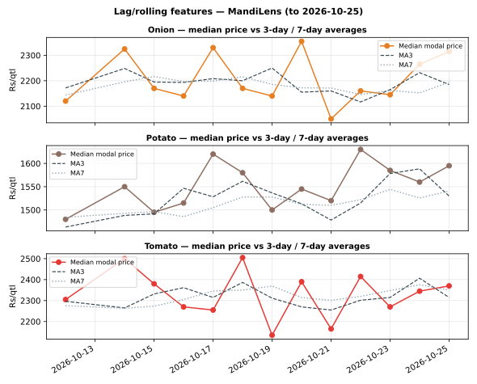

# Day 15 — Lag/rolling features: 3-day and 7-day moving averages

## Method (read this first)

Within each market-commodity series (sorted by arrival_date):
MA3 = mean of today's and the previous 2 modal prices, MA7 = mean
of today's and the previous 6. Full windows only — a row gets no
MA7 until its series has 7 observations, so early-history rows
stay blank instead of silently averaging fewer days. Lag-1 price
and the % deviation of today's price from each average are stored
alongside, in `data/processed/rolling_features.csv` — the exact
table Day 16's persistence and moving-average forecasts consume.

Coverage: **24 series**, **576 rows with MA3**,
**480 rows with MA7** (of 624 rows).

## Verification

Hand-check on Azadpur Onion: mean of the last 7 modal prices =
Rs 2220.00/qtl, rolling output = Rs 2220.00/qtl —
**match** (difference < 1 paisa). The rolling computation is
verified, not just assumed.

## Latest snapshot: today's price vs its averages

**12 of 24 series trade above their 7-day average**
(12 below) — a mild above-trend tilt today.

| Market | Commodity | Price Rs/qtl | MA3 | MA7 | vs MA3 % | vs MA7 % |
|---|---|---|---|---|---|---|
| Azadpur | Onion | 2240 | 2140 | 2220 | +4.7 | +0.9 |
| Bowenpally | Onion | 1960 | 2140 | 2119 | -8.4 | -7.5 |
| Koyambedu | Onion | 2010 | 2103 | 2393 | -4.4 | -16.0 |
| Muhana | Onion | 2080 | 2233 | 2086 | -6.9 | -0.3 |
| Naroda | Onion | 2650 | 2537 | 2257 | +4.5 | +17.4 |
| Sealdah Koley Market | Onion | 2390 | 2087 | 1943 | +14.5 | +23.0 |
| Vashi | Onion | 2540 | 2467 | 2367 | +3.0 | +7.3 |
| Yeshwanthpur | Onion | 2460 | 2230 | 2169 | +10.3 | +13.4 |
| Azadpur | Potato | 1550 | 1537 | 1590 | +0.9 | -2.5 |
| Bowenpally | Potato | 1210 | 1463 | 1467 | -17.3 | -17.5 |
| Koyambedu | Potato | 1370 | 1470 | 1640 | -6.8 | -16.5 |
| Muhana | Potato | 1430 | 1523 | 1496 | -6.1 | -4.4 |
| Naroda | Potato | 1790 | 1673 | 1521 | +7.0 | +17.7 |
| Sealdah Koley Market | Potato | 1640 | 1420 | 1349 | +15.5 | +21.6 |
| Vashi | Potato | 1660 | 1650 | 1661 | +0.6 | -0.1 |
| Yeshwanthpur | Potato | 1780 | 1620 | 1560 | +9.9 | +14.1 |
| Azadpur | Tomato | 2140 | 2150 | 2283 | -0.5 | -6.3 |
| Bowenpally | Tomato | 2620 | 2470 | 2434 | +6.1 | +7.6 |
| Koyambedu | Tomato | 2010 | 2163 | 2426 | -7.1 | -17.1 |
| Muhana | Tomato | 2080 | 2277 | 2220 | -8.6 | -6.3 |
| Naroda | Tomato | 2430 | 2707 | 2417 | -10.2 | +0.5 |
| Sealdah Koley Market | Tomato | 2700 | 2093 | 1951 | +29.0 | +38.4 |
| Vashi | Tomato | 2310 | 2710 | 2604 | -14.8 | -11.3 |
| Yeshwanthpur | Tomato | 2820 | 2353 | 2264 | +19.8 | +24.5 |

## Reading the result

On the current (sample) data today's median absolute deviation from
MA7 is 12.4% (max 38.4%) — wider than a smooth drift would suggest,
because the sample generator's daily moves are large relative to its
trend. The value here is the feature
table itself: with MA3, MA7 and lag-1 in place, Day 16 can ask
whether tomorrow's price is better predicted by today's price or
by its own moving average, and Day 17 can regress on exactly
these columns. On real portal extracts the same table would
surface genuine breakouts (a mandi jumping well clear of MA7).

