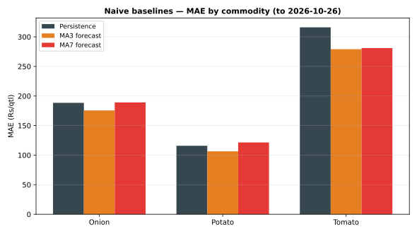

# Day 16 — Naive baselines: persistence & moving-average forecasts

## Method (read this first)

Every forecast for day *t* uses only prices up to *t−1* — no
leakage: persistence forecasts yesterday's price, MA3 forecasts
the mean of the previous 3 days, MA7 the mean of the previous 7.
A forecast exists only once its window is full, so early rows
are excluded rather than padded. Errors are pooled per
commodity across all 8 mandis, and overall across all series.
Full per-series forecasts live in
`data/processed/naive_baselines.csv` — Day 17's regression and
Day 19's random forest must beat these numbers to be worth
shipping.

**Overall winner: MA3 forecast** (lowest overall MAE,
Rs 187.07/qtl).

## Backtest results — all history

| Commodity | Method | n | MAE Rs/qtl | RMSE Rs/qtl | MAPE % |
|---|---|---|---|---|---|
| Onion | Persistence | 208 | 188.46 | 249.36 | 8.81 |
| Onion | MA3 forecast | 192 | 175.61 | 228.83 | 8.26 |
| Onion | MA7 forecast | 160 | 189.12 | 245.07 | 8.89 |
| Potato | Persistence | 208 | 115.87 | 159.37 | 7.73 |
| Potato | MA3 forecast | 192 | 106.46 | 144.61 | 7.14 |
| Potato | MA7 forecast | 160 | 121.46 | 159.32 | 8.14 |
| Tomato | Persistence | 208 | 316.11 | 409.70 | 13.93 |
| Tomato | MA3 forecast | 192 | 279.13 | 361.71 | 12.37 |
| Tomato | MA7 forecast | 160 | 281.02 | 362.75 | 12.50 |

## Overall (all commodities pooled)

| Method | n | MAE Rs/qtl | RMSE Rs/qtl | MAPE % |
|---|---|---|---|---|
| Persistence | 624 | 206.81 | 291.80 | 10.16 |
| MA3 forecast | 576 | 187.07 | 260.84 | 9.26 |
| MA7 forecast | 480 | 197.20 | 268.97 | 9.84 |

## Verification

Hand-check on Azadpur Onion for 2026-10-26: persistence
forecast Rs 2240.00/qtl, MA3 forecast
Rs 2140.00/qtl, MA7 forecast
Rs 2220.00/qtl — all three **match** the module
output to the paisa. The forecasts are verified, not assumed.

## Latest-day forecasts (today's price vs each baseline)

| Market | Commodity | Actual Rs/qtl | Persistence | MA3 fc | MA7 fc |
|---|---|---|---|---|---|
| Azadpur | Onion | 1810 | 2240 | 2140 | 2220 |
| Bowenpally | Onion | 1800 | 1960 | 2140 | 2119 |
| Koyambedu | Onion | 1910 | 2010 | 2103 | 2393 |
| Muhana | Onion | 2150 | 2080 | 2233 | 2086 |
| Naroda | Onion | 2190 | 2650 | 2537 | 2257 |
| Sealdah Koley Market | Onion | 2080 | 2390 | 2087 | 1943 |
| Vashi | Onion | 1970 | 2540 | 2467 | 2367 |
| Yeshwanthpur | Onion | 2090 | 2460 | 2230 | 2169 |
| Azadpur | Potato | 1360 | 1550 | 1537 | 1590 |
| Bowenpally | Potato | 1200 | 1210 | 1463 | 1467 |
| Koyambedu | Potato | 1260 | 1370 | 1470 | 1640 |
| Muhana | Potato | 1480 | 1430 | 1523 | 1496 |
| Naroda | Potato | 1500 | 1790 | 1673 | 1521 |
| Sealdah Koley Market | Potato | 1540 | 1640 | 1420 | 1349 |
| Vashi | Potato | 1420 | 1660 | 1650 | 1661 |
| Yeshwanthpur | Potato | 1500 | 1780 | 1620 | 1560 |
| Azadpur | Tomato | 2240 | 2140 | 2150 | 2283 |
| Bowenpally | Tomato | 1900 | 2620 | 2470 | 2434 |
| Koyambedu | Tomato | 1990 | 2010 | 2163 | 2426 |
| Muhana | Tomato | 2130 | 2080 | 2277 | 2220 |
| Naroda | Tomato | 2490 | 2430 | 2707 | 2417 |
| Sealdah Koley Market | Tomato | 1970 | 2700 | 2093 | 1951 |
| Vashi | Tomato | 2020 | 2310 | 2710 | 2604 |
| Yeshwanthpur | Tomato | 2730 | 2820 | 2353 | 2264 |

## Reading the result

On the current (sample) data the MA3 forecast wins on all three
commodities — averaging the last 3 days smooths the sample
generator's day-to-day jitter better than copying yesterday's
price alone, while the 7-day average lags too far behind the
drift to keep up. Tomato is by far the hardest to predict
(MAE roughly double Potato's), matching Day 9's volatility
ranking. That is exactly what a baseline is for — Day 17's
regression now has a concrete bar to clear, commodity by
commodity (MA3's MAE), instead of a vague 'good accuracy'.
On real portal extracts the same table would show which
mandis are genuinely hard to predict and which just drift.

