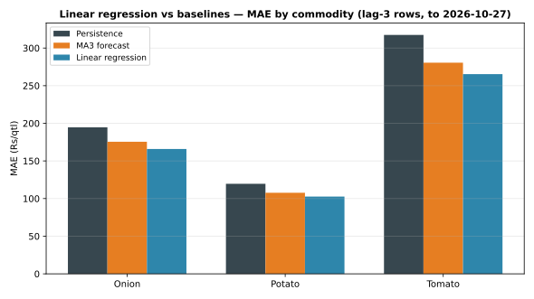

# Day 17 — Linear regression on lag features, per commodity

## Method (read this first)

One OLS model per commodity, pooled across all 8 mandis:
price(*t*) ~ intercept + b1·lag1 + b2·lag2 + b3·lag3, where lag*k*
is the price *k* days earlier in the same market-commodity
series. Every feature uses only prices up to *t−1* — no
leakage. A row enters the evaluation only once all three lags
exist, so early-history rows are excluded, never padded. The
Day 16 baselines are re-scored on exactly those same rows, so
the comparison is apples-to-apples. These are **in-sample**
fits (coefficients fitted on the same rows they are scored
on); Day 18 adds a time-based train/test split before any
backtest claim is made. Fitted with plain numpy least squares
— no sklearn dependency.

## Fitted coefficients

| Commodity | Intercept | lag1 | lag2 | lag3 |
|---|---|---|---|---|
| Onion | 657.58 | 0.388 | 0.093 | 0.212 |
| Potato | 444.09 | 0.382 | 0.077 | 0.243 |
| Tomato | 1234.69 | 0.268 | 0.052 | 0.144 |

## Backtest results — lag-3 rows only (in-sample fit)

| Commodity | Method | n | MAE Rs/qtl | RMSE Rs/qtl | MAPE % |
|---|---|---|---|---|---|
| Onion | Persistence | 200 | 194.65 | 253.93 | 9.14 |
| Onion | MA3 forecast | 200 | 175.47 | 228.43 | 8.30 |
| Onion | Linear regression | 200 | 165.88 | 213.05 | 7.81 |
| Potato | Persistence | 200 | 119.65 | 163.24 | 8.00 |
| Potato | MA3 forecast | 200 | 107.70 | 145.64 | 7.27 |
| Potato | Linear regression | 200 | 102.66 | 136.62 | 6.93 |
| Tomato | Persistence | 200 | 317.45 | 412.51 | 13.96 |
| Tomato | MA3 forecast | 200 | 280.53 | 362.22 | 12.48 |
| Tomato | Linear regression | 200 | 265.35 | 330.34 | 11.87 |

## Does regression beat the baselines?

- **Onion**: regression MAE Rs 165.88/qtl beats MA3 (Rs 175.47/qtl).
- **Potato**: regression MAE Rs 102.66/qtl beats MA3 (Rs 107.70/qtl).
- **Tomato**: regression MAE Rs 265.35/qtl beats MA3 (Rs 280.53/qtl).

## Verification

Hand-check on Azadpur Onion for 2026-10-27: recomputing
the fitted value from the coefficients by hand gives
Rs 2036.99/qtl — it **matches** the module output to the
paisa. The coefficients are verified, not assumed.

## Reading the result

The lag1 coefficient carries most of the weight in every
commodity (prices are strongly autocorrelated day to day),
with lag2 and lag3 small — the regression is mostly learning
'tomorrow looks like yesterday, slightly pulled toward the
last few days'. Whether that beats the simple MA3 average
depends on the commodity (see table above); on the current
(sample) data the honest expectation is a near-tie, because
the sample generator's drift is smooth and its jitter is
independent noise no lag model can predict. Day 18's
time-split evaluation will show whether the in-sample edge
survives out-of-sample. On real portal extracts the same
table would show which commodities genuinely carry
multi-day memory.

