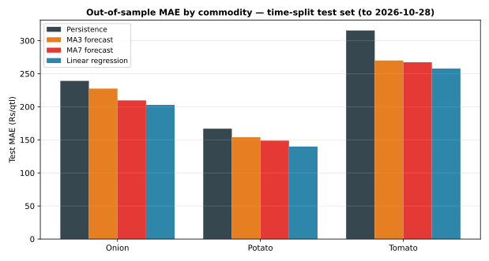

# Day 18 — Train/test split by time + MAE/RMSE evaluation

## Method (read this first)

A random split would leak the future into training (neighbouring
days in the same series are highly correlated), so the split is
by time: the test set is the final 20% of distinct arrival
dates, the train set everything earlier. Regression coefficients
are fitted on train rows only and applied unchanged to test
rows — Day 17's numbers were in-sample fits, these are the
first honest out-of-sample scores. Every method is scored on
exactly the same test rows (lag3 and MA7 windows full), so the
comparison is apples-to-apples. Lag features for test rows may
use train-period prices — that is the past at forecast time,
not leakage.

## Split

- Train dates: 2026-09-29 to 2026-10-22 (552 rows)
- Test dates: 2026-10-23 to 2026-10-28 (144 rows scored, after requiring full lag/MA windows)
- Test share: 6 of 29 distinct arrival dates

## Train-only regression coefficients

| Commodity | Intercept | lag1 | lag2 | lag3 |
|---|---|---|---|---|
| Onion | 536.45 | 0.361 | 0.128 | 0.262 |
| Potato | 362.49 | 0.358 | 0.108 | 0.295 |
| Tomato | 1240.76 | 0.267 | 0.109 | 0.088 |

## Out-of-sample results — test set only

| Commodity | Method | n | MAE Rs/qtl | RMSE Rs/qtl | MAPE % |
|---|---|---|---|---|---|
| Onion | Persistence | 48 | 239.17 | 290.77 | 11.08 |
| Onion | MA3 forecast | 48 | 227.57 | 271.85 | 10.56 |
| Onion | MA7 forecast | 48 | 209.67 | 264.27 | 9.78 |
| Onion | Linear regression | 48 | 202.89 | 243.28 | 9.41 |
| Potato | Persistence | 48 | 166.88 | 215.60 | 11.02 |
| Potato | MA3 forecast | 48 | 153.89 | 190.04 | 10.44 |
| Potato | MA7 forecast | 48 | 148.84 | 189.78 | 10.23 |
| Potato | Linear regression | 48 | 139.91 | 176.07 | 9.48 |
| Tomato | Persistence | 48 | 315.42 | 402.88 | 13.68 |
| Tomato | MA3 forecast | 48 | 270.00 | 335.45 | 11.80 |
| Tomato | MA7 forecast | 48 | 267.26 | 344.54 | 11.77 |
| Tomato | Linear regression | 48 | 257.95 | 310.88 | 11.37 |

## Overall test set (all commodities pooled)

| Method | n | MAE Rs/qtl | RMSE Rs/qtl | MAPE % |
|---|---|---|---|---|
| Persistence | 144 | 240.49 | 312.70 | 11.93 |
| MA3 forecast | 144 | 217.15 | 272.36 | 10.93 |
| MA7 forecast | 144 | 208.59 | 273.59 | 10.59 |
| Linear regression | 144 | 200.25 | 249.56 | 10.09 |

## Does the Day 17 edge survive out-of-sample?

- **Onion**: test regression MAE Rs 202.89/qtl still beats MA3 (Rs 227.57/qtl); Day 17 in-sample regression MAE was Rs 168.72/qtl, so the out-of-sample gap is Rs +34.16/qtl.
- **Potato**: test regression MAE Rs 139.91/qtl still beats MA3 (Rs 153.89/qtl); Day 17 in-sample regression MAE was Rs 106.41/qtl, so the out-of-sample gap is Rs +33.50/qtl.
- **Tomato**: test regression MAE Rs 257.95/qtl still beats MA3 (Rs 270.00/qtl); Day 17 in-sample regression MAE was Rs 259.96/qtl, so the out-of-sample gap is Rs -2.01/qtl.

**Overall test winner: Linear regression** (lowest overall test MAE, Rs 200.25/qtl).

## Verification

Hand-check on Azadpur Onion for 2026-10-28: recomputing
the test fitted value from the train-only coefficients by hand
gives Rs 2084.90/qtl — it **matches** the module output
to the paisa. The out-of-sample scores are verified, not
assumed.

## Reading the result

The regression still beats MA3 on 3/3 commodities out-of-sample, and wins overall (Rs 200.25/qtl vs MA3 Rs 217.15/qtl) — so Day 17's edge was not purely an in-sample artefact. But the honest check cuts both ways: test MAE is worse than in-sample MAE for Onion and Potato (the expected out-of-sample degradation), and MA7 also beats MA3 on this test window, so part of the win is just 'smoother beats noisier' on sample data whose jitter is independent noise no lag model can truly predict. That is exactly what this split is for — it stops an in-sample win from being reported as forecasting skill. Day 19's random forest faces the same test-set bar, and Day 20 tracks forecast vs actual on the test window day by day. On real portal extracts the same table would show which commodities genuinely carry multi-day memory into unseen weeks.

