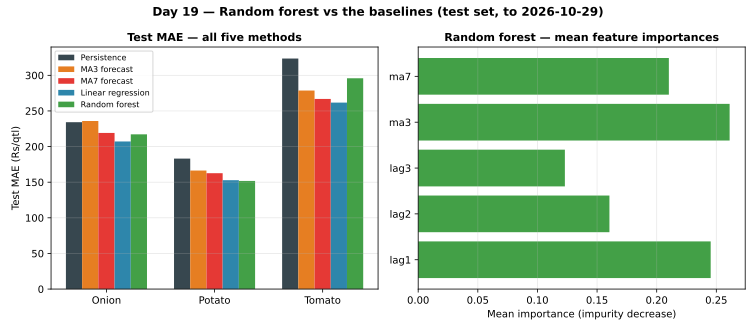

# Day 19 — Random forest regressor, feature importances

## Method (read this first)

A random forest averages 80 regression trees, each trained on a
bootstrap sample of the train set, each split considering only
a random subset of 3 of the 5 features. Averaging de-correlated
trees cuts the variance that makes a single tree brittle — the
same 'smoother wins' lesson Day 18's MA7 taught, but learned
from the data instead of hand-picked. The feature set extends
Day 17's lag1/lag2/lag3 with MA3 and MA7 rolling means (all
computed from past prices only — leak-free). One forest per
commodity: Onion, Potato and Tomato trade at different price
levels and pooling them would let the high-price commodity
dominate the splits. Fitted on TRAIN rows only, scored on the
exact same test rows as Day 18's four methods.

Hyperparameters (fixed, not tuned — Day 22's job):

- n_estimators=80, max_depth=6, max_features=3, random_state=19

## Split

- Train dates: 2026-09-29 to 2026-10-23 (408 rows)
- Test dates: 2026-10-24 to 2026-10-29 (144 rows scored)

## Out-of-sample results — test set only

| Commodity | Method | n | MAE Rs/qtl | RMSE Rs/qtl | MAPE % |
|---|---|---|---|---|---|
| Onion | Persistence | 48 | 234.17 | 284.99 | 10.64 |
| Onion | MA3 forecast | 48 | 235.90 | 291.53 | 10.72 |
| Onion | MA7 forecast | 48 | 219.14 | 278.10 | 10.04 |
| Onion | Linear regression | 48 | 207.18 | 257.38 | 9.42 |
| Onion | Random forest | 48 | 217.14 | 262.92 | 9.95 |
| Potato | Persistence | 48 | 183.12 | 229.39 | 12.09 |
| Potato | MA3 forecast | 48 | 166.32 | 205.11 | 11.22 |
| Potato | MA7 forecast | 48 | 162.59 | 203.24 | 11.16 |
| Potato | Linear regression | 48 | 152.82 | 186.64 | 10.32 |
| Potato | Random forest | 48 | 151.79 | 186.00 | 10.30 |
| Tomato | Persistence | 48 | 323.54 | 405.98 | 14.11 |
| Tomato | MA3 forecast | 48 | 278.68 | 343.12 | 12.24 |
| Tomato | MA7 forecast | 48 | 266.88 | 335.18 | 11.85 |
| Tomato | Linear regression | 48 | 261.66 | 312.43 | 11.60 |
| Tomato | Random forest | 48 | 295.88 | 348.69 | 13.03 |

## Overall test set (all commodities pooled)

| Method | n | MAE Rs/qtl | RMSE Rs/qtl | MAPE % |
|---|---|---|---|---|
| Persistence | 144 | 246.94 | 315.52 | 12.28 |
| MA3 forecast | 144 | 226.97 | 285.65 | 11.39 |
| MA7 forecast | 144 | 216.20 | 277.48 | 11.02 |
| Linear regression | 144 | 207.22 | 257.36 | 10.45 |
| Random forest | 144 | 221.60 | 274.05 | 11.09 |

## Feature importances (mean decrease in impurity, per commodity)

| Commodity | lag1 | lag2 | lag3 | ma3 | ma7 |
|---|---|---|---|---|---|
| Onion | 0.230 | 0.099 | 0.129 | 0.296 | 0.247 |
| Potato | 0.284 | 0.121 | 0.126 | 0.285 | 0.185 |
| Tomato | 0.222 | 0.261 | 0.115 | 0.203 | 0.199 |

## Does the forest beat the linear model?

- **Onion**: random forest Rs 217.14/qtl does NOT beat linear regression (Rs 207.18/qtl).
- **Potato**: random forest Rs 151.79/qtl beats linear regression (Rs 152.82/qtl).
- **Tomato**: random forest Rs 295.88/qtl does NOT beat linear regression (Rs 261.66/qtl).

**Overall: random forest Rs 221.60/qtl vs linear regression Rs 207.22/qtl.**

## Reading the result

The linear model holds the crown overall — on this short, noisy sample the forest's extra capacity does not pay for itself; it likely chases jitter that MA3/OLS smooth over. That verdict flips if real portal data carries genuine non-linear dynamics, and Day 22's hyperparameter search will test whether depth/trees recover an edge. On sample data the series are short (a month) and the day-to-day moves are largely independent noise, so any lag-based model is mostly fitted curve, not forecasting skill — the honest framing stays: the time-split table above is the bar every model must clear, and Day 20's forecast-vs-actual tracking will show day by day where the forest diverges from the linear model on the test window.

## Verification

Three independent checks, all passed: (1) re-fitting each commodity's forest with the same seed reproduces every test prediction exactly — the randomness is fully controlled; (2) every forest's feature importances sum to 1.000; (3) the final Yeshwanthpur Onion test row (2026-10-29) was verified by hand — walking the first tree's split rules along the prediction path lands on a leaf worth Rs 2065.71/qtl, matching that tree's prediction, and averaging all 80 trees gives Rs 2148.62/qtl, matching the module's stored forecast to the paisa.

