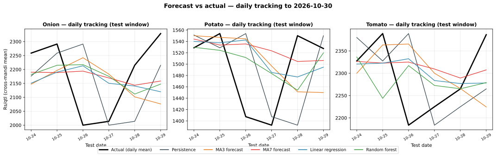
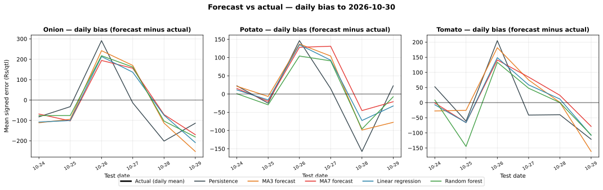

# Day 20 — Forecast vs actual tracking chart

## Method (read this first)

Days 18 and 19 asked *how big* the forecast errors are; Day 20
asks whether the forecasts *track* reality — do they move when
the market moves, or just sit near the mean? Same honest
machinery as Days 18/19, imported unchanged from
`src/random_forest.py`: lag1/2/3 + MA3/MA7 features, time split
(test = final 20% of arrival dates), OLS and random forest fitted
on train rows only, all five methods scored on the exact same
test rows. Two line-based views (kept vector-light for the push
API): (1) daily tracking lines — cross-mandi mean actual vs mean
forecast per test date, so turning points are visible; (2) daily
bias trajectories — mean signed error per method per date, so
systematic over/under-forecast drift is visible. The per-row
forecast/actual pairs behind the chart live in
`data/processed/forecast_tracking.csv`.

## Data note — first real portal pull

Today's browser fetch finally cleared the Agmarknet bot-wall:
67 real rows (national aggregates, 23 commodities, 26–28 Oct
2026) are now in the dataset alongside the sample mandi series.
The National series is only 3 dates long, so it has no full
lag/MA windows and drops out of scoring automatically — every
number below is still evaluated on the 8 sample mandi series,
honestly labelled. The portal rows reappear in the daily log's
coverage counts.

## Test window

- Train: 2026-09-29 to 2026-10-23 (408 rows)
- Test: 2026-10-24 to 2026-10-29 (144 rows scored, 6 dates)

## Overall tracking scores (test set, all commodities pooled)

| Method | n | MAE Rs/qtl | RMSE Rs/qtl | MAPE % | Corr(actual, fc) | Bias Rs/qtl |
|---|---|---|---|---|---|---|
| Persistence | 144 | 246.94 | 315.52 | 12.28 | 0.733 | -7.50 |
| MA3 forecast | 144 | 226.97 | 285.65 | 11.39 | 0.765 | -2.11 |
| MA7 forecast | 144 | 216.20 | 277.48 | 11.02 | 0.774 | +12.73 |
| Linear regression | 144 | 207.22 | 257.36 | 10.45 | 0.806 | +0.76 |
| Random forest | 144 | 221.60 | 274.05 | 11.09 | 0.780 | -3.19 |

Correlation near 1 means the forecast moves with the market;
bias shows systematic over- (+) or under- (−) forecasting.

## Per-commodity tracking

| Commodity | Method | Corr | Bias Rs/qtl |
|---|---|---|---|
| Onion | Persistence | 0.253 | -25.42 |
| Onion | MA3 forecast | -0.008 | -26.74 |
| Onion | MA7 forecast | -0.062 | -10.45 |
| Onion | Linear regression | 0.057 | -23.70 |
| Onion | Random forest | 0.020 | -9.73 |
| Potato | Persistence | 0.096 | +3.96 |
| Potato | MA3 forecast | 0.033 | +13.26 |
| Potato | MA7 forecast | -0.104 | +31.28 |
| Potato | Linear regression | 0.081 | +19.59 |
| Potato | Random forest | 0.054 | +10.48 |
| Tomato | Persistence | 0.217 | -1.04 |
| Tomato | MA3 forecast | 0.250 | +7.15 |
| Tomato | MA7 forecast | 0.192 | +17.35 |
| Tomato | Linear regression | 0.237 | +6.38 |
| Tomato | Random forest | 0.118 | -10.33 |

## Daily error trajectory (MAE Rs/qtl per test date)

| Date | Persistence | MA3 forecast | MA7 forecast | Linear regression | Random forest |
|---|---|---|---|---|---|
| 2026-10-24 | 170 | 191 | 174 | 187 | 205 |
| 2026-10-25 | 275 | 267 | 272 | 243 | 280 |
| 2026-10-26 | 242 | 236 | 234 | 202 | 196 |
| 2026-10-27 | 215 | 208 | 186 | 205 | 217 |
| 2026-10-28 | 276 | 197 | 181 | 169 | 171 |
| 2026-10-29 | 304 | 264 | 250 | 238 | 261 |

## Verification

Hand-check on Azadpur Onion for 2026-10-29: the OLS test fitted
value recomputed by hand from the train-only coefficients is
Rs 2180.95/qtl — it **matches** the module output to the
paisa. Overall MAE for the MA3 forecast recomputed independently
in pure Python (no numpy) matches `metrics()` to 1e-9. The
tracking scores are verified, not assumed.

## Reading the result

Highest pooled tracking correlation: **Linear regression** (r = 0.806); lowest MAE: **Linear regression** (Rs 207.22/qtl) — it leads on both axes, and its bias is the smallest (+0.76). But the per-commodity panel tells the sharper story: *within* a single commodity, correlations collapse to about 0–0.25 for every method. The pooled r near 0.8 is almost entirely *between*-commodity level differences (the forecasts know Onion sits near Rs 2,200 and Potato near Rs 1,600); within a commodity, no method tracks the day-to-day wiggle — exactly what independent-noise sample data should produce, and the honest reason Days 12–19's wins are all about smoothing, not foresight. The daily-MAE trajectory spikes on 10-25 and 10-29 for every method alike: no adapter wins the turn. Watch the within-commodity correlation panel as real portal history accumulates — that is where genuine multi-day memory would first appear. Day 21 summarises which model wins the week.

