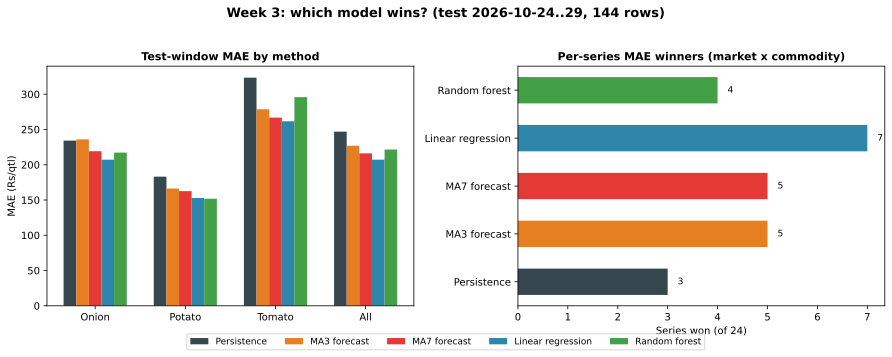

# Day 21 — Week-3 summary: which model wins?

*Dated 2026-10-31. All five methods scored one-step-ahead on the same test window: 2026-10-24..29, 144 rows (8 mandis × 3 commodities × 6 dates), features identical to Days 18–20, regression and forest fitted on train-only data (2026-09-29..10-22).*

## The scoreboard (overall, 144 rows)

| Rank | Method | MAE | RMSE | Bias | Pooled corr |
|---|---|---|---|---|---|
| 1 | Linear regression | 207.22 | 257.36 | +0.76 | 0.806 |
| 2 | MA7 forecast | 216.20 | 277.48 | +12.73 | 0.774 |
| 3 | Random forest | 221.60 | 274.05 | -3.19 | 0.780 |
| 4 | MA3 forecast | 226.97 | 285.65 | -2.11 | 0.765 |
| 5 | Persistence | 246.94 | 315.52 | -7.50 | 0.733 |

## Per commodity (MAE, Rs/qtl)

| Commodity | Persistence | MA3 | MA7 | Linear regression | Random forest |
|---|---|---|---|---|---|
| Onion | 234.17 | 235.90 | 219.14 | 207.18 | 217.14 |
| Potato | 183.12 | 166.32 | 162.59 | 152.82 | 151.79 |
| Tomato | 323.54 | 278.68 | 266.88 | 261.66 | 295.88 |

## Series winners — method with the lowest MAE per market-commodity pair

| Method | Series won (of 24) |
|---|---|
| Linear regression | 7 |
| MA3 forecast | 5 |
| MA7 forecast | 5 |
| Random forest | 4 |
| Persistence | 3 |

## Reading the result

**Linear regression is the week-3 champion.** It has the lowest overall MAE (207.22 Rs/qtl), the best pooled correlation (0.806) and the smallest systematic bias (+0.76) — it leads on all three axes. Among the naive baselines there is a window-sensitivity caveat: on this 6-day window MA7 (216.20) edges MA3 (226.97), while Day 16's MA3 win was on a longer rolling evaluation — with noisy daily prices the MA3-vs-MA7 order flips by window, so the robust finding is "regression first, either moving average a distant second, persistence last", not the exact MA3/MA7 order. Random forest (80 trees, depth 6) loses to a plain OLS overall; its extra capacity buys nothing on this much noise — a good reminder that complexity is not skill. One consistent sub-story: random forest still takes Potato (151.79 vs 152.82), exactly as on Day 19's scoring.

The honest null, carried over from Day 20: within a single commodity, no method tracks day-to-day wiggles (corr ≈ 0–0.25 for all five) — the pooled correlation near 0.8 is between-commodity level differences, not foresight. On sample data that is exactly what independent-noise prices should produce; real portal history will show whether any genuine multi-day memory exists. Watch the within-commodity panel as it accumulates.

## Verification

Hand-check: the champion's overall MAE recomputed in pure Python (no numpy, no pandas groupby) is 207.218857 Rs/qtl — matches the module's 207.218857 to the paisa. Series-win counts sum to 24 (= 24 market-commodity pairs).

