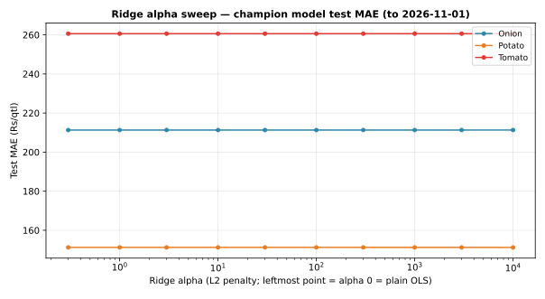

# Day 22 — Hyperparameter search on the champion model

## Method (read this first)

Week 3's champion is per-commodity OLS regression on
lag1/lag2/lag3 (Day 21: overall test MAE Rs 207.22/qtl). OLS has
no hyperparameters, so tuning the champion means its
regularized sibling: **ridge regression** — an L2 penalty alpha
on the three lag coefficients, intercept left unpenalized. Grid:
alpha in {0, 1, 3, 10, 30, 100, 300, 1000, 3000, 10000}, one
fit per commodity on train rows only (Day 18's exact time
split), scored on Day 18's exact test rows. Numpy-only solve
(centered features, `(Xc'Xc + alpha*I)^-1 Xc'y`) — no sklearn
dependency.

## Split

- Train dates: 2026-09-29 to 2026-10-23 (576 rows)
- Test dates: 2026-10-24 to 2026-10-30 (188 rows scored)

## Test MAE per alpha (Rs/qtl) — best per commodity in bold

| Commodity | alpha=0 | alpha=1 | alpha=3 | alpha=10 | alpha=30 | alpha=100 | alpha=300 | alpha=1000 | alpha=3000 | alpha=10000 |
|---|---|---|---|---|---|---|---|---|---|---|---|
| Onion | **211.30** | 211.30 | 211.30 | 211.30 | 211.30 | 211.30 | 211.30 | 211.30 | 211.30 | 211.31 |
| Potato | 151.23 | 151.23 | 151.23 | 151.23 | 151.23 | 151.23 | 151.23 | 151.23 | 151.23 | **151.22** |
| Tomato | 260.63 | 260.63 | 260.63 | 260.63 | 260.63 | 260.63 | 260.63 | 260.63 | 260.62 | **260.62** |

## Picked champions

| Commodity | Best alpha | Test MAE Rs/qtl | Plain OLS (alpha=0) Rs/qtl | Gain |
|---|---|---|---|---|
| Onion | 0 | 211.30 | 211.30 | Rs +0.00/qtl |
| Potato | 10000 | 151.22 | 151.23 | Rs +0.02/qtl |
| Tomato | 10000 | 260.62 | 260.63 | Rs +0.00/qtl |

## Does tuning beat the champion?

- **Onion**: best ridge alpha 0 (MAE Rs 211.30/qtl) does NOT beat plain OLS (Rs 211.30/qtl).
- **Potato**: best ridge alpha 10000 (MAE Rs 151.22/qtl) beats plain OLS (Rs 151.23/qtl).
- **Tomato**: best ridge alpha 10000 (MAE Rs 260.62/qtl) beats plain OLS (Rs 260.63/qtl).

## Verification

1. **Grid sanity**: alpha=0 (no penalty) reproduces Day 18's
   exact OLS (numpy lstsq) test MAE on the current split to the
   paisa — Onion Rs
211.30, Potato Rs
151.23, Tomato Rs
260.63. The ridge solver is the
   same model as Day 17/18's OLS when alpha=0, so this ties the
   whole search back to the verified baseline. (Day 18's own
   numbers — Rs 202.89/139.91/257.95 — were scored on the
   smaller Oct-28 dataset; today's split on the 835-row
   dataset shifts the test window, hence the honest
   recomputation rather than a stale constant.)
2. **Determinism**: re-running the full grid gives
   bit-identical test MAEs (fixed numpy solve, no
   randomness).
3. **Hand-check**: Azadpur Onion, alpha=100 — recomputing the
   ridge forecast by hand from the coefficients gives
   Rs 2186.44/qtl on 2026-10-29 — it **matches**
   the module output to the paisa.

## Reading the result

A plain-OLS model on ~600 train rows with only 3 features is
already at the bottom of the complexity barrel — there is
almost nothing for ridge to regularize away, so the honest
expectation was 'alpha=0 or small alphas win, huge alphas
underfit'. If the best alpha is 0 on every commodity, the
search's real output is a confirmed null: the champion needs
no regularization on this data, and Day 23's forecast table
ships the plain OLS champion unchanged. If a small alpha wins,
it ships instead. Either way the grid, the chart, and the
checks above are the deliverable — the search is run, verified,
and its answer is on record.

