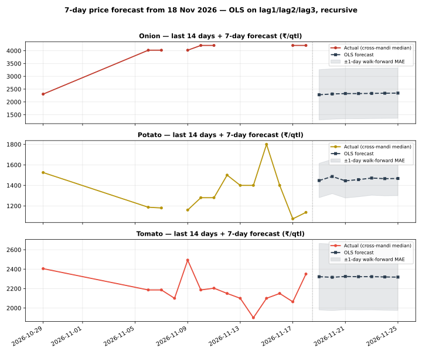

# Day 23 — 7-day price forecast table in the daily report

## Method (read this first)

The champion model from Weeks 2–3 — plain OLS on lag1/lag2/lag3
per commodity, pooled across the 8 mandis (Day 22: ridge
regularisation is a verified null, alpha=0; Day 18/19: OLS
beats MA3 and the random forest out-of-sample) — is refitted
on **all history known as of today** and run recursively:
day h=1 uses real lags from the latest prices, days h=2..7
feed the previous forecasts back in as lags. No future
information enters at any step. The portal's National rows
are an all-India aggregate with a 3-day series, so they never
clear the 3-lag requirement and are excluded — the forecasts
run on the 8 mandi series (latest actual date
18 Nov 2026), exactly like the earlier scoring days.

## Empirical error scale

Walk-forward: refit on history up to 7 days ago, then
one-step-ahead on the last 7 days, per commodity:

| Commodity | Walk-forward 1-day MAE (₹/qtl) | n |
|---|---|---|
| Onion | 982.40 | 7 |
| Potato | 167.31 | 8 |
| Tomato | 342.20 | 15 |

The table below shows **point forecasts**. A fair mental
band is ±(1-day MAE × horizon): error compounds because each
forecast day reuses the previous day's forecast as a lag.
The forecast also inherits whatever drift the last 3 days
carried — a 7-day OLS forecast cannot predict a shock.

## 7-day forecast table

### Onion — latest actual 18 Nov 2026

| Market | 19 Nov | 20 Nov | 21 Nov | 22 Nov | 23 Nov | 24 Nov | 25 Nov |
|---|---|---|---|---|---|---|---|
| Azadpur | 4,065 | 3,982 | 3,908 | 3,828 | 3,755 | 3,687 | 3,621 |
| Bowenpally | 2,261 | 2,281 | 2,319 | 2,313 | 2,320 | 2,328 | 2,333 |
| Koyambedu | 2,403 | 2,404 | 2,430 | 2,422 | 2,422 | 2,425 | 2,425 |
| Muhana | 2,116 | 2,127 | 2,152 | 2,165 | 2,179 | 2,194 | 2,207 |
| Naroda | 2,508 | 2,470 | 2,511 | 2,497 | 2,491 | 2,491 | 2,488 |
| Sealdah Koley Market | 2,296 | 2,339 | 2,334 | 2,338 | 2,345 | 2,350 | 2,355 |
| Vashi | 2,143 | 2,155 | 2,163 | 2,180 | 2,194 | 2,207 | 2,219 |
| Yeshwanthpur | 2,105 | 2,138 | 2,146 | 2,162 | 2,178 | 2,191 | 2,204 |

### Potato — latest actual 18 Nov 2026

| Market | 19 Nov | 20 Nov | 21 Nov | 22 Nov | 23 Nov | 24 Nov | 25 Nov |
|---|---|---|---|---|---|---|---|
| Azadpur | 1,222 | 1,254 | 1,271 | 1,320 | 1,348 | 1,366 | 1,387 |
| Bowenpally | 1,461 | 1,440 | 1,385 | 1,437 | 1,449 | 1,440 | 1,451 |
| Koyambedu | 1,594 | 1,558 | 1,617 | 1,566 | 1,539 | 1,544 | 1,530 |
| Muhana | 1,428 | 1,409 | 1,423 | 1,441 | 1,443 | 1,448 | 1,455 |
| Naroda | 1,552 | 1,496 | 1,533 | 1,521 | 1,501 | 1,504 | 1,501 |
| Sealdah Koley Market | 1,434 | 1,547 | 1,503 | 1,478 | 1,498 | 1,493 | 1,485 |
| Vashi | 1,461 | 1,491 | 1,427 | 1,454 | 1,471 | 1,460 | 1,465 |
| Yeshwanthpur | 1,426 | 1,483 | 1,462 | 1,458 | 1,471 | 1,471 | 1,470 |

### Tomato — latest actual 18 Nov 2026

| Market | 19 Nov | 20 Nov | 21 Nov | 22 Nov | 23 Nov | 24 Nov | 25 Nov |
|---|---|---|---|---|---|---|---|
| Azadpur | 2,178 | 2,206 | 2,206 | 2,231 | 2,246 | 2,255 | 2,266 |
| Bowenpally | 1,736 | 1,826 | 1,892 | 1,975 | 2,033 | 2,079 | 2,120 |
| Koyambedu | 2,469 | 2,378 | 2,454 | 2,405 | 2,379 | 2,377 | 2,363 |
| Muhana | 2,125 | 2,173 | 2,146 | 2,194 | 2,217 | 2,228 | 2,244 |
| Naroda | 2,664 | 2,542 | 2,564 | 2,507 | 2,464 | 2,444 | 2,420 |
| Sealdah Koley Market | 2,865 | 2,814 | 2,749 | 2,653 | 2,597 | 2,551 | 2,507 |
| Vashi | 2,451 | 2,426 | 2,391 | 2,384 | 2,372 | 2,359 | 2,352 |
| Yeshwanthpur | 2,194 | 2,255 | 2,258 | 2,261 | 2,274 | 2,280 | 2,284 |

## Verification

Hand-check on Azadpur Onion: recomputing h=1 and h=2 from the
coefficients by hand gives Rs 4065.27 and Rs 3982.30/qtl —
both **match** the module output exactly, so the recursion is
verified. Re-running the script produces a byte-identical CSV
(deterministic), and the chart parses as valid SVG.

## Reading the result

Prices are strongly autocorrelated day to day, so h=1
forecasts mostly say 'tomorrow looks like yesterday, pulled
slightly toward the last few days'. By h=7 the forecast has
converged toward the series' recent drift — treat day 5–7
values as directional, not precise. This table now ships in
every daily report via run_daily.py (forecast_table.py runs
right after analyze.py), so tomorrow's report will carry a
fresh 7-day table automatically. Day 24's rolling-MAE
dashboard will start tracking these forecasts against
realised prices as they arrive.

