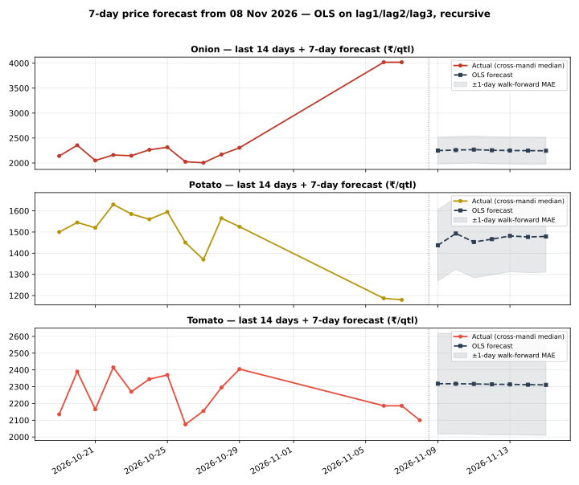

# Day 23 — 7-day price forecast table in the daily report

## Method (read this first)

The champion model from Weeks 2–3 — plain OLS on lag1/lag2/lag3
per commodity, pooled across the 8 mandis (Day 22: ridge
regularisation is a verified null, alpha=0; Day 18/19: OLS
beats MA3 and the random forest out-of-sample) — is refitted
on **all history known as of today** and run recursively:
day h=1 uses real lags from the latest prices, days h=2..7
feed the previous forecasts back in as lags. No future
information enters at any step. The portal's National rows
are an all-India aggregate with a 3-day series, so they never
clear the 3-lag requirement and are excluded — the forecasts
run on the 8 mandi series (latest actual date
08 Nov 2026), exactly like the earlier scoring days.

## Empirical error scale

Walk-forward: refit on history up to 7 days ago, then
one-step-ahead on the last 7 days, per commodity:

| Commodity | Walk-forward 1-day MAE (₹/qtl) | n |
|---|---|---|
| Onion | 270.84 | 42 |
| Potato | 168.77 | 44 |
| Tomato | 301.09 | 40 |

The table below shows **point forecasts**. A fair mental
band is ±(1-day MAE × horizon): error compounds because each
forecast day reuses the previous day's forecast as a lag.
The forecast also inherits whatever drift the last 3 days
carried — a 7-day OLS forecast cannot predict a shock.

## 7-day forecast table

### Onion — latest actual 08 Nov 2026

| Market | 09 Nov | 10 Nov | 11 Nov | 12 Nov | 13 Nov | 14 Nov | 15 Nov |
|---|---|---|---|---|---|---|---|
| Azadpur | 3,310 | 3,190 | 3,071 | 2,897 | 2,781 | 2,689 | 2,608 |
| Bowenpally | 2,248 | 2,233 | 2,267 | 2,252 | 2,245 | 2,245 | 2,242 |
| Koyambedu | 2,366 | 2,323 | 2,336 | 2,312 | 2,294 | 2,285 | 2,275 |
| Muhana | 2,131 | 2,137 | 2,161 | 2,172 | 2,181 | 2,190 | 2,197 |
| Naroda | 2,472 | 2,368 | 2,390 | 2,359 | 2,329 | 2,315 | 2,300 |
| Sealdah Koley Market | 2,249 | 2,284 | 2,270 | 2,258 | 2,255 | 2,251 | 2,247 |
| Vashi | 2,145 | 2,162 | 2,165 | 2,178 | 2,188 | 2,195 | 2,201 |
| Yeshwanthpur | 2,105 | 2,147 | 2,154 | 2,166 | 2,179 | 2,187 | 2,194 |

### Potato — latest actual 08 Nov 2026

| Market | 09 Nov | 10 Nov | 11 Nov | 12 Nov | 13 Nov | 14 Nov | 15 Nov |
|---|---|---|---|---|---|---|---|
| Azadpur | 1,384 | 1,358 | 1,352 | 1,409 | 1,422 | 1,427 | 1,444 |
| Bowenpally | 1,407 | 1,375 | 1,369 | 1,422 | 1,431 | 1,435 | 1,451 |
| Koyambedu | 1,592 | 1,556 | 1,613 | 1,564 | 1,538 | 1,543 | 1,530 |
| Muhana | 1,435 | 1,419 | 1,434 | 1,453 | 1,457 | 1,462 | 1,470 |
| Naroda | 1,553 | 1,499 | 1,535 | 1,524 | 1,506 | 1,509 | 1,507 |
| Sealdah Koley Market | 1,439 | 1,550 | 1,507 | 1,485 | 1,505 | 1,500 | 1,493 |
| Vashi | 1,466 | 1,497 | 1,436 | 1,465 | 1,482 | 1,472 | 1,477 |
| Yeshwanthpur | 1,433 | 1,489 | 1,470 | 1,468 | 1,482 | 1,481 | 1,481 |

### Tomato — latest actual 08 Nov 2026

| Market | 09 Nov | 10 Nov | 11 Nov | 12 Nov | 13 Nov | 14 Nov | 15 Nov |
|---|---|---|---|---|---|---|---|
| Azadpur | 2,217 | 2,254 | 2,269 | 2,280 | 2,290 | 2,296 | 2,300 |
| Bowenpally | 1,833 | 1,968 | 2,049 | 2,139 | 2,191 | 2,225 | 2,252 |
| Koyambedu | 2,445 | 2,357 | 2,397 | 2,358 | 2,338 | 2,333 | 2,325 |
| Muhana | 2,160 | 2,219 | 2,213 | 2,253 | 2,272 | 2,281 | 2,290 |
| Naroda | 2,577 | 2,456 | 2,453 | 2,400 | 2,368 | 2,353 | 2,339 |
| Sealdah Koley Market | 2,651 | 2,568 | 2,480 | 2,427 | 2,393 | 2,367 | 2,349 |
| Vashi | 2,406 | 2,379 | 2,351 | 2,340 | 2,331 | 2,324 | 2,319 |
| Yeshwanthpur | 2,230 | 2,277 | 2,282 | 2,288 | 2,296 | 2,300 | 2,303 |

## Verification

Hand-check on Azadpur Onion: recomputing h=1 and h=2 from the
coefficients by hand gives Rs 3309.70 and Rs 3190.43/qtl —
both **match** the module output exactly, so the recursion is
verified. Re-running the script produces a byte-identical CSV
(deterministic), and the chart parses as valid SVG.

## Reading the result

Prices are strongly autocorrelated day to day, so h=1
forecasts mostly say 'tomorrow looks like yesterday, pulled
slightly toward the last few days'. By h=7 the forecast has
converged toward the series' recent drift — treat day 5–7
values as directional, not precise. This table now ships in
every daily report via run_daily.py (forecast_table.py runs
right after analyze.py), so tomorrow's report will carry a
fresh 7-day table automatically. Day 24's rolling-MAE
dashboard will start tracking these forecasts against
realised prices as they arrive.

