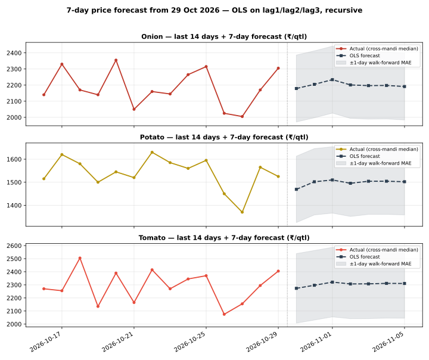

# Day 23 — 7-day price forecast table in the daily report

## Method (read this first)

The champion model from Weeks 2–3 — plain OLS on lag1/lag2/lag3
per commodity, pooled across the 8 mandis (Day 22: ridge
regularisation is a verified null, alpha=0; Day 18/19: OLS
beats MA3 and the random forest out-of-sample) — is refitted
on **all history known as of today** and run recursively:
day h=1 uses real lags from the latest prices, days h=2..7
feed the previous forecasts back in as lags. No future
information enters at any step. The portal's National rows
are an all-India aggregate with a 3-day series, so they never
clear the 3-lag requirement and are excluded — the forecasts
run on the 8 mandi series (latest actual date
29 Oct 2026), exactly like the earlier scoring days.

## Empirical error scale

Walk-forward: refit on history up to 7 days ago, then
one-step-ahead on the last 7 days, per commodity:

| Commodity | Walk-forward 1-day MAE (₹/qtl) | n |
|---|---|---|
| Onion | 207.68 | 56 |
| Potato | 143.95 | 56 |
| Tomato | 265.78 | 56 |

The table below shows **point forecasts**. A fair mental
band is ±(1-day MAE × horizon): error compounds because each
forecast day reuses the previous day's forecast as a lag.
The forecast also inherits whatever drift the last 3 days
carried — a 7-day OLS forecast cannot predict a shock.

## 7-day forecast table

### Onion — latest actual 29 Oct 2026

| Market | 30 Oct | 31 Oct | 01 Nov | 02 Nov | 03 Nov | 04 Nov | 05 Nov |
|---|---|---|---|---|---|---|---|
| Azadpur | 2,220 | 2,288 | 2,250 | 2,221 | 2,221 | 2,212 | 2,202 |
| Bowenpally | 2,160 | 2,162 | 2,232 | 2,193 | 2,183 | 2,192 | 2,186 |
| Koyambedu | 2,290 | 2,248 | 2,291 | 2,249 | 2,226 | 2,224 | 2,213 |
| Muhana | 2,114 | 2,112 | 2,140 | 2,146 | 2,149 | 2,157 | 2,161 |
| Naroda | 2,399 | 2,267 | 2,337 | 2,290 | 2,249 | 2,245 | 2,231 |
| Sealdah Koley Market | 2,198 | 2,260 | 2,236 | 2,209 | 2,210 | 2,204 | 2,196 |
| Vashi | 2,152 | 2,155 | 2,145 | 2,158 | 2,163 | 2,164 | 2,167 |
| Yeshwanthpur | 2,091 | 2,141 | 2,135 | 2,141 | 2,153 | 2,157 | 2,160 |

### Potato — latest actual 29 Oct 2026

| Market | 30 Oct | 31 Oct | 01 Nov | 02 Nov | 03 Nov | 04 Nov | 05 Nov |
|---|---|---|---|---|---|---|---|
| Azadpur | 1,479 | 1,594 | 1,549 | 1,519 | 1,535 | 1,527 | 1,518 |
| Bowenpally | 1,462 | 1,449 | 1,507 | 1,491 | 1,486 | 1,498 | 1,498 |
| Koyambedu | 1,591 | 1,571 | 1,619 | 1,568 | 1,550 | 1,553 | 1,540 |
| Muhana | 1,436 | 1,425 | 1,443 | 1,462 | 1,467 | 1,474 | 1,481 |
| Naroda | 1,550 | 1,508 | 1,543 | 1,529 | 1,516 | 1,520 | 1,516 |
| Sealdah Koley Market | 1,460 | 1,557 | 1,513 | 1,500 | 1,517 | 1,510 | 1,506 |
| Vashi | 1,477 | 1,496 | 1,444 | 1,477 | 1,489 | 1,483 | 1,490 |
| Yeshwanthpur | 1,445 | 1,496 | 1,477 | 1,480 | 1,492 | 1,492 | 1,494 |

### Tomato — latest actual 29 Oct 2026

| Market | 30 Oct | 31 Oct | 01 Nov | 02 Nov | 03 Nov | 04 Nov | 05 Nov |
|---|---|---|---|---|---|---|---|
| Azadpur | 2,192 | 2,261 | 2,244 | 2,275 | 2,291 | 2,295 | 2,301 |
| Bowenpally | 2,259 | 2,265 | 2,320 | 2,303 | 2,304 | 2,310 | 2,309 |
| Koyambedu | 2,422 | 2,335 | 2,390 | 2,347 | 2,329 | 2,329 | 2,322 |
| Muhana | 2,187 | 2,242 | 2,226 | 2,269 | 2,285 | 2,291 | 2,299 |
| Naroda | 2,546 | 2,425 | 2,436 | 2,382 | 2,353 | 2,343 | 2,332 |
| Sealdah Koley Market | 2,288 | 2,309 | 2,322 | 2,311 | 2,312 | 2,313 | 2,312 |
| Vashi | 2,401 | 2,374 | 2,345 | 2,336 | 2,328 | 2,322 | 2,319 |
| Yeshwanthpur | 2,232 | 2,285 | 2,288 | 2,293 | 2,302 | 2,305 | 2,307 |

## Verification

Hand-check on Azadpur Onion: recomputing h=1 and h=2 from the
coefficients by hand gives Rs 2219.74 and Rs 2288.07/qtl —
both **match** the module output exactly, so the recursion is
verified. Re-running the script produces a byte-identical CSV
(deterministic), and the chart parses as valid SVG.

## Reading the result

Prices are strongly autocorrelated day to day, so h=1
forecasts mostly say 'tomorrow looks like yesterday, pulled
slightly toward the last few days'. By h=7 the forecast has
converged toward the series' recent drift — treat day 5–7
values as directional, not precise. This table now ships in
every daily report via run_daily.py (forecast_table.py runs
right after analyze.py), so tomorrow's report will carry a
fresh 7-day table automatically. Day 24's rolling-MAE
dashboard will start tracking these forecasts against
realised prices as they arrive.

