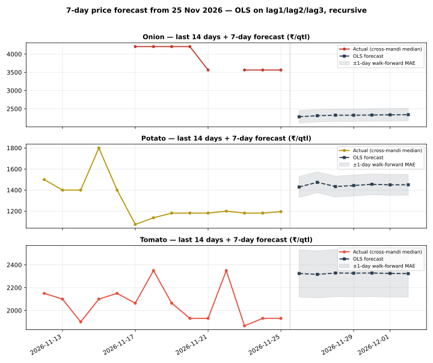

# Day 23 — 7-day price forecast table in the daily report

## Method (read this first)

The champion model from Weeks 2–3 — plain OLS on lag1/lag2/lag3
per commodity, pooled across the 8 mandis (Day 22: ridge
regularisation is a verified null, alpha=0; Day 18/19: OLS
beats MA3 and the random forest out-of-sample) — is refitted
on **all history known as of today** and run recursively:
day h=1 uses real lags from the latest prices, days h=2..7
feed the previous forecasts back in as lags. No future
information enters at any step. The portal's National rows
are an all-India aggregate with a 3-day series, so they never
clear the 3-lag requirement and are excluded — the forecasts
run on the 8 mandi series (latest actual date
25 Nov 2026), exactly like the earlier scoring days.

## Empirical error scale

Walk-forward: refit on history up to 7 days ago, then
one-step-ahead on the last 7 days, per commodity:

| Commodity | Walk-forward 1-day MAE (₹/qtl) | n |
|---|---|---|
| Onion | 170.75 | 7 |
| Potato | 99.31 | 13 |
| Tomato | 206.89 | 19 |

The table below shows **point forecasts**. A fair mental
band is ±(1-day MAE × horizon): error compounds because each
forecast day reuses the previous day's forecast as a lag.
The forecast also inherits whatever drift the last 3 days
carried — a 7-day OLS forecast cannot predict a shock.

## 7-day forecast table

### Onion — latest actual 25 Nov 2026

| Market | 26 Nov | 27 Nov | 28 Nov | 29 Nov | 30 Nov | 01 Dec | 02 Dec |
|---|---|---|---|---|---|---|---|
| Azadpur | 3,457 | 3,395 | 3,339 | 3,281 | 3,227 | 3,177 | 3,130 |
| Bowenpally | 2,266 | 2,283 | 2,318 | 2,313 | 2,318 | 2,325 | 2,329 |
| Koyambedu | 2,404 | 2,402 | 2,425 | 2,416 | 2,415 | 2,416 | 2,415 |
| Muhana | 2,118 | 2,130 | 2,154 | 2,168 | 2,182 | 2,196 | 2,208 |
| Naroda | 2,508 | 2,468 | 2,504 | 2,489 | 2,481 | 2,479 | 2,474 |
| Sealdah Koley Market | 2,296 | 2,336 | 2,330 | 2,333 | 2,339 | 2,343 | 2,346 |
| Vashi | 2,142 | 2,154 | 2,163 | 2,181 | 2,194 | 2,207 | 2,219 |
| Yeshwanthpur | 2,106 | 2,139 | 2,148 | 2,164 | 2,179 | 2,193 | 2,205 |

### Potato — latest actual 25 Nov 2026

| Market | 26 Nov | 27 Nov | 28 Nov | 29 Nov | 30 Nov | 01 Dec | 02 Dec |
|---|---|---|---|---|---|---|---|
| Azadpur | 1,229 | 1,265 | 1,278 | 1,310 | 1,334 | 1,349 | 1,366 |
| Bowenpally | 1,287 | 1,305 | 1,328 | 1,349 | 1,364 | 1,378 | 1,390 |
| Koyambedu | 1,604 | 1,569 | 1,620 | 1,572 | 1,545 | 1,545 | 1,530 |
| Muhana | 1,415 | 1,396 | 1,409 | 1,423 | 1,424 | 1,429 | 1,435 |
| Naroda | 1,551 | 1,497 | 1,530 | 1,516 | 1,497 | 1,497 | 1,492 |
| Sealdah Koley Market | 1,437 | 1,539 | 1,497 | 1,473 | 1,489 | 1,483 | 1,474 |
| Vashi | 1,450 | 1,476 | 1,416 | 1,440 | 1,453 | 1,444 | 1,447 |
| Yeshwanthpur | 1,422 | 1,472 | 1,452 | 1,447 | 1,457 | 1,456 | 1,454 |

### Tomato — latest actual 25 Nov 2026

| Market | 26 Nov | 27 Nov | 28 Nov | 29 Nov | 30 Nov | 01 Dec | 02 Dec |
|---|---|---|---|---|---|---|---|
| Azadpur | 2,013 | 2,047 | 2,073 | 2,108 | 2,133 | 2,155 | 2,175 |
| Bowenpally | 1,787 | 1,858 | 1,866 | 1,944 | 1,992 | 2,026 | 2,064 |
| Koyambedu | 2,478 | 2,389 | 2,478 | 2,429 | 2,403 | 2,404 | 2,390 |
| Muhana | 2,111 | 2,152 | 2,116 | 2,163 | 2,185 | 2,194 | 2,211 |
| Naroda | 2,698 | 2,581 | 2,616 | 2,563 | 2,522 | 2,504 | 2,479 |
| Sealdah Koley Market | 3,010 | 2,931 | 2,869 | 2,790 | 2,731 | 2,681 | 2,634 |
| Vashi | 2,469 | 2,447 | 2,411 | 2,408 | 2,397 | 2,384 | 2,376 |
| Yeshwanthpur | 2,180 | 2,245 | 2,246 | 2,246 | 2,260 | 2,266 | 2,271 |

## Verification

Hand-check on Azadpur Onion: recomputing h=1 and h=2 from the
coefficients by hand gives Rs 3457.23 and Rs 3394.72/qtl —
both **match** the module output exactly, so the recursion is
verified. Re-running the script produces a byte-identical CSV
(deterministic), and the chart parses as valid SVG.

## Reading the result

Prices are strongly autocorrelated day to day, so h=1
forecasts mostly say 'tomorrow looks like yesterday, pulled
slightly toward the last few days'. By h=7 the forecast has
converged toward the series' recent drift — treat day 5–7
values as directional, not precise. This table now ships in
every daily report via run_daily.py (forecast_table.py runs
right after analyze.py), so tomorrow's report will carry a
fresh 7-day table automatically. Day 24's rolling-MAE
dashboard will start tracking these forecasts against
realised prices as they arrive.

