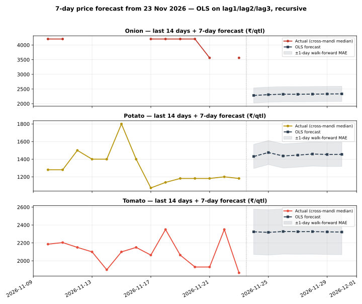

# Day 23 — 7-day price forecast table in the daily report

## Method (read this first)

The champion model from Weeks 2–3 — plain OLS on lag1/lag2/lag3
per commodity, pooled across the 8 mandis (Day 22: ridge
regularisation is a verified null, alpha=0; Day 18/19: OLS
beats MA3 and the random forest out-of-sample) — is refitted
on **all history known as of today** and run recursively:
day h=1 uses real lags from the latest prices, days h=2..7
feed the previous forecasts back in as lags. No future
information enters at any step. The portal's National rows
are an all-India aggregate with a 3-day series, so they never
clear the 3-lag requirement and are excluded — the forecasts
run on the 8 mandi series (latest actual date
23 Nov 2026), exactly like the earlier scoring days.

## Empirical error scale

Walk-forward: refit on history up to 7 days ago, then
one-step-ahead on the last 7 days, per commodity:

| Commodity | Walk-forward 1-day MAE (₹/qtl) | n |
|---|---|---|
| Onion | 257.27 | 7 |
| Potato | 136.77 | 12 |
| Tomato | 252.93 | 18 |

The table below shows **point forecasts**. A fair mental
band is ±(1-day MAE × horizon): error compounds because each
forecast day reuses the previous day's forecast as a lag.
The forecast also inherits whatever drift the last 3 days
carried — a 7-day OLS forecast cannot predict a shock.

## 7-day forecast table

### Onion — latest actual 23 Nov 2026

| Market | 24 Nov | 25 Nov | 26 Nov | 27 Nov | 28 Nov | 29 Nov | 30 Nov |
|---|---|---|---|---|---|---|---|
| Azadpur | 3,542 | 3,439 | 3,375 | 3,316 | 3,256 | 3,201 | 3,150 |
| Bowenpally | 2,267 | 2,284 | 2,317 | 2,312 | 2,316 | 2,323 | 2,327 |
| Koyambedu | 2,404 | 2,401 | 2,423 | 2,414 | 2,412 | 2,412 | 2,410 |
| Muhana | 2,118 | 2,130 | 2,154 | 2,168 | 2,182 | 2,195 | 2,208 |
| Naroda | 2,507 | 2,467 | 2,501 | 2,486 | 2,477 | 2,474 | 2,468 |
| Sealdah Koley Market | 2,296 | 2,334 | 2,328 | 2,331 | 2,337 | 2,340 | 2,343 |
| Vashi | 2,141 | 2,154 | 2,163 | 2,180 | 2,194 | 2,206 | 2,218 |
| Yeshwanthpur | 2,106 | 2,139 | 2,148 | 2,164 | 2,179 | 2,192 | 2,205 |

### Potato — latest actual 23 Nov 2026

| Market | 24 Nov | 25 Nov | 26 Nov | 27 Nov | 28 Nov | 29 Nov | 30 Nov |
|---|---|---|---|---|---|---|---|
| Azadpur | 1,244 | 1,277 | 1,295 | 1,326 | 1,348 | 1,364 | 1,380 |
| Bowenpally | 1,271 | 1,300 | 1,316 | 1,343 | 1,363 | 1,376 | 1,390 |
| Koyambedu | 1,603 | 1,568 | 1,618 | 1,570 | 1,543 | 1,544 | 1,529 |
| Muhana | 1,418 | 1,399 | 1,413 | 1,427 | 1,429 | 1,434 | 1,440 |
| Naroda | 1,551 | 1,497 | 1,530 | 1,516 | 1,498 | 1,498 | 1,494 |
| Sealdah Koley Market | 1,438 | 1,540 | 1,498 | 1,475 | 1,491 | 1,485 | 1,477 |
| Vashi | 1,451 | 1,477 | 1,419 | 1,443 | 1,457 | 1,448 | 1,451 |
| Yeshwanthpur | 1,424 | 1,474 | 1,454 | 1,450 | 1,460 | 1,459 | 1,458 |

### Tomato — latest actual 23 Nov 2026

| Market | 24 Nov | 25 Nov | 26 Nov | 27 Nov | 28 Nov | 29 Nov | 30 Nov |
|---|---|---|---|---|---|---|---|
| Azadpur | 2,020 | 2,056 | 2,085 | 2,120 | 2,146 | 2,168 | 2,189 |
| Bowenpally | 1,812 | 1,862 | 1,947 | 1,991 | 2,033 | 2,074 | 2,106 |
| Koyambedu | 2,476 | 2,388 | 2,471 | 2,422 | 2,397 | 2,397 | 2,382 |
| Muhana | 2,113 | 2,156 | 2,124 | 2,171 | 2,194 | 2,204 | 2,221 |
| Naroda | 2,688 | 2,572 | 2,601 | 2,547 | 2,506 | 2,487 | 2,461 |
| Sealdah Koley Market | 2,992 | 2,908 | 2,842 | 2,759 | 2,698 | 2,647 | 2,600 |
| Vashi | 2,464 | 2,440 | 2,406 | 2,401 | 2,389 | 2,376 | 2,368 |
| Yeshwanthpur | 2,185 | 2,248 | 2,249 | 2,250 | 2,264 | 2,270 | 2,275 |

## Verification

Hand-check on Azadpur Onion: recomputing h=1 and h=2 from the
coefficients by hand gives Rs 3542.23 and Rs 3439.38/qtl —
both **match** the module output exactly, so the recursion is
verified. Re-running the script produces a byte-identical CSV
(deterministic), and the chart parses as valid SVG.

## Reading the result

Prices are strongly autocorrelated day to day, so h=1
forecasts mostly say 'tomorrow looks like yesterday, pulled
slightly toward the last few days'. By h=7 the forecast has
converged toward the series' recent drift — treat day 5–7
values as directional, not precise. This table now ships in
every daily report via run_daily.py (forecast_table.py runs
right after analyze.py), so tomorrow's report will carry a
fresh 7-day table automatically. Day 24's rolling-MAE
dashboard will start tracking these forecasts against
realised prices as they arrive.

