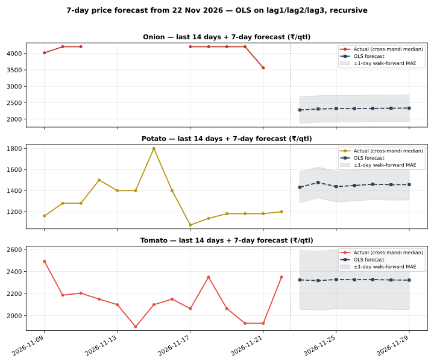

# Day 23 — 7-day price forecast table in the daily report

## Method (read this first)

The champion model from Weeks 2–3 — plain OLS on lag1/lag2/lag3
per commodity, pooled across the 8 mandis (Day 22: ridge
regularisation is a verified null, alpha=0; Day 18/19: OLS
beats MA3 and the random forest out-of-sample) — is refitted
on **all history known as of today** and run recursively:
day h=1 uses real lags from the latest prices, days h=2..7
feed the previous forecasts back in as lags. No future
information enters at any step. The portal's National rows
are an all-India aggregate with a 3-day series, so they never
clear the 3-lag requirement and are excluded — the forecasts
run on the 8 mandi series (latest actual date
22 Nov 2026), exactly like the earlier scoring days.

## Empirical error scale

Walk-forward: refit on history up to 7 days ago, then
one-step-ahead on the last 7 days, per commodity:

| Commodity | Walk-forward 1-day MAE (₹/qtl) | n |
|---|---|---|
| Onion | 406.27 | 7 |
| Potato | 146.47 | 11 |
| Tomato | 266.79 | 18 |

The table below shows **point forecasts**. A fair mental
band is ±(1-day MAE × horizon): error compounds because each
forecast day reuses the previous day's forecast as a lag.
The forecast also inherits whatever drift the last 3 days
carried — a 7-day OLS forecast cannot predict a shock.

## 7-day forecast table

### Onion — latest actual 22 Nov 2026

| Market | 23 Nov | 24 Nov | 25 Nov | 26 Nov | 27 Nov | 28 Nov | 29 Nov |
|---|---|---|---|---|---|---|---|
| Azadpur | 3,665 | 3,610 | 3,504 | 3,446 | 3,385 | 3,324 | 3,269 |
| Bowenpally | 2,264 | 2,282 | 2,317 | 2,311 | 2,317 | 2,324 | 2,328 |
| Koyambedu | 2,403 | 2,401 | 2,425 | 2,416 | 2,414 | 2,415 | 2,414 |
| Muhana | 2,117 | 2,129 | 2,154 | 2,167 | 2,181 | 2,195 | 2,207 |
| Naroda | 2,506 | 2,467 | 2,503 | 2,488 | 2,480 | 2,478 | 2,473 |
| Sealdah Koley Market | 2,296 | 2,336 | 2,330 | 2,333 | 2,339 | 2,343 | 2,346 |
| Vashi | 2,142 | 2,154 | 2,163 | 2,180 | 2,194 | 2,206 | 2,218 |
| Yeshwanthpur | 2,106 | 2,139 | 2,147 | 2,163 | 2,179 | 2,192 | 2,205 |

### Potato — latest actual 22 Nov 2026

| Market | 23 Nov | 24 Nov | 25 Nov | 26 Nov | 27 Nov | 28 Nov | 29 Nov |
|---|---|---|---|---|---|---|---|
| Azadpur | 1,248 | 1,282 | 1,300 | 1,331 | 1,354 | 1,370 | 1,386 |
| Bowenpally | 1,274 | 1,304 | 1,320 | 1,348 | 1,368 | 1,382 | 1,396 |
| Koyambedu | 1,603 | 1,567 | 1,617 | 1,569 | 1,542 | 1,543 | 1,529 |
| Muhana | 1,419 | 1,401 | 1,415 | 1,430 | 1,432 | 1,437 | 1,443 |
| Naroda | 1,551 | 1,497 | 1,530 | 1,516 | 1,498 | 1,499 | 1,495 |
| Sealdah Koley Market | 1,439 | 1,540 | 1,498 | 1,476 | 1,492 | 1,486 | 1,478 |
| Vashi | 1,451 | 1,478 | 1,421 | 1,445 | 1,459 | 1,450 | 1,454 |
| Yeshwanthpur | 1,425 | 1,475 | 1,456 | 1,452 | 1,462 | 1,461 | 1,460 |

### Tomato — latest actual 22 Nov 2026

| Market | 23 Nov | 24 Nov | 25 Nov | 26 Nov | 27 Nov | 28 Nov | 29 Nov |
|---|---|---|---|---|---|---|---|
| Azadpur | 2,047 | 2,067 | 2,093 | 2,130 | 2,154 | 2,174 | 2,194 |
| Bowenpally | 1,689 | 1,765 | 1,825 | 1,901 | 1,957 | 2,003 | 2,047 |
| Koyambedu | 2,476 | 2,388 | 2,472 | 2,423 | 2,398 | 2,397 | 2,383 |
| Muhana | 2,113 | 2,155 | 2,124 | 2,170 | 2,193 | 2,203 | 2,220 |
| Naroda | 2,689 | 2,573 | 2,603 | 2,549 | 2,507 | 2,488 | 2,463 |
| Sealdah Koley Market | 2,994 | 2,910 | 2,845 | 2,762 | 2,701 | 2,650 | 2,603 |
| Vashi | 2,464 | 2,441 | 2,406 | 2,402 | 2,390 | 2,377 | 2,369 |
| Yeshwanthpur | 2,184 | 2,247 | 2,249 | 2,250 | 2,264 | 2,270 | 2,275 |

## Verification

Hand-check on Azadpur Onion: recomputing h=1 and h=2 from the
coefficients by hand gives Rs 3664.75 and Rs 3610.42/qtl —
both **match** the module output exactly, so the recursion is
verified. Re-running the script produces a byte-identical CSV
(deterministic), and the chart parses as valid SVG.

## Reading the result

Prices are strongly autocorrelated day to day, so h=1
forecasts mostly say 'tomorrow looks like yesterday, pulled
slightly toward the last few days'. By h=7 the forecast has
converged toward the series' recent drift — treat day 5–7
values as directional, not precise. This table now ships in
every daily report via run_daily.py (forecast_table.py runs
right after analyze.py), so tomorrow's report will carry a
fresh 7-day table automatically. Day 24's rolling-MAE
dashboard will start tracking these forecasts against
realised prices as they arrive.

