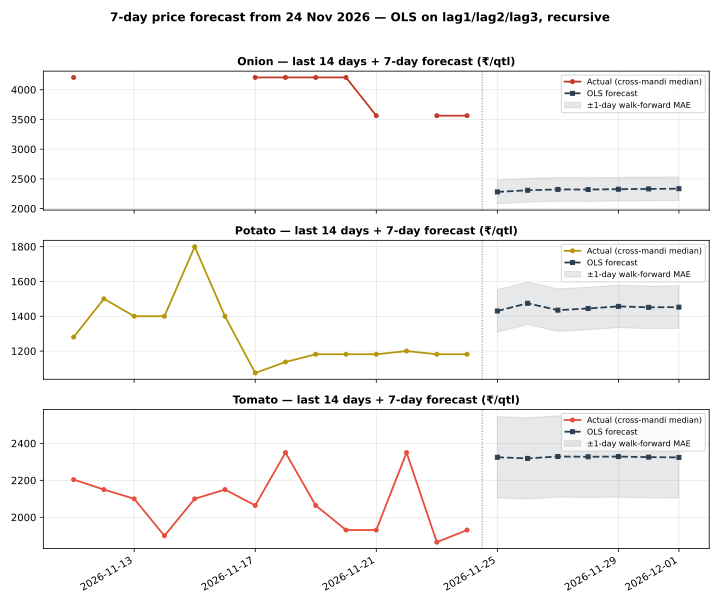

# Day 23 — 7-day price forecast table in the daily report

## Method (read this first)

The champion model from Weeks 2–3 — plain OLS on lag1/lag2/lag3
per commodity, pooled across the 8 mandis (Day 22: ridge
regularisation is a verified null, alpha=0; Day 18/19: OLS
beats MA3 and the random forest out-of-sample) — is refitted
on **all history known as of today** and run recursively:
day h=1 uses real lags from the latest prices, days h=2..7
feed the previous forecasts back in as lags. No future
information enters at any step. The portal's National rows
are an all-India aggregate with a 3-day series, so they never
clear the 3-lag requirement and are excluded — the forecasts
run on the 8 mandi series (latest actual date
24 Nov 2026), exactly like the earlier scoring days.

## Empirical error scale

Walk-forward: refit on history up to 7 days ago, then
one-step-ahead on the last 7 days, per commodity:

| Commodity | Walk-forward 1-day MAE (₹/qtl) | n |
|---|---|---|
| Onion | 198.98 | 7 |
| Potato | 122.31 | 13 |
| Tomato | 219.93 | 18 |

The table below shows **point forecasts**. A fair mental
band is ±(1-day MAE × horizon): error compounds because each
forecast day reuses the previous day's forecast as a lag.
The forecast also inherits whatever drift the last 3 days
carried — a 7-day OLS forecast cannot predict a shock.

## 7-day forecast table

### Onion — latest actual 24 Nov 2026

| Market | 25 Nov | 26 Nov | 27 Nov | 28 Nov | 29 Nov | 30 Nov | 01 Dec |
|---|---|---|---|---|---|---|---|
| Azadpur | 3,453 | 3,388 | 3,330 | 3,269 | 3,214 | 3,163 | 3,114 |
| Bowenpally | 2,266 | 2,283 | 2,317 | 2,311 | 2,316 | 2,323 | 2,327 |
| Koyambedu | 2,404 | 2,401 | 2,424 | 2,414 | 2,412 | 2,412 | 2,411 |
| Muhana | 2,118 | 2,130 | 2,154 | 2,168 | 2,181 | 2,195 | 2,208 |
| Naroda | 2,508 | 2,467 | 2,502 | 2,486 | 2,478 | 2,475 | 2,469 |
| Sealdah Koley Market | 2,295 | 2,335 | 2,329 | 2,331 | 2,337 | 2,340 | 2,344 |
| Vashi | 2,142 | 2,154 | 2,163 | 2,180 | 2,194 | 2,206 | 2,218 |
| Yeshwanthpur | 2,106 | 2,139 | 2,148 | 2,163 | 2,179 | 2,192 | 2,205 |

### Potato — latest actual 24 Nov 2026

| Market | 25 Nov | 26 Nov | 27 Nov | 28 Nov | 29 Nov | 30 Nov | 01 Dec |
|---|---|---|---|---|---|---|---|
| Azadpur | 1,241 | 1,273 | 1,291 | 1,321 | 1,343 | 1,358 | 1,374 |
| Bowenpally | 1,268 | 1,296 | 1,312 | 1,338 | 1,358 | 1,371 | 1,385 |
| Koyambedu | 1,604 | 1,568 | 1,619 | 1,571 | 1,544 | 1,544 | 1,530 |
| Muhana | 1,417 | 1,397 | 1,410 | 1,425 | 1,426 | 1,431 | 1,437 |
| Naroda | 1,551 | 1,497 | 1,530 | 1,516 | 1,497 | 1,498 | 1,493 |
| Sealdah Koley Market | 1,437 | 1,540 | 1,497 | 1,474 | 1,490 | 1,484 | 1,475 |
| Vashi | 1,450 | 1,476 | 1,417 | 1,441 | 1,455 | 1,446 | 1,449 |
| Yeshwanthpur | 1,423 | 1,473 | 1,453 | 1,448 | 1,459 | 1,457 | 1,456 |

### Tomato — latest actual 24 Nov 2026

| Market | 25 Nov | 26 Nov | 27 Nov | 28 Nov | 29 Nov | 30 Nov | 01 Dec |
|---|---|---|---|---|---|---|---|
| Azadpur | 2,018 | 2,054 | 2,082 | 2,117 | 2,143 | 2,165 | 2,186 |
| Bowenpally | 1,854 | 1,939 | 1,982 | 2,024 | 2,066 | 2,098 | 2,127 |
| Koyambedu | 2,477 | 2,390 | 2,475 | 2,426 | 2,401 | 2,401 | 2,387 |
| Muhana | 2,113 | 2,155 | 2,123 | 2,169 | 2,192 | 2,202 | 2,219 |
| Naroda | 2,692 | 2,576 | 2,607 | 2,554 | 2,513 | 2,494 | 2,469 |
| Sealdah Koley Market | 2,999 | 2,917 | 2,853 | 2,771 | 2,711 | 2,660 | 2,613 |
| Vashi | 2,466 | 2,443 | 2,409 | 2,405 | 2,393 | 2,380 | 2,373 |
| Yeshwanthpur | 2,184 | 2,247 | 2,249 | 2,250 | 2,264 | 2,270 | 2,275 |

## Verification

Hand-check on Azadpur Onion: recomputing h=1 and h=2 from the
coefficients by hand gives Rs 3452.70 and Rs 3387.62/qtl —
both **match** the module output exactly, so the recursion is
verified. Re-running the script produces a byte-identical CSV
(deterministic), and the chart parses as valid SVG.

## Reading the result

Prices are strongly autocorrelated day to day, so h=1
forecasts mostly say 'tomorrow looks like yesterday, pulled
slightly toward the last few days'. By h=7 the forecast has
converged toward the series' recent drift — treat day 5–7
values as directional, not precise. This table now ships in
every daily report via run_daily.py (forecast_table.py runs
right after analyze.py), so tomorrow's report will carry a
fresh 7-day table automatically. Day 24's rolling-MAE
dashboard will start tracking these forecasts against
realised prices as they arrive.

