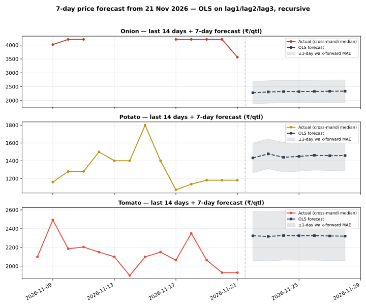

# Day 23 — 7-day price forecast table in the daily report

## Method (read this first)

The champion model from Weeks 2–3 — plain OLS on lag1/lag2/lag3
per commodity, pooled across the 8 mandis (Day 22: ridge
regularisation is a verified null, alpha=0; Day 18/19: OLS
beats MA3 and the random forest out-of-sample) — is refitted
on **all history known as of today** and run recursively:
day h=1 uses real lags from the latest prices, days h=2..7
feed the previous forecasts back in as lags. No future
information enters at any step. The portal's National rows
are an all-India aggregate with a 3-day series, so they never
clear the 3-lag requirement and are excluded — the forecasts
run on the 8 mandi series (latest actual date
21 Nov 2026), exactly like the earlier scoring days.

## Empirical error scale

Walk-forward: refit on history up to 7 days ago, then
one-step-ahead on the last 7 days, per commodity:

| Commodity | Walk-forward 1-day MAE (₹/qtl) | n |
|---|---|---|
| Onion | 406.27 | 7 |
| Potato | 166.92 | 11 |
| Tomato | 262.47 | 18 |

The table below shows **point forecasts**. A fair mental
band is ±(1-day MAE × horizon): error compounds because each
forecast day reuses the previous day's forecast as a lag.
The forecast also inherits whatever drift the last 3 days
carried — a 7-day OLS forecast cannot predict a shock.

## 7-day forecast table

### Onion — latest actual 21 Nov 2026

| Market | 22 Nov | 23 Nov | 24 Nov | 25 Nov | 26 Nov | 27 Nov | 28 Nov |
|---|---|---|---|---|---|---|---|
| Azadpur | 3,665 | 3,610 | 3,504 | 3,446 | 3,385 | 3,324 | 3,269 |
| Bowenpally | 2,264 | 2,282 | 2,317 | 2,311 | 2,317 | 2,324 | 2,328 |
| Koyambedu | 2,403 | 2,401 | 2,425 | 2,416 | 2,414 | 2,415 | 2,414 |
| Muhana | 2,117 | 2,129 | 2,154 | 2,167 | 2,181 | 2,195 | 2,207 |
| Naroda | 2,506 | 2,467 | 2,503 | 2,488 | 2,480 | 2,478 | 2,473 |
| Sealdah Koley Market | 2,296 | 2,336 | 2,330 | 2,333 | 2,339 | 2,343 | 2,346 |
| Vashi | 2,142 | 2,154 | 2,163 | 2,180 | 2,194 | 2,206 | 2,218 |
| Yeshwanthpur | 2,106 | 2,139 | 2,147 | 2,163 | 2,179 | 2,192 | 2,205 |

### Potato — latest actual 21 Nov 2026

| Market | 22 Nov | 23 Nov | 24 Nov | 25 Nov | 26 Nov | 27 Nov | 28 Nov |
|---|---|---|---|---|---|---|---|
| Azadpur | 1,249 | 1,284 | 1,302 | 1,334 | 1,357 | 1,373 | 1,389 |
| Bowenpally | 1,276 | 1,306 | 1,322 | 1,350 | 1,370 | 1,384 | 1,398 |
| Koyambedu | 1,603 | 1,566 | 1,616 | 1,568 | 1,542 | 1,542 | 1,528 |
| Muhana | 1,420 | 1,402 | 1,416 | 1,431 | 1,433 | 1,438 | 1,445 |
| Naroda | 1,551 | 1,498 | 1,530 | 1,517 | 1,499 | 1,499 | 1,495 |
| Sealdah Koley Market | 1,439 | 1,540 | 1,499 | 1,476 | 1,492 | 1,486 | 1,479 |
| Vashi | 1,451 | 1,479 | 1,422 | 1,446 | 1,460 | 1,451 | 1,455 |
| Yeshwanthpur | 1,425 | 1,476 | 1,456 | 1,452 | 1,463 | 1,462 | 1,462 |

### Tomato — latest actual 21 Nov 2026

| Market | 22 Nov | 23 Nov | 24 Nov | 25 Nov | 26 Nov | 27 Nov | 28 Nov |
|---|---|---|---|---|---|---|---|
| Azadpur | 2,051 | 2,072 | 2,098 | 2,136 | 2,160 | 2,181 | 2,200 |
| Bowenpally | 1,698 | 1,777 | 1,839 | 1,916 | 1,972 | 2,019 | 2,062 |
| Koyambedu | 2,475 | 2,386 | 2,468 | 2,419 | 2,393 | 2,392 | 2,378 |
| Muhana | 2,115 | 2,158 | 2,128 | 2,174 | 2,197 | 2,207 | 2,224 |
| Naroda | 2,684 | 2,566 | 2,594 | 2,539 | 2,497 | 2,478 | 2,453 |
| Sealdah Koley Market | 2,983 | 2,896 | 2,829 | 2,744 | 2,682 | 2,631 | 2,584 |
| Vashi | 2,461 | 2,437 | 2,402 | 2,397 | 2,385 | 2,372 | 2,364 |
| Yeshwanthpur | 2,186 | 2,248 | 2,251 | 2,252 | 2,265 | 2,271 | 2,276 |

## Verification

Hand-check on Azadpur Onion: recomputing h=1 and h=2 from the
coefficients by hand gives Rs 3664.75 and Rs 3610.42/qtl —
both **match** the module output exactly, so the recursion is
verified. Re-running the script produces a byte-identical CSV
(deterministic), and the chart parses as valid SVG.

## Reading the result

Prices are strongly autocorrelated day to day, so h=1
forecasts mostly say 'tomorrow looks like yesterday, pulled
slightly toward the last few days'. By h=7 the forecast has
converged toward the series' recent drift — treat day 5–7
values as directional, not precise. This table now ships in
every daily report via run_daily.py (forecast_table.py runs
right after analyze.py), so tomorrow's report will carry a
fresh 7-day table automatically. Day 24's rolling-MAE
dashboard will start tracking these forecasts against
realised prices as they arrive.

