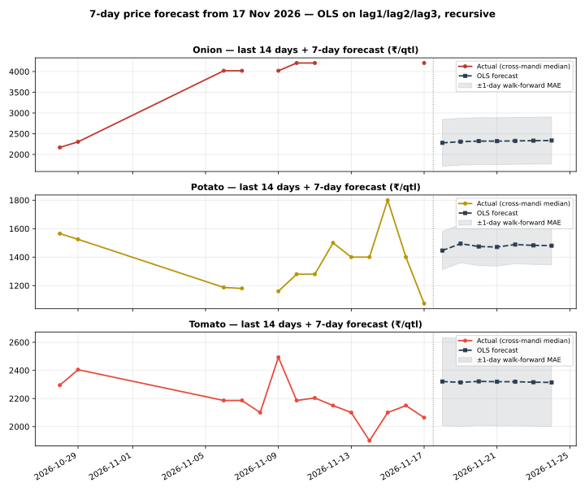

# Day 23 — 7-day price forecast table in the daily report

## Method (read this first)

The champion model from Weeks 2–3 — plain OLS on lag1/lag2/lag3
per commodity, pooled across the 8 mandis (Day 22: ridge
regularisation is a verified null, alpha=0; Day 18/19: OLS
beats MA3 and the random forest out-of-sample) — is refitted
on **all history known as of today** and run recursively:
day h=1 uses real lags from the latest prices, days h=2..7
feed the previous forecasts back in as lags. No future
information enters at any step. The portal's National rows
are an all-India aggregate with a 3-day series, so they never
clear the 3-lag requirement and are excluded — the forecasts
run on the 8 mandi series (latest actual date
17 Nov 2026), exactly like the earlier scoring days.

## Empirical error scale

Walk-forward: refit on history up to 7 days ago, then
one-step-ahead on the last 7 days, per commodity:

| Commodity | Walk-forward 1-day MAE (₹/qtl) | n |
|---|---|---|
| Onion | 566.22 | 14 |
| Potato | 134.39 | 8 |
| Tomato | 313.06 | 16 |

The table below shows **point forecasts**. A fair mental
band is ±(1-day MAE × horizon): error compounds because each
forecast day reuses the previous day's forecast as a lag.
The forecast also inherits whatever drift the last 3 days
carried — a 7-day OLS forecast cannot predict a shock.

## 7-day forecast table

### Onion — latest actual 17 Nov 2026

| Market | 18 Nov | 19 Nov | 20 Nov | 21 Nov | 22 Nov | 23 Nov | 24 Nov |
|---|---|---|---|---|---|---|---|
| Azadpur | 4,040 | 3,943 | 3,856 | 3,764 | 3,681 | 3,604 | 3,530 |
| Bowenpally | 2,264 | 2,282 | 2,317 | 2,311 | 2,316 | 2,324 | 2,328 |
| Koyambedu | 2,403 | 2,401 | 2,424 | 2,415 | 2,414 | 2,414 | 2,413 |
| Muhana | 2,117 | 2,129 | 2,154 | 2,167 | 2,181 | 2,195 | 2,207 |
| Naroda | 2,506 | 2,467 | 2,503 | 2,488 | 2,479 | 2,477 | 2,472 |
| Sealdah Koley Market | 2,296 | 2,336 | 2,330 | 2,333 | 2,339 | 2,342 | 2,346 |
| Vashi | 2,142 | 2,154 | 2,163 | 2,180 | 2,194 | 2,206 | 2,218 |
| Yeshwanthpur | 2,106 | 2,139 | 2,147 | 2,163 | 2,179 | 2,192 | 2,205 |

### Potato — latest actual 17 Nov 2026

| Market | 18 Nov | 19 Nov | 20 Nov | 21 Nov | 22 Nov | 23 Nov | 24 Nov |
|---|---|---|---|---|---|---|---|
| Azadpur | 1,232 | 1,284 | 1,289 | 1,335 | 1,366 | 1,381 | 1,401 |
| Bowenpally | 1,448 | 1,551 | 1,484 | 1,478 | 1,500 | 1,490 | 1,486 |
| Koyambedu | 1,593 | 1,564 | 1,617 | 1,566 | 1,542 | 1,545 | 1,532 |
| Muhana | 1,428 | 1,412 | 1,427 | 1,445 | 1,448 | 1,454 | 1,461 |
| Naroda | 1,550 | 1,499 | 1,535 | 1,521 | 1,505 | 1,507 | 1,504 |
| Sealdah Koley Market | 1,444 | 1,549 | 1,505 | 1,485 | 1,503 | 1,497 | 1,490 |
| Vashi | 1,465 | 1,489 | 1,431 | 1,460 | 1,474 | 1,465 | 1,470 |
| Yeshwanthpur | 1,433 | 1,485 | 1,465 | 1,464 | 1,476 | 1,475 | 1,475 |

### Tomato — latest actual 17 Nov 2026

| Market | 18 Nov | 19 Nov | 20 Nov | 21 Nov | 22 Nov | 23 Nov | 24 Nov |
|---|---|---|---|---|---|---|---|
| Azadpur | 2,180 | 2,208 | 2,208 | 2,234 | 2,248 | 2,257 | 2,267 |
| Bowenpally | 1,730 | 1,835 | 1,904 | 1,987 | 2,046 | 2,092 | 2,133 |
| Koyambedu | 2,463 | 2,374 | 2,446 | 2,397 | 2,371 | 2,369 | 2,355 |
| Muhana | 2,129 | 2,176 | 2,151 | 2,198 | 2,221 | 2,232 | 2,247 |
| Naroda | 2,653 | 2,531 | 2,551 | 2,492 | 2,450 | 2,430 | 2,406 |
| Sealdah Koley Market | 2,797 | 2,700 | 2,685 | 2,591 | 2,536 | 2,501 | 2,463 |
| Vashi | 2,446 | 2,420 | 2,385 | 2,377 | 2,365 | 2,352 | 2,345 |
| Yeshwanthpur | 2,196 | 2,256 | 2,259 | 2,262 | 2,274 | 2,280 | 2,284 |

## Verification

Hand-check on Azadpur Onion: recomputing h=1 and h=2 from the
coefficients by hand gives Rs 4040.18 and Rs 3942.85/qtl —
both **match** the module output exactly, so the recursion is
verified. Re-running the script produces a byte-identical CSV
(deterministic), and the chart parses as valid SVG.

## Reading the result

Prices are strongly autocorrelated day to day, so h=1
forecasts mostly say 'tomorrow looks like yesterday, pulled
slightly toward the last few days'. By h=7 the forecast has
converged toward the series' recent drift — treat day 5–7
values as directional, not precise. This table now ships in
every daily report via run_daily.py (forecast_table.py runs
right after analyze.py), so tomorrow's report will carry a
fresh 7-day table automatically. Day 24's rolling-MAE
dashboard will start tracking these forecasts against
realised prices as they arrive.

