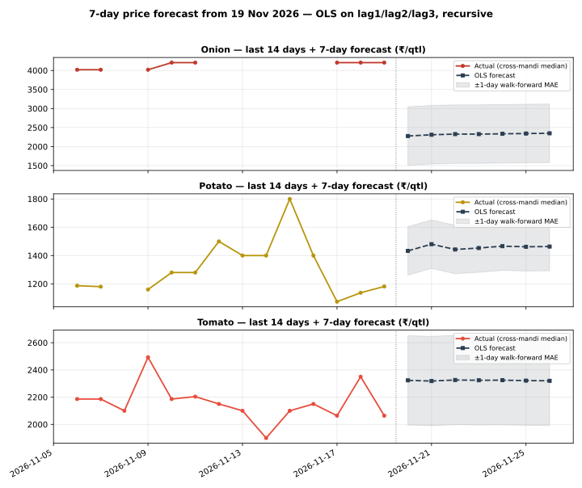

# Day 23 — 7-day price forecast table in the daily report

## Method (read this first)

The champion model from Weeks 2–3 — plain OLS on lag1/lag2/lag3
per commodity, pooled across the 8 mandis (Day 22: ridge
regularisation is a verified null, alpha=0; Day 18/19: OLS
beats MA3 and the random forest out-of-sample) — is refitted
on **all history known as of today** and run recursively:
day h=1 uses real lags from the latest prices, days h=2..7
feed the previous forecasts back in as lags. No future
information enters at any step. The portal's National rows
are an all-India aggregate with a 3-day series, so they never
clear the 3-lag requirement and are excluded — the forecasts
run on the 8 mandi series (latest actual date
19 Nov 2026), exactly like the earlier scoring days.

## Empirical error scale

Walk-forward: refit on history up to 7 days ago, then
one-step-ahead on the last 7 days, per commodity:

| Commodity | Walk-forward 1-day MAE (₹/qtl) | n |
|---|---|---|
| Onion | 769.58 | 7 |
| Potato | 171.51 | 9 |
| Tomato | 328.30 | 16 |

The table below shows **point forecasts**. A fair mental
band is ±(1-day MAE × horizon): error compounds because each
forecast day reuses the previous day's forecast as a lag.
The forecast also inherits whatever drift the last 3 days
carried — a 7-day OLS forecast cannot predict a shock.

## 7-day forecast table

### Onion — latest actual 19 Nov 2026

| Market | 20 Nov | 21 Nov | 22 Nov | 23 Nov | 24 Nov | 25 Nov | 26 Nov |
|---|---|---|---|---|---|---|---|
| Azadpur | 4,084 | 4,011 | 3,946 | 3,876 | 3,811 | 3,750 | 3,690 |
| Bowenpally | 2,259 | 2,280 | 2,320 | 2,315 | 2,322 | 2,331 | 2,337 |
| Koyambedu | 2,403 | 2,405 | 2,434 | 2,427 | 2,429 | 2,433 | 2,435 |
| Muhana | 2,115 | 2,126 | 2,151 | 2,164 | 2,178 | 2,193 | 2,206 |
| Naroda | 2,510 | 2,472 | 2,517 | 2,505 | 2,500 | 2,502 | 2,501 |
| Sealdah Koley Market | 2,296 | 2,342 | 2,337 | 2,341 | 2,350 | 2,356 | 2,361 |
| Vashi | 2,143 | 2,155 | 2,162 | 2,180 | 2,194 | 2,207 | 2,220 |
| Yeshwanthpur | 2,104 | 2,138 | 2,145 | 2,161 | 2,177 | 2,190 | 2,204 |

### Potato — latest actual 19 Nov 2026

| Market | 20 Nov | 21 Nov | 22 Nov | 23 Nov | 24 Nov | 25 Nov | 26 Nov |
|---|---|---|---|---|---|---|---|
| Azadpur | 1,229 | 1,259 | 1,297 | 1,331 | 1,354 | 1,374 | 1,392 |
| Bowenpally | 1,335 | 1,336 | 1,342 | 1,380 | 1,395 | 1,404 | 1,418 |
| Koyambedu | 1,602 | 1,563 | 1,613 | 1,566 | 1,540 | 1,541 | 1,527 |
| Muhana | 1,424 | 1,407 | 1,421 | 1,437 | 1,440 | 1,445 | 1,452 |
| Naroda | 1,552 | 1,498 | 1,530 | 1,518 | 1,500 | 1,501 | 1,497 |
| Sealdah Koley Market | 1,439 | 1,541 | 1,501 | 1,478 | 1,494 | 1,489 | 1,482 |
| Vashi | 1,453 | 1,483 | 1,426 | 1,450 | 1,465 | 1,457 | 1,461 |
| Yeshwanthpur | 1,427 | 1,478 | 1,460 | 1,456 | 1,468 | 1,467 | 1,467 |

### Tomato — latest actual 19 Nov 2026

| Market | 20 Nov | 21 Nov | 22 Nov | 23 Nov | 24 Nov | 25 Nov | 26 Nov |
|---|---|---|---|---|---|---|---|
| Azadpur | 2,159 | 2,169 | 2,186 | 2,213 | 2,228 | 2,241 | 2,253 |
| Bowenpally | 1,722 | 1,809 | 1,874 | 1,955 | 2,013 | 2,060 | 2,102 |
| Koyambedu | 2,472 | 2,383 | 2,459 | 2,411 | 2,385 | 2,383 | 2,370 |
| Muhana | 2,121 | 2,167 | 2,141 | 2,188 | 2,211 | 2,222 | 2,238 |
| Naroda | 2,671 | 2,552 | 2,575 | 2,519 | 2,477 | 2,457 | 2,432 |
| Sealdah Koley Market | 2,957 | 2,863 | 2,791 | 2,703 | 2,640 | 2,589 | 2,543 |
| Vashi | 2,455 | 2,430 | 2,396 | 2,389 | 2,377 | 2,365 | 2,357 |
| Yeshwanthpur | 2,192 | 2,253 | 2,256 | 2,259 | 2,272 | 2,278 | 2,283 |

## Verification

Hand-check on Azadpur Onion: recomputing h=1 and h=2 from the
coefficients by hand gives Rs 4083.76 and Rs 4011.46/qtl —
both **match** the module output exactly, so the recursion is
verified. Re-running the script produces a byte-identical CSV
(deterministic), and the chart parses as valid SVG.

## Reading the result

Prices are strongly autocorrelated day to day, so h=1
forecasts mostly say 'tomorrow looks like yesterday, pulled
slightly toward the last few days'. By h=7 the forecast has
converged toward the series' recent drift — treat day 5–7
values as directional, not precise. This table now ships in
every daily report via run_daily.py (forecast_table.py runs
right after analyze.py), so tomorrow's report will carry a
fresh 7-day table automatically. Day 24's rolling-MAE
dashboard will start tracking these forecasts against
realised prices as they arrive.

