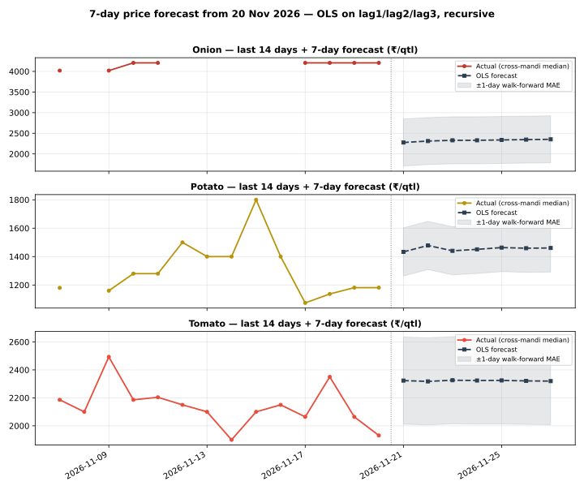

# Day 23 — 7-day price forecast table in the daily report

## Method (read this first)

The champion model from Weeks 2–3 — plain OLS on lag1/lag2/lag3
per commodity, pooled across the 8 mandis (Day 22: ridge
regularisation is a verified null, alpha=0; Day 18/19: OLS
beats MA3 and the random forest out-of-sample) — is refitted
on **all history known as of today** and run recursively:
day h=1 uses real lags from the latest prices, days h=2..7
feed the previous forecasts back in as lags. No future
information enters at any step. The portal's National rows
are an all-India aggregate with a 3-day series, so they never
clear the 3-lag requirement and are excluded — the forecasts
run on the 8 mandi series (latest actual date
20 Nov 2026), exactly like the earlier scoring days.

## Empirical error scale

Walk-forward: refit on history up to 7 days ago, then
one-step-ahead on the last 7 days, per commodity:

| Commodity | Walk-forward 1-day MAE (₹/qtl) | n |
|---|---|---|
| Onion | 569.60 | 7 |
| Potato | 169.67 | 10 |
| Tomato | 311.56 | 17 |

The table below shows **point forecasts**. A fair mental
band is ±(1-day MAE × horizon): error compounds because each
forecast day reuses the previous day's forecast as a lag.
The forecast also inherits whatever drift the last 3 days
carried — a 7-day OLS forecast cannot predict a shock.

## 7-day forecast table

### Onion — latest actual 20 Nov 2026

| Market | 21 Nov | 22 Nov | 23 Nov | 24 Nov | 25 Nov | 26 Nov | 27 Nov |
|---|---|---|---|---|---|---|---|
| Azadpur | 4,098 | 4,034 | 3,976 | 3,913 | 3,854 | 3,799 | 3,745 |
| Bowenpally | 2,257 | 2,280 | 2,321 | 2,316 | 2,324 | 2,334 | 2,341 |
| Koyambedu | 2,403 | 2,407 | 2,438 | 2,431 | 2,434 | 2,439 | 2,442 |
| Muhana | 2,114 | 2,125 | 2,150 | 2,163 | 2,177 | 2,192 | 2,205 |
| Naroda | 2,511 | 2,474 | 2,521 | 2,511 | 2,507 | 2,510 | 2,510 |
| Sealdah Koley Market | 2,296 | 2,343 | 2,339 | 2,344 | 2,354 | 2,360 | 2,366 |
| Vashi | 2,143 | 2,155 | 2,162 | 2,180 | 2,194 | 2,207 | 2,220 |
| Yeshwanthpur | 2,103 | 2,137 | 2,144 | 2,160 | 2,176 | 2,190 | 2,203 |

### Potato — latest actual 20 Nov 2026

| Market | 21 Nov | 22 Nov | 23 Nov | 24 Nov | 25 Nov | 26 Nov | 27 Nov |
|---|---|---|---|---|---|---|---|
| Azadpur | 1,229 | 1,279 | 1,302 | 1,331 | 1,356 | 1,374 | 1,390 |
| Bowenpally | 1,279 | 1,310 | 1,326 | 1,355 | 1,376 | 1,389 | 1,403 |
| Koyambedu | 1,603 | 1,566 | 1,614 | 1,567 | 1,541 | 1,541 | 1,528 |
| Muhana | 1,421 | 1,405 | 1,418 | 1,434 | 1,436 | 1,442 | 1,448 |
| Naroda | 1,551 | 1,498 | 1,530 | 1,517 | 1,499 | 1,500 | 1,496 |
| Sealdah Koley Market | 1,440 | 1,540 | 1,499 | 1,478 | 1,493 | 1,488 | 1,480 |
| Vashi | 1,452 | 1,480 | 1,424 | 1,447 | 1,462 | 1,454 | 1,458 |
| Yeshwanthpur | 1,426 | 1,477 | 1,458 | 1,454 | 1,465 | 1,464 | 1,464 |

### Tomato — latest actual 20 Nov 2026

| Market | 21 Nov | 22 Nov | 23 Nov | 24 Nov | 25 Nov | 26 Nov | 27 Nov |
|---|---|---|---|---|---|---|---|
| Azadpur | 2,075 | 2,112 | 2,122 | 2,160 | 2,184 | 2,201 | 2,219 |
| Bowenpally | 1,709 | 1,792 | 1,856 | 1,935 | 1,992 | 2,039 | 2,081 |
| Koyambedu | 2,473 | 2,385 | 2,463 | 2,414 | 2,389 | 2,388 | 2,373 |
| Muhana | 2,118 | 2,162 | 2,134 | 2,180 | 2,204 | 2,214 | 2,231 |
| Naroda | 2,677 | 2,560 | 2,585 | 2,529 | 2,487 | 2,467 | 2,442 |
| Sealdah Koley Market | 2,971 | 2,880 | 2,810 | 2,724 | 2,661 | 2,610 | 2,563 |
| Vashi | 2,458 | 2,434 | 2,399 | 2,393 | 2,381 | 2,368 | 2,360 |
| Yeshwanthpur | 2,189 | 2,251 | 2,253 | 2,255 | 2,268 | 2,274 | 2,279 |

## Verification

Hand-check on Azadpur Onion: recomputing h=1 and h=2 from the
coefficients by hand gives Rs 4097.96 and Rs 4033.90/qtl —
both **match** the module output exactly, so the recursion is
verified. Re-running the script produces a byte-identical CSV
(deterministic), and the chart parses as valid SVG.

## Reading the result

Prices are strongly autocorrelated day to day, so h=1
forecasts mostly say 'tomorrow looks like yesterday, pulled
slightly toward the last few days'. By h=7 the forecast has
converged toward the series' recent drift — treat day 5–7
values as directional, not precise. This table now ships in
every daily report via run_daily.py (forecast_table.py runs
right after analyze.py), so tomorrow's report will carry a
fresh 7-day table automatically. Day 24's rolling-MAE
dashboard will start tracking these forecasts against
realised prices as they arrive.

