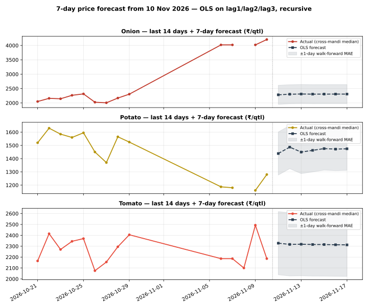

# Day 23 — 7-day price forecast table in the daily report

## Method (read this first)

The champion model from Weeks 2–3 — plain OLS on lag1/lag2/lag3
per commodity, pooled across the 8 mandis (Day 22: ridge
regularisation is a verified null, alpha=0; Day 18/19: OLS
beats MA3 and the random forest out-of-sample) — is refitted
on **all history known as of today** and run recursively:
day h=1 uses real lags from the latest prices, days h=2..7
feed the previous forecasts back in as lags. No future
information enters at any step. The portal's National rows
are an all-India aggregate with a 3-day series, so they never
clear the 3-lag requirement and are excluded — the forecasts
run on the 8 mandi series (latest actual date
10 Nov 2026), exactly like the earlier scoring days.

## Empirical error scale

Walk-forward: refit on history up to 7 days ago, then
one-step-ahead on the last 7 days, per commodity:

| Commodity | Walk-forward 1-day MAE (₹/qtl) | n |
|---|---|---|
| Onion | 331.72 | 28 |
| Potato | 162.84 | 31 |
| Tomato | 289.82 | 29 |

The table below shows **point forecasts**. A fair mental
band is ±(1-day MAE × horizon): error compounds because each
forecast day reuses the previous day's forecast as a lag.
The forecast also inherits whatever drift the last 3 days
carried — a 7-day OLS forecast cannot predict a shock.

## 7-day forecast table

### Onion — latest actual 10 Nov 2026

| Market | 11 Nov | 12 Nov | 13 Nov | 14 Nov | 15 Nov | 16 Nov | 17 Nov |
|---|---|---|---|---|---|---|---|
| Azadpur | 3,884 | 3,731 | 3,613 | 3,481 | 3,367 | 3,266 | 3,174 |
| Bowenpally | 2,272 | 2,283 | 2,308 | 2,300 | 2,301 | 2,303 | 2,303 |
| Koyambedu | 2,398 | 2,388 | 2,400 | 2,385 | 2,378 | 2,372 | 2,366 |
| Muhana | 2,122 | 2,136 | 2,159 | 2,172 | 2,185 | 2,198 | 2,209 |
| Naroda | 2,494 | 2,450 | 2,469 | 2,447 | 2,432 | 2,422 | 2,411 |
| Sealdah Koley Market | 2,293 | 2,322 | 2,313 | 2,312 | 2,313 | 2,313 | 2,312 |
| Vashi | 2,140 | 2,154 | 2,164 | 2,180 | 2,193 | 2,204 | 2,214 |
| Yeshwanthpur | 2,111 | 2,142 | 2,152 | 2,168 | 2,182 | 2,194 | 2,206 |

### Potato — latest actual 10 Nov 2026

| Market | 11 Nov | 12 Nov | 13 Nov | 14 Nov | 15 Nov | 16 Nov | 17 Nov |
|---|---|---|---|---|---|---|---|
| Azadpur | 1,266 | 1,306 | 1,325 | 1,362 | 1,386 | 1,402 | 1,418 |
| Bowenpally | 1,368 | 1,365 | 1,413 | 1,423 | 1,428 | 1,443 | 1,451 |
| Koyambedu | 1,597 | 1,563 | 1,613 | 1,565 | 1,541 | 1,543 | 1,530 |
| Muhana | 1,429 | 1,415 | 1,430 | 1,447 | 1,451 | 1,457 | 1,464 |
| Naroda | 1,551 | 1,500 | 1,534 | 1,521 | 1,505 | 1,507 | 1,504 |
| Sealdah Koley Market | 1,444 | 1,546 | 1,505 | 1,485 | 1,502 | 1,497 | 1,490 |
| Vashi | 1,461 | 1,489 | 1,433 | 1,460 | 1,475 | 1,467 | 1,472 |
| Yeshwanthpur | 1,433 | 1,485 | 1,466 | 1,465 | 1,477 | 1,477 | 1,477 |

### Tomato — latest actual 10 Nov 2026

| Market | 11 Nov | 12 Nov | 13 Nov | 14 Nov | 15 Nov | 16 Nov | 17 Nov |
|---|---|---|---|---|---|---|---|
| Azadpur | 2,242 | 2,260 | 2,271 | 2,283 | 2,291 | 2,296 | 2,300 |
| Bowenpally | 1,873 | 1,979 | 2,066 | 2,141 | 2,188 | 2,222 | 2,247 |
| Koyambedu | 2,447 | 2,359 | 2,406 | 2,364 | 2,343 | 2,339 | 2,330 |
| Muhana | 2,156 | 2,214 | 2,204 | 2,246 | 2,266 | 2,276 | 2,286 |
| Naroda | 2,590 | 2,468 | 2,470 | 2,414 | 2,380 | 2,364 | 2,348 |
| Sealdah Koley Market | 2,580 | 2,510 | 2,466 | 2,416 | 2,386 | 2,365 | 2,349 |
| Vashi | 2,414 | 2,387 | 2,357 | 2,346 | 2,337 | 2,328 | 2,323 |
| Yeshwanthpur | 2,224 | 2,275 | 2,280 | 2,285 | 2,294 | 2,299 | 2,302 |

## Verification

Hand-check on Azadpur Onion: recomputing h=1 and h=2 from the
coefficients by hand gives Rs 3883.76 and Rs 3730.68/qtl —
both **match** the module output exactly, so the recursion is
verified. Re-running the script produces a byte-identical CSV
(deterministic), and the chart parses as valid SVG.

## Reading the result

Prices are strongly autocorrelated day to day, so h=1
forecasts mostly say 'tomorrow looks like yesterday, pulled
slightly toward the last few days'. By h=7 the forecast has
converged toward the series' recent drift — treat day 5–7
values as directional, not precise. This table now ships in
every daily report via run_daily.py (forecast_table.py runs
right after analyze.py), so tomorrow's report will carry a
fresh 7-day table automatically. Day 24's rolling-MAE
dashboard will start tracking these forecasts against
realised prices as they arrive.

