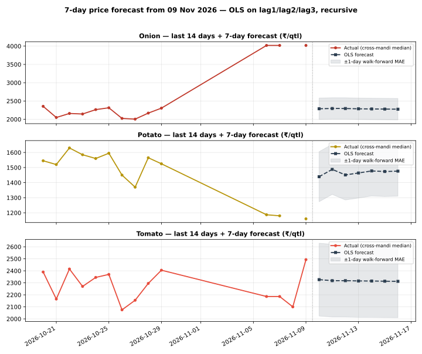

# Day 23 — 7-day price forecast table in the daily report

## Method (read this first)

The champion model from Weeks 2–3 — plain OLS on lag1/lag2/lag3
per commodity, pooled across the 8 mandis (Day 22: ridge
regularisation is a verified null, alpha=0; Day 18/19: OLS
beats MA3 and the random forest out-of-sample) — is refitted
on **all history known as of today** and run recursively:
day h=1 uses real lags from the latest prices, days h=2..7
feed the previous forecasts back in as lags. No future
information enters at any step. The portal's National rows
are an all-India aggregate with a 3-day series, so they never
clear the 3-lag requirement and are excluded — the forecasts
run on the 8 mandi series (latest actual date
09 Nov 2026), exactly like the earlier scoring days.

## Empirical error scale

Walk-forward: refit on history up to 7 days ago, then
one-step-ahead on the last 7 days, per commodity:

| Commodity | Walk-forward 1-day MAE (₹/qtl) | n |
|---|---|---|
| Onion | 293.43 | 35 |
| Potato | 166.09 | 37 |
| Tomato | 302.97 | 34 |

The table below shows **point forecasts**. A fair mental
band is ±(1-day MAE × horizon): error compounds because each
forecast day reuses the previous day's forecast as a lag.
The forecast also inherits whatever drift the last 3 days
carried — a 7-day OLS forecast cannot predict a shock.

## 7-day forecast table

### Onion — latest actual 09 Nov 2026

| Market | 10 Nov | 11 Nov | 12 Nov | 13 Nov | 14 Nov | 15 Nov | 16 Nov |
|---|---|---|---|---|---|---|---|
| Azadpur | 3,659 | 3,459 | 3,294 | 3,140 | 3,011 | 2,902 | 2,808 |
| Bowenpally | 2,286 | 2,287 | 2,297 | 2,287 | 2,283 | 2,280 | 2,276 |
| Koyambedu | 2,395 | 2,374 | 2,370 | 2,350 | 2,337 | 2,326 | 2,316 |
| Muhana | 2,129 | 2,145 | 2,165 | 2,178 | 2,190 | 2,200 | 2,208 |
| Naroda | 2,482 | 2,432 | 2,429 | 2,399 | 2,378 | 2,361 | 2,346 |
| Sealdah Koley Market | 2,291 | 2,305 | 2,293 | 2,287 | 2,284 | 2,280 | 2,277 |
| Vashi | 2,138 | 2,153 | 2,165 | 2,180 | 2,191 | 2,201 | 2,209 |
| Yeshwanthpur | 2,117 | 2,145 | 2,157 | 2,173 | 2,185 | 2,196 | 2,205 |

### Potato — latest actual 09 Nov 2026

| Market | 10 Nov | 11 Nov | 12 Nov | 13 Nov | 14 Nov | 15 Nov | 16 Nov |
|---|---|---|---|---|---|---|---|
| Azadpur | 1,273 | 1,311 | 1,330 | 1,368 | 1,392 | 1,407 | 1,424 |
| Bowenpally | 1,398 | 1,369 | 1,367 | 1,416 | 1,426 | 1,431 | 1,446 |
| Koyambedu | 1,597 | 1,562 | 1,612 | 1,564 | 1,540 | 1,542 | 1,529 |
| Muhana | 1,431 | 1,417 | 1,432 | 1,450 | 1,453 | 1,459 | 1,466 |
| Naroda | 1,552 | 1,501 | 1,534 | 1,522 | 1,506 | 1,508 | 1,504 |
| Sealdah Koley Market | 1,445 | 1,546 | 1,505 | 1,486 | 1,503 | 1,498 | 1,492 |
| Vashi | 1,461 | 1,490 | 1,435 | 1,462 | 1,476 | 1,469 | 1,474 |
| Yeshwanthpur | 1,434 | 1,486 | 1,468 | 1,467 | 1,479 | 1,478 | 1,479 |

### Tomato — latest actual 09 Nov 2026

| Market | 10 Nov | 11 Nov | 12 Nov | 13 Nov | 14 Nov | 15 Nov | 16 Nov |
|---|---|---|---|---|---|---|---|
| Azadpur | 2,244 | 2,263 | 2,274 | 2,286 | 2,293 | 2,298 | 2,302 |
| Bowenpally | 1,827 | 1,960 | 2,042 | 2,133 | 2,186 | 2,221 | 2,249 |
| Koyambedu | 2,445 | 2,359 | 2,401 | 2,360 | 2,340 | 2,336 | 2,327 |
| Muhana | 2,160 | 2,218 | 2,211 | 2,252 | 2,271 | 2,280 | 2,290 |
| Naroda | 2,581 | 2,460 | 2,459 | 2,405 | 2,373 | 2,357 | 2,343 |
| Sealdah Koley Market | 2,621 | 2,514 | 2,465 | 2,417 | 2,384 | 2,363 | 2,347 |
| Vashi | 2,409 | 2,382 | 2,353 | 2,343 | 2,334 | 2,326 | 2,322 |
| Yeshwanthpur | 2,229 | 2,277 | 2,282 | 2,288 | 2,297 | 2,301 | 2,303 |

## Verification

Hand-check on Azadpur Onion: recomputing h=1 and h=2 from the
coefficients by hand gives Rs 3659.12 and Rs 3459.15/qtl —
both **match** the module output exactly, so the recursion is
verified. Re-running the script produces a byte-identical CSV
(deterministic), and the chart parses as valid SVG.

## Reading the result

Prices are strongly autocorrelated day to day, so h=1
forecasts mostly say 'tomorrow looks like yesterday, pulled
slightly toward the last few days'. By h=7 the forecast has
converged toward the series' recent drift — treat day 5–7
values as directional, not precise. This table now ships in
every daily report via run_daily.py (forecast_table.py runs
right after analyze.py), so tomorrow's report will carry a
fresh 7-day table automatically. Day 24's rolling-MAE
dashboard will start tracking these forecasts against
realised prices as they arrive.

