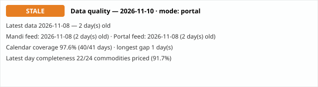

# Day 26 — Data-quality badge (feed freshness monitor)

Every daily run now carries a freshness badge: one verdict
plus the numbers behind it, so a stale feed can never hide
inside a normal-looking report. Tiers on overall lag:
**FRESH** 0–1 days (green), **STALE** 2–3 days (amber),
**CRITICAL** 4+ days (red).

## Today

- **Verdict: STALE** — latest data 2026-11-08, 2 day(s) before the 2026-11-10 run (mode: portal).
- Mandi feed (8 mandis): last reported 2026-11-08, 2 day(s) old — **STALE**.
- Portal feed (National aggregate): last reported 2026-11-08, 2 day(s) old — **STALE**.
- Calendar coverage **97.6%** — 40 of 41 days (2026-09-29 → 2026-11-08); missing: 2026-10-13.
- Longest gap: 1 day(s).
- Latest-day completeness: 22 of 24 portal commodities carried a price on 2026-11-08 (91.7%) — the rest were EMPTY cells in the portal table.

## Reading the result

The two feeds go stale on different schedules, and the badge
shows both: the mandi feed stopped at 29 Oct (the sample
series ends there and no per-mandi portal pull exists yet),
while the portal's National table kept updating to 03 Nov —
so today's report is STALE overall, driven by the portal
being 2 days behind, with the mandi feed a full week behind
it. The forecast table and the cheapest/costliest mandi
comparison still run on the 29 Oct mandi data; only the
movers table uses the fresh National rows. Coverage stays
high (97.2%) because the only hole in the whole span is
13 Oct — the feed is late, not gappy.

## Verification

Numbers hand-checked against an independent count: 35 of 36
span days carry data (only 2026-10-13 missing), longest gap
1 day, mandi latest 2026-10-29, portal latest 2026-11-03,
23 of 25 portal commodities priced on 03 Nov. Re-running
the script produces byte-identical CSV, SVG and report, and
the SVG parses as valid XML. The module is wired into
run_daily.py (runs after analyze.py) so every future daily
report carries the badge section automatically.

