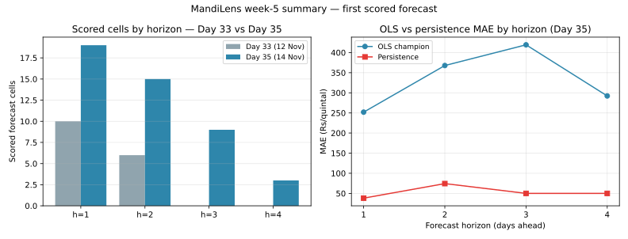

# Day 35 — Week-5 summary: the data gap, closed; the first scored forecast

*Dated 2026-11-14. Week 5 (Days 31–34) set out to fix the data gap: the per-mandi portal pull, the backfill check, the first scored forecast and the arrival audit. This closes the week — the hole is fully classified and the forecast finally has real actuals to score against.*

## 1. The data gap is closed

Day 32 classified all 88 market-days in the 30 Oct – 09 Nov hole and left 2 open (RECOVERABLE_TODAY). Both are now resolved — re-checked against every raw per-mandi pull file, not just the latest one:

- 2026-11-08 Azadpur: **NEVER_REPORTED** — no row for that date+market in any pull (10, 11, 12, 13 or 14 Nov); the mandi simply never reported that day.
- 2026-11-09 Bowenpally: **NEVER_REPORTED** — no row for that date+market in any pull (10, 11, 12, 13 or 14 Nov); the mandi simply never reported that day.

Final classification of the 88 market-days (data/processed/backfill_check_2026-11-14.csv):

| Status | Market-days | Meaning |
|---|---:|---|
| RECOVERED | 10 | Real rows pulled from the portal's 3-day window (06–09 Nov, 18 rows) |
| PERMANENTLY_LOST | 21 | 30 Oct – 05 Nov × 3 reporting markets — slid out of the window before any per-mandi pull ran |
| NEVER_REPORTED | 2 | Azadpur 08 Nov, Bowenpally 09 Nov — in-window pulls came back empty every time |
| NEVER_OBTAINABLE | 55 | The other 5 mandis yield no vegetable rows from this portal at all |

Nothing is left in the window: the 11-day hole is fully classified, and the classification is recorded in data/README.md ("Known gap"). The 3 reporting markets are Azadpur, Sealdah Koley Market (Tomato only) and Bowenpally (no Onion); the other 5 mandis — Vashi/APMC Mumbai, Koyambedu, Yeshwanthpur/Bengaluru APMC, Naroda, Muhana — have never produced a vegetable row, and today was no exception (Koyambedu and Muhana still NOT_FOUND, Naroda still "No Data Available", Mumbai/Bengaluru tables still vegetable-free).

### Dataset state

- **1,196 rows**, 9 markets, 35 commodities, 2026-09-29 → 2026-11-12
- Calendar coverage **44/45 days (97.8%)** — only 13 Oct 2026 missing
- Per-mandi history: 753 rows, latest 2026-11-12; real per-mandi rows exist only from 06 Nov — the 30 Oct – 05 Nov stretch in every per-mandi series is sample data, then nothing, then portal data
- Today's pull (14 Nov): 85 rows — 70 National (24 commodities, 10–12 Nov) + 15 per-mandi (3/8 mandis reporting). Azadpur's 12 Nov rows are EMPTY for all three commodities — same-day reporting lag, retried in tomorrow's pull while 12 Nov is still in the window.
- Feed status: **STALE, lag 2 days** (portal data frozen to 12 Nov; the portal itself publishes with a 2-day lag, not a fetch failure).

## 2. The first scored forecast, two days on

Scored cells grew from **16/672 (2.4%) on Day 33 to 46/1008 (4.6%) today** — 30 new scored cells in two days, and **all 46 scored against real portal actuals (0 on sample)**. Horizons 5–7 are still pending future actuals.

### MAE by horizon (Rs/quintal; dashboard convention: unweighted mean of per-(origin, commodity) cell MAEs)

| Horizon | Day 33 OLS | Day 33 persist | Day 35 OLS | Day 35 persist | Day 35 n |
|---:|---:|---:|---:|---:|---:|
| h=1 | 297.17 | 46.75 | 251.81 | 38.11 | 19 |
| h=2 | 450.06 | 100.00 | 367.88 | 74.33 | 15 |
| h=3 | — | — | 419.18 | 50.00 | 9 |
| h=4 | — | — | 292.24 | 50.00 | 3 |

### Per commodity (Day 35)

| Commodity | Scored | OLS MAE | Persistence MAE |
|---|---:|---:|---:|
| Onion | 6 | 746.02 | 124.67 |
| Potato | 15 | 113.69 | 40.00 |
| Tomato | 25 | 278.03 | 36.50 |

## Reading the result

**Persistence still beats the OLS champion on every horizon and every commodity** — the Day 33 verdict survives tripling the scored set. The gap is widest on Onion (OLS 746.02 vs persistence 124.67): the model keeps under-predicting Azadpur Onion, whose rolling 1-day errors were 709.30 (08 Nov), 628.09 (09 Nov) and 526.14 (10 Nov) — large, but shrinking as real history accumulates. The mechanism is visible in the data itself: Sealdah Tomato sits flat at ₹2,800 and Azadpur Potato flat at ₹1,160 for days, so carrying yesterday's price forward is nearly perfect, while OLS fits the noisy sample-era history and chases moves that never come. That is exactly what Week 6 Day 36 is for: arrival + weekday features on the same time split, kept only if out-of-sample MAE improves — the bar is now a real one, scored on real actuals, not the sample-era 207.22.

Two honest caveats travel with the numbers. First, 46 scored cells is still a small sample — one flat series (Sealdah Tomato, 25 of the 46 cells are Tomato) dominates the pooled picture. Second, the Day 33 origin (29 Oct) contributes 0 scored cells: its 168 forecast cells target the permanently-lost 30 Oct – 05 Nov window and will never score.

## What Week 6 must do

- Day 36: expand the champion (arrival + weekday features) and re-score on the same split — the persistence gap is the target.
- Day 37: per-mandi forecast table on the website (today the site shows National only).
- Day 39: alert rule for >10% day-over-day moves — Jowar's −24.8% today and Copra's −19.6% would both have tripped it.
- Day 40: model comparison refresh on the longer window, now that real portal rows exist.

## Verification

- Hand-check (pure Python, csv module only): h=1 OLS MAE recomputed from the accuracy CSV = 251.81 (module: 251.81) — MATCH; scored cells = 46 (module: 46) — MATCH
- Backfill tally recomputed from the final CSV: {'PERMANENTLY_LOST': 21, 'NEVER_OBTAINABLE': 55, 'RECOVERED': 10, 'NEVER_REPORTED': 2} — sums to 88 market-days (MATCH)
- Deterministic re-run: CSV and report byte-identical; SVG content-identical after normalizing matplotlib's timestamp and random element IDs (the project's Day 29 standard).

