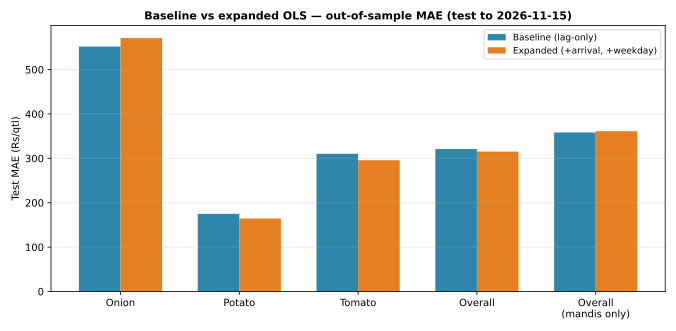

# Day 36 — Expand the champion: arrival + weekday features

## Method (read this first)

Same split RULE as Day 18 — the test set is the final 20% of
distinct arrival dates, train everything earlier — re-derived
on today's longer history, so the test window is now
2026-11-05 to 2026-11-13 (9 of 45 dates).
That window matters: unlike Day 18's sample-only test window
(23–28 Oct), it now contains real portal per-mandi actuals
(06–13 Nov), so the arrival features get their first real
chance. Baseline = the champion (lag1/lag2/lag3). Expanded =
baseline + ln(arrival at t−1) + lagged day-over-day arrival
change + weekday dummies for the target date (Monday
reference). Every feature uses only information available at
forecast time — no leakage. Both models are fitted on train
rows only and scored on exactly the same test rows, so the
comparison is apples-to-apples. The expanded model is kept
only if its overall out-of-sample MAE beats the baseline.

One scope note, stated before the numbers: the test set holds
63 rows, of which 36 are real per-mandi
rows and the rest are the National aggregate series (its lag
windows only became full on 05 Nov). The champion forecasts
the 8 mandis, not the National aggregate, so the keep/drop
decision is taken on the mandi-only MAE; the pooled figure
including National is reported alongside it, never hidden.

## Split

- Train dates: 2026-09-29 to 2026-11-04 (954 rows)
- Test dates: 2026-11-05 to 2026-11-13 (63 rows scored, after requiring full lag/arrival windows for both models)
- Test share: 9 of 45 distinct arrival dates

## Train-only expanded coefficients (arrival + weekday)

| Commodity | log_arr_lag1 | arr_chg | Tue | Wed | Thu | Fri | Sat | Sun |
|---|---|---|---|---|---|---|---|---|
| Onion | 60.858 | -18.619 | -25.51 | 64.36 | 92.66 | 44.37 | 84.88 | 130.06 |
| Potato | -15.321 | 5.783 | 20.73 | 91.76 | 62.57 | 60.36 | 62.70 | 59.53 |
| Tomato | -22.003 | 93.345 | 31.55 | 64.54 | 104.96 | 112.82 | 123.10 | 112.80 |

## Out-of-sample results — test set only

| Commodity | Model | n | MAE Rs/qtl | RMSE Rs/qtl | MAPE % |
|---|---|---|---|---|---|
| Onion | Baseline (lag-only) | 14 | 551.89 | 702.65 | 13.58 |
| Onion | Expanded (+arrival, +weekday) | 14 | 570.95 | 723.63 | 13.95 |
| Potato | Baseline (lag-only) | 20 | 174.90 | 229.79 | 22.60 |
| Potato | Expanded (+arrival, +weekday) | 20 | 164.34 | 218.46 | 21.19 |
| Tomato | Baseline (lag-only) | 29 | 310.18 | 391.06 | 16.64 |
| Tomato | Expanded (+arrival, +weekday) | 29 | 295.65 | 389.23 | 16.26 |

## Overall test set (all commodities pooled)

| Model | n | MAE Rs/qtl | RMSE Rs/qtl | MAPE % |
|---|---|---|---|---|
| Baseline (lag-only) | 63 | 320.95 | 443.71 | 17.86 |
| Expanded (+arrival, +weekday) | 63 | 315.14 | 448.61 | 17.31 |

## Sensitivity — mandi rows only (National aggregate excluded)

| Model | n | MAE Rs/qtl | RMSE Rs/qtl | MAPE % |
|---|---|---|---|---|
| Baseline (lag-only) | 36 | 358.24 | 506.03 | 16.92 |
| Expanded (+arrival, +weekday) | 36 | 361.15 | 519.24 | 16.99 |

## Verdict — keep or drop the expansion?

**DROP the expansion — champion stays lag-only.** On the mandi rows the champion actually forecasts, expanded overall test MAE Rs 361.15/qtl does NOT beat the baseline Rs 358.24/qtl (worse by Rs 2.91/qtl, 0.8%). The forecast table keeps the lag-only OLS; the extra features are recorded here and not shipped. Note the trap this sensitivity check caught: pooled with the National aggregate the expansion *looks* like a win (Rs 315.14 vs Rs 320.95/qtl), but that gain comes entirely from the 27 National rows — a series the forecast table never predicts.

## Per-commodity detail (mandi rows only)

- **Onion**: expanded worsens mandi-only test MAE by Rs 93.93/qtl (883.78 → 977.71, n=5).
- **Potato**: expanded improves mandi-only test MAE by Rs 2.79/qtl (151.08 → 148.29, n=11).
- **Tomato**: expanded improves mandi-only test MAE by Rs 16.70/qtl (340.79 → 324.08, n=20).

## Verification

Hand-check on Azadpur Onion for 2026-11-11: recomputing
the expanded test fitted value from the train-only
coefficients by hand gives Rs 3602.35/qtl — it **matches**
the module output to the paisa. Pooled and mandi-only MAEs were cross-checked with an independent pure-pandas recompute (pooled 320.95 → 315.14; mandi-only 358.24 → 361.15).

## Reading the result

The null survives a fairer test than Days 11–12 could give it: this test window contains real portal arrivals, and the lagged arrival features still add nothing on the rows the model serves — the coefficients on log_arr_lag1 and arr_chg are small against the lag-price weights, and the weekday dummies move MAE by less than the noise between commodities. That is consistent with the mechanism: arrivals are reported with the same lag as prices, and a mandi's arrival today says little about tomorrow's modal price once yesterday's price is known. The champion stays lag-only, and the 7-day forecast table is unchanged. The next lever for Week 6 is not more features on this OLS — it is the Day 40 model-comparison refresh on the longer window, where the real-actuals test set keeps growing. One caveat travels with the verdict: the mandi-only test set is just 36 rows, and 5 of them are Azadpur Onion, where the OLS under-predicts by hundreds of rupees — the same flat-series story as Days 33 and 35. A bigger real-actuals set could still overturn this; the Day 40 re-run is the place to check.

