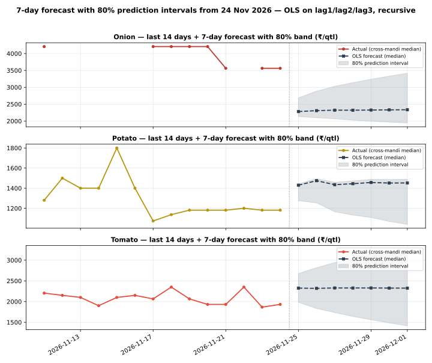

# Day 38 — Forecast confidence bands (prediction intervals)

## Method

Every stored 7-day forecast is scored against actual modal
prices (the Day-24 scorer, reused unchanged) and the SIGNED
residual r = actual − forecast is kept. Per commodity the
residuals are pooled across all origins and horizons; the 80%
prediction interval is the empirical 10th/90th percentile of
that pooled distribution. Because the pool mixes horizons 1–7,
each horizon h rescales the offsets by sqrt(h / h_bar), where
h_bar is the mean horizon of that commodity's pooled residuals
— the standard random-walk error-growth assumption, stated
here rather than hidden. Bands are floored at ₹0 (prices
cannot go negative). A commodity with fewer than 3 scored
residuals gets no empirical quantiles: its band is
±(walk-forward 1-day MAE × sqrt(h)) and is flagged
`mae_fallback` in the CSV.

## Residual base (all scored rows to date)

All 415 scored residuals rest on
real Agmarknet portal actuals (0 scored against seeded
sample-mode actuals — zero). Origins: 08–13 Nov 2026.

| Commodity | Scored residuals (n) | Mean horizon h_bar | q10 (₹/qtl) | q90 (₹/qtl) | Method |
|---|---|---|---|---|---|
| Onion | 55 | 3.75 | -286.83 | 789.96 | empirical_q10_q90 |
| Potato | 138 | 3.72 | -300.64 | 27.04 | empirical_q10_q90 |
| Tomato | 222 | 3.70 | -661.29 | 680.18 | empirical_q10_q90 |

## In-sample coverage (sanity check, not an out-of-sample claim)

Share of scored residuals falling inside their own horizon's
band. By construction the pooled band covers ~80% at the mean
horizon; per-horizon numbers will drift as more scored rows
arrive.

- Onion: 80.0% inside (n=55)
- Potato: 78.3% inside (n=138)
- Tomato: 87.4% inside (n=222)

## Today's bands (cross-mandi median, ₹/qtl)

| Commodity | 25 Nov | 26 Nov | 27 Nov | 28 Nov | 29 Nov | 30 Nov | 01 Dec |
|---|---|---|---|---|---|---|---|
| Onion | 2,281 (2,133–2,689) | 2,309 (2,099–2,886) | 2,323 (2,066–3,030) | 2,321 (2,025–3,138) | 2,327 (1,995–3,239) | 2,332 (1,969–3,332) | 2,335 (1,943–3,415) |
| Potato | 1,430 (1,274–1,444) | 1,475 (1,254–1,494) | 1,435 (1,165–1,459) | 1,445 (1,133–1,473) | 1,457 (1,108–1,488) | 1,451 (1,069–1,486) | 1,452 (1,040–1,490) |
| Tomato | 2,325 (1,981–2,679) | 2,319 (1,832–2,819) | 2,329 (1,733–2,942) | 2,328 (1,640–3,035) | 2,329 (1,560–3,120) | 2,325 (1,483–3,192) | 2,324 (1,414–3,260) |

## Hand check

- Azadpur Onion base 2026-11-08 h=1: forecast 3309.70 -> band [3161.49, 3717.88] (empirical q10 -286.83 / q90 789.96, h_bar 3.75, scale sqrt(1/3.75)=0.517); actual 4019.00 -> OUTSIDE

## Verification

- Banded CSV re-runs deterministically (same inputs, same
  quantiles); chart parses as valid SVG.
- The site sidecar (confidence_bands_YYYY-MM-DD.json) carries
  per-commodity, per-horizon lo/hi offsets so build_site.py
  can render the band under every forecast cell; the site's
  forecast note now states the residual count behind each band.

## Limits

- The residual base is THIN: a handful of scored rows per
  commodity, all from real portal actuals since 10 Nov — so
  the 80% label is an empirical-quantile statement on a small
  sample, not a calibrated interval. It widens honestly as
  scored rows accumulate (re-run daily via run_daily.py).
- sqrt(h) widening is an assumption, not a measurement: if
  multi-step errors grow faster than a random walk, the h=6–7
  bands understate the true spread. The coverage table above
  will expose that as scored rows arrive.
- Bands inherit the forecast's own limits (sample-fit history
  to 29 Oct + real rows from 10 Nov; sparse per-mandi actuals).

