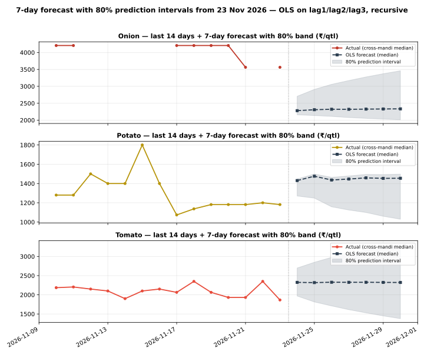

# Day 38 — Forecast confidence bands (prediction intervals)

## Method

Every stored 7-day forecast is scored against actual modal
prices (the Day-24 scorer, reused unchanged) and the SIGNED
residual r = actual − forecast is kept. Per commodity the
residuals are pooled across all origins and horizons; the 80%
prediction interval is the empirical 10th/90th percentile of
that pooled distribution. Because the pool mixes horizons 1–7,
each horizon h rescales the offsets by sqrt(h / h_bar), where
h_bar is the mean horizon of that commodity's pooled residuals
— the standard random-walk error-growth assumption, stated
here rather than hidden. Bands are floored at ₹0 (prices
cannot go negative). A commodity with fewer than 3 scored
residuals gets no empirical quantiles: its band is
±(walk-forward 1-day MAE × sqrt(h)) and is flagged
`mae_fallback` in the CSV.

## Residual base (all scored rows to date)

All 373 scored residuals rest on
real Agmarknet portal actuals (0 scored against seeded
sample-mode actuals — zero). Origins: 08–13 Nov 2026.

| Commodity | Scored residuals (n) | Mean horizon h_bar | q10 (₹/qtl) | q90 (₹/qtl) | Method |
|---|---|---|---|---|---|
| Onion | 48 | 3.71 | -234.86 | 818.70 | empirical_q10_q90 |
| Potato | 124 | 3.69 | -308.44 | 30.90 | empirical_q10_q90 |
| Tomato | 201 | 3.67 | -682.88 | 717.86 | empirical_q10_q90 |

## In-sample coverage (sanity check, not an out-of-sample claim)

Share of scored residuals falling inside their own horizon's
band. By construction the pooled band covers ~80% at the mean
horizon; per-horizon numbers will drift as more scored rows
arrive.

- Onion: 79.2% inside (n=48)
- Potato: 76.6% inside (n=124)
- Tomato: 89.6% inside (n=201)

## Today's bands (cross-mandi median, ₹/qtl)

| Commodity | 24 Nov | 25 Nov | 26 Nov | 27 Nov | 28 Nov | 29 Nov | 30 Nov |
|---|---|---|---|---|---|---|---|
| Onion | 2,281 (2,159–2,707) | 2,309 (2,137–2,910) | 2,323 (2,112–3,059) | 2,321 (2,077–3,172) | 2,327 (2,054–3,277) | 2,331 (2,033–3,373) | 2,335 (2,012–3,460) |
| Potato | 1,431 (1,270–1,447) | 1,476 (1,248–1,498) | 1,437 (1,158–1,464) | 1,446 (1,125–1,479) | 1,459 (1,099–1,495) | 1,454 (1,060–1,493) | 1,455 (1,030–1,497) |
| Tomato | 2,324 (1,968–2,699) | 2,318 (1,814–2,848) | 2,328 (1,710–2,977) | 2,326 (1,613–3,076) | 2,327 (1,529–3,165) | 2,323 (1,450–3,242) | 2,322 (1,378–3,314) |

## Hand check

- Azadpur Onion base 2026-11-08 h=1: forecast 3309.70 -> band [3187.74, 3734.84] (empirical q10 -234.86 / q90 818.70, h_bar 3.71, scale sqrt(1/3.71)=0.519); actual 4019.00 -> OUTSIDE

## Verification

- Banded CSV re-runs deterministically (same inputs, same
  quantiles); chart parses as valid SVG.
- The site sidecar (confidence_bands_YYYY-MM-DD.json) carries
  per-commodity, per-horizon lo/hi offsets so build_site.py
  can render the band under every forecast cell; the site's
  forecast note now states the residual count behind each band.

## Limits

- The residual base is THIN: a handful of scored rows per
  commodity, all from real portal actuals since 10 Nov — so
  the 80% label is an empirical-quantile statement on a small
  sample, not a calibrated interval. It widens honestly as
  scored rows accumulate (re-run daily via run_daily.py).
- sqrt(h) widening is an assumption, not a measurement: if
  multi-step errors grow faster than a random walk, the h=6–7
  bands understate the true spread. The coverage table above
  will expose that as scored rows arrive.
- Bands inherit the forecast's own limits (sample-fit history
  to 29 Oct + real rows from 10 Nov; sparse per-mandi actuals).

