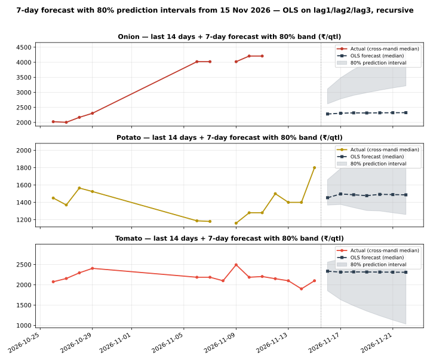

# Day 38 — Forecast confidence bands (prediction intervals)

## Method

Every stored 7-day forecast is scored against actual modal
prices (the Day-24 scorer, reused unchanged) and the SIGNED
residual r = actual − forecast is kept. Per commodity the
residuals are pooled across all origins and horizons; the 80%
prediction interval is the empirical 10th/90th percentile of
that pooled distribution. Because the pool mixes horizons 1–7,
each horizon h rescales the offsets by sqrt(h / h_bar), where
h_bar is the mean horizon of that commodity's pooled residuals
— the standard random-walk error-growth assumption, stated
here rather than hidden. Bands are floored at ₹0 (prices
cannot go negative). A commodity with fewer than 3 scored
residuals gets no empirical quantiles: its band is
±(walk-forward 1-day MAE × sqrt(h)) and is flagged
`mae_fallback` in the CSV.

## Residual base (all scored rows to date)

All 100 scored residuals rest on
real Agmarknet portal actuals (0 scored against seeded
sample-mode actuals — zero). Origins: 08–13 Nov 2026.

| Commodity | Scored residuals (n) | Mean horizon h_bar | q10 (₹/qtl) | q90 (₹/qtl) | Method |
|---|---|---|---|---|---|
| Onion | 6 | 1.67 | 434.56 | 1075.42 | empirical_q10_q90 |
| Potato | 33 | 2.82 | -143.82 | 348.88 | empirical_q10_q90 |
| Tomato | 61 | 2.90 | -821.24 | 384.48 | empirical_q10_q90 |

## In-sample coverage (sanity check, not an out-of-sample claim)

Share of scored residuals falling inside their own horizon's
band. By construction the pooled band covers ~80% at the mean
horizon; per-horizon numbers will drift as more scored rows
arrive.

- Onion: 83.3% inside (n=6)
- Potato: 75.8% inside (n=33)
- Tomato: 90.2% inside (n=61)

## Today's bands (cross-mandi median, ₹/qtl)

| Commodity | 16 Nov | 17 Nov | 18 Nov | 19 Nov | 20 Nov | 21 Nov | 22 Nov |
|---|---|---|---|---|---|---|---|
| Onion | 2,281 (2,617–3,114) | 2,306 (2,782–3,484) | 2,318 (2,901–3,761) | 2,316 (2,989–3,982) | 2,319 (3,072–4,182) | 2,323 (3,147–4,363) | 2,325 (3,216–4,529) |
| Potato | 1,453 (1,368–1,661) | 1,497 (1,375–1,790) | 1,488 (1,339–1,848) | 1,477 (1,306–1,893) | 1,492 (1,301–1,957) | 1,490 (1,280–1,999) | 1,487 (1,260–2,037) |
| Tomato | 2,334 (1,852–2,560) | 2,313 (1,631–2,632) | 2,318 (1,483–2,709) | 2,316 (1,351–2,767) | 2,314 (1,236–2,819) | 2,311 (1,130–2,864) | 2,309 (1,033–2,906) |

## Hand check

- Azadpur Onion base 2026-11-08 h=1: forecast 3309.70 -> band [3646.31, 4142.71] (empirical q10 434.56 / q90 1075.42, h_bar 1.67, scale sqrt(1/1.67)=0.775); actual 4019.00 -> INSIDE

## Verification

- Banded CSV re-runs deterministically (same inputs, same
  quantiles); chart parses as valid SVG.
- The site sidecar (confidence_bands_YYYY-MM-DD.json) carries
  per-commodity, per-horizon lo/hi offsets so build_site.py
  can render the band under every forecast cell; the site's
  forecast note now states the residual count behind each band.

## Limits

- The residual base is THIN: a handful of scored rows per
  commodity, all from real portal actuals since 10 Nov — so
  the 80% label is an empirical-quantile statement on a small
  sample, not a calibrated interval. It widens honestly as
  scored rows accumulate (re-run daily via run_daily.py).
- sqrt(h) widening is an assumption, not a measurement: if
  multi-step errors grow faster than a random walk, the h=6–7
  bands understate the true spread. The coverage table above
  will expose that as scored rows arrive.
- Bands inherit the forecast's own limits (sample-fit history
  to 29 Oct + real rows from 10 Nov; sparse per-mandi actuals).
- Onion's band sits entirely ABOVE its point forecast (q10 is
  +₹435/qtl): on the 6 scored Onion rows
  the model under-predicts every time — the band is reporting a
  real bias, not a symmetric error. A bias correction is a
  follow-up, not today's change.

