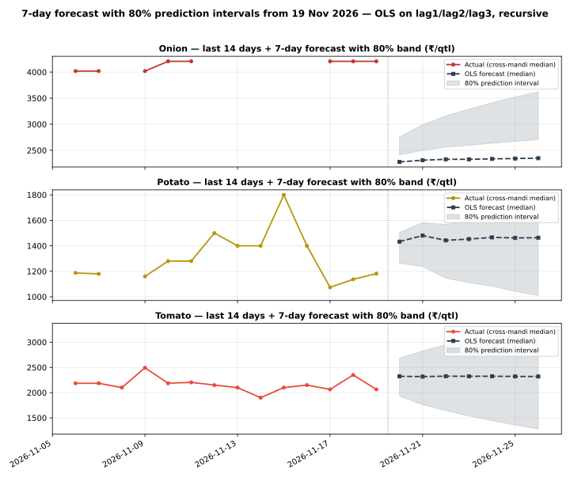

# Day 38 — Forecast confidence bands (prediction intervals)

## Method

Every stored 7-day forecast is scored against actual modal
prices (the Day-24 scorer, reused unchanged) and the SIGNED
residual r = actual − forecast is kept. Per commodity the
residuals are pooled across all origins and horizons; the 80%
prediction interval is the empirical 10th/90th percentile of
that pooled distribution. Because the pool mixes horizons 1–7,
each horizon h rescales the offsets by sqrt(h / h_bar), where
h_bar is the mean horizon of that commodity's pooled residuals
— the standard random-walk error-growth assumption, stated
here rather than hidden. Bands are floored at ₹0 (prices
cannot go negative). A commodity with fewer than 3 scored
residuals gets no empirical quantiles: its band is
±(walk-forward 1-day MAE × sqrt(h)) and is flagged
`mae_fallback` in the CSV.

## Residual base (all scored rows to date)

All 233 scored residuals rest on
real Agmarknet portal actuals (0 scored against seeded
sample-mode actuals — zero). Origins: 08–13 Nov 2026.

| Commodity | Scored residuals (n) | Mean horizon h_bar | q10 (₹/qtl) | q90 (₹/qtl) | Method |
|---|---|---|---|---|---|
| Onion | 27 | 3.48 | 250.05 | 897.45 | empirical_q10_q90 |
| Potato | 75 | 3.48 | -319.83 | 134.37 | empirical_q10_q90 |
| Tomato | 131 | 3.49 | -735.32 | 672.96 | empirical_q10_q90 |

## In-sample coverage (sanity check, not an out-of-sample claim)

Share of scored residuals falling inside their own horizon's
band. By construction the pooled band covers ~80% at the mean
horizon; per-horizon numbers will drift as more scored rows
arrive.

- Onion: 81.5% inside (n=27)
- Potato: 74.7% inside (n=75)
- Tomato: 86.3% inside (n=131)

## Today's bands (cross-mandi median, ₹/qtl)

| Commodity | 20 Nov | 21 Nov | 22 Nov | 23 Nov | 24 Nov | 25 Nov | 26 Nov |
|---|---|---|---|---|---|---|---|
| Onion | 2,277 (2,412–2,758) | 2,311 (2,500–2,991) | 2,328 (2,560–3,161) | 2,328 (2,596–3,290) | 2,336 (2,636–3,412) | 2,343 (2,672–3,522) | 2,349 (2,704–3,622) |
| Potato | 1,433 (1,261–1,505) | 1,481 (1,238–1,582) | 1,443 (1,146–1,568) | 1,453 (1,110–1,597) | 1,466 (1,083–1,627) | 1,462 (1,042–1,638) | 1,464 (1,010–1,654) |
| Tomato | 2,323 (1,930–2,684) | 2,318 (1,761–2,828) | 2,326 (1,644–2,950) | 2,324 (1,537–3,045) | 2,325 (1,444–3,130) | 2,321 (1,357–3,204) | 2,320 (1,278–3,273) |

## Hand check

- Azadpur Onion base 2026-11-08 h=1: forecast 3309.70 -> band [3443.71, 3790.68] (empirical q10 250.05 / q90 897.45, h_bar 3.48, scale sqrt(1/3.48)=0.536); actual 4019.00 -> OUTSIDE

## Verification

- Banded CSV re-runs deterministically (same inputs, same
  quantiles); chart parses as valid SVG.
- The site sidecar (confidence_bands_YYYY-MM-DD.json) carries
  per-commodity, per-horizon lo/hi offsets so build_site.py
  can render the band under every forecast cell; the site's
  forecast note now states the residual count behind each band.

## Limits

- The residual base is THIN: a handful of scored rows per
  commodity, all from real portal actuals since 10 Nov — so
  the 80% label is an empirical-quantile statement on a small
  sample, not a calibrated interval. It widens honestly as
  scored rows accumulate (re-run daily via run_daily.py).
- sqrt(h) widening is an assumption, not a measurement: if
  multi-step errors grow faster than a random walk, the h=6–7
  bands understate the true spread. The coverage table above
  will expose that as scored rows arrive.
- Bands inherit the forecast's own limits (sample-fit history
  to 29 Oct + real rows from 10 Nov; sparse per-mandi actuals).
- Onion's band sits entirely ABOVE its point forecast (q10 is
  +₹250/qtl): on the 27 scored Onion rows
  the model under-predicts every time — the band is reporting a
  real bias, not a symmetric error. A bias correction is a
  follow-up, not today's change.

