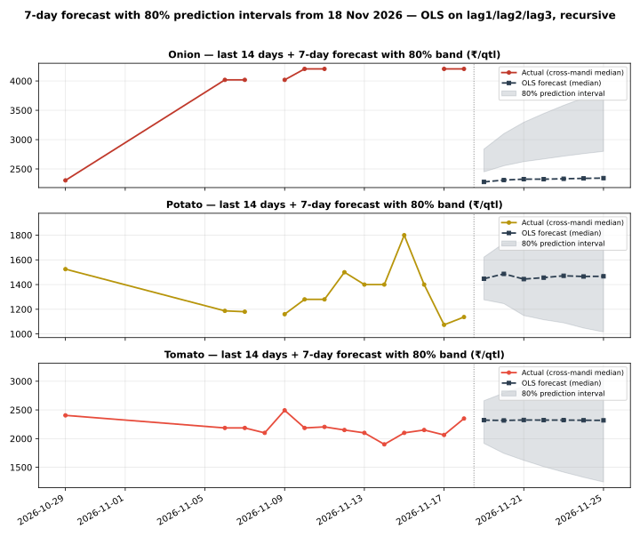

# Day 38 — Forecast confidence bands (prediction intervals)

## Method

Every stored 7-day forecast is scored against actual modal
prices (the Day-24 scorer, reused unchanged) and the SIGNED
residual r = actual − forecast is kept. Per commodity the
residuals are pooled across all origins and horizons; the 80%
prediction interval is the empirical 10th/90th percentile of
that pooled distribution. Because the pool mixes horizons 1–7,
each horizon h rescales the offsets by sqrt(h / h_bar), where
h_bar is the mean horizon of that commodity's pooled residuals
— the standard random-walk error-growth assumption, stated
here rather than hidden. Bands are floored at ₹0 (prices
cannot go negative). A commodity with fewer than 3 scored
residuals gets no empirical quantiles: its band is
±(walk-forward 1-day MAE × sqrt(h)) and is flagged
`mae_fallback` in the CSV.

## Residual base (all scored rows to date)

All 191 scored residuals rest on
real Agmarknet portal actuals (0 scored against seeded
sample-mode actuals — zero). Origins: 08–13 Nov 2026.

| Commodity | Scored residuals (n) | Mean horizon h_bar | q10 (₹/qtl) | q90 (₹/qtl) | Method |
|---|---|---|---|---|---|
| Onion | 20 | 3.30 | 313.05 | 1017.24 | empirical_q10_q90 |
| Potato | 61 | 3.36 | -312.50 | 321.87 | empirical_q10_q90 |
| Tomato | 110 | 3.39 | -747.44 | 623.36 | empirical_q10_q90 |

## In-sample coverage (sanity check, not an out-of-sample claim)

Share of scored residuals falling inside their own horizon's
band. By construction the pooled band covers ~80% at the mean
horizon; per-horizon numbers will drift as more scored rows
arrive.

- Onion: 80.0% inside (n=20)
- Potato: 83.6% inside (n=61)
- Tomato: 83.6% inside (n=110)

## Today's bands (cross-mandi median, ₹/qtl)

| Commodity | 19 Nov | 20 Nov | 21 Nov | 22 Nov | 23 Nov | 24 Nov | 25 Nov |
|---|---|---|---|---|---|---|---|
| Onion | 2,279 (2,451–2,839) | 2,310 (2,554–3,102) | 2,326 (2,625–3,296) | 2,325 (2,670–3,445) | 2,332 (2,718–3,585) | 2,339 (2,761–3,711) | 2,344 (2,800–3,825) |
| Potato | 1,447 (1,277–1,623) | 1,487 (1,246–1,735) | 1,444 (1,149–1,748) | 1,456 (1,115–1,807) | 1,471 (1,090–1,864) | 1,465 (1,048–1,896) | 1,467 (1,016–1,932) |
| Tomato | 2,322 (1,916–2,661) | 2,316 (1,742–2,795) | 2,325 (1,622–2,911) | 2,322 (1,511–2,999) | 2,323 (1,415–3,080) | 2,320 (1,325–3,149) | 2,318 (1,244–3,214) |

## Hand check

- Azadpur Onion base 2026-11-08 h=1: forecast 3309.70 -> band [3482.03, 3869.67] (empirical q10 313.05 / q90 1017.24, h_bar 3.30, scale sqrt(1/3.30)=0.550); actual 4019.00 -> OUTSIDE

## Verification

- Banded CSV re-runs deterministically (same inputs, same
  quantiles); chart parses as valid SVG.
- The site sidecar (confidence_bands_YYYY-MM-DD.json) carries
  per-commodity, per-horizon lo/hi offsets so build_site.py
  can render the band under every forecast cell; the site's
  forecast note now states the residual count behind each band.

## Limits

- The residual base is THIN: a handful of scored rows per
  commodity, all from real portal actuals since 10 Nov — so
  the 80% label is an empirical-quantile statement on a small
  sample, not a calibrated interval. It widens honestly as
  scored rows accumulate (re-run daily via run_daily.py).
- sqrt(h) widening is an assumption, not a measurement: if
  multi-step errors grow faster than a random walk, the h=6–7
  bands understate the true spread. The coverage table above
  will expose that as scored rows arrive.
- Bands inherit the forecast's own limits (sample-fit history
  to 29 Oct + real rows from 10 Nov; sparse per-mandi actuals).
- Onion's band sits entirely ABOVE its point forecast (q10 is
  +₹313/qtl): on the 20 scored Onion rows
  the model under-predicts every time — the band is reporting a
  real bias, not a symmetric error. A bias correction is a
  follow-up, not today's change.

