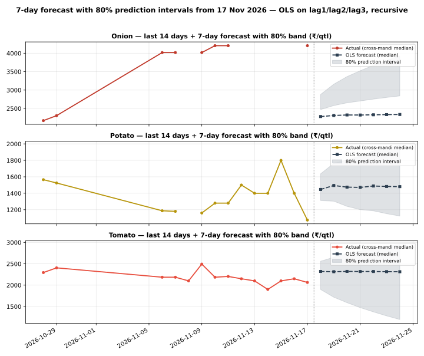

# Day 38 — Forecast confidence bands (prediction intervals)

## Method

Every stored 7-day forecast is scored against actual modal
prices (the Day-24 scorer, reused unchanged) and the SIGNED
residual r = actual − forecast is kept. Per commodity the
residuals are pooled across all origins and horizons; the 80%
prediction interval is the empirical 10th/90th percentile of
that pooled distribution. Because the pool mixes horizons 1–7,
each horizon h rescales the offsets by sqrt(h / h_bar), where
h_bar is the mean horizon of that commodity's pooled residuals
— the standard random-walk error-growth assumption, stated
here rather than hidden. Bands are floored at ₹0 (prices
cannot go negative). A commodity with fewer than 3 scored
residuals gets no empirical quantiles: its band is
±(walk-forward 1-day MAE × sqrt(h)) and is flagged
`mae_fallback` in the CSV.

## Residual base (all scored rows to date)

All 156 scored residuals rest on
real Agmarknet portal actuals (0 scored against seeded
sample-mode actuals — zero). Origins: 08–13 Nov 2026.

| Commodity | Scored residuals (n) | Mean horizon h_bar | q10 (₹/qtl) | q90 (₹/qtl) | Method |
|---|---|---|---|---|---|
| Onion | 13 | 2.92 | 325.58 | 1028.96 | empirical_q10_q90 |
| Potato | 47 | 3.17 | -240.69 | 339.57 | empirical_q10_q90 |
| Tomato | 96 | 3.30 | -768.30 | 436.03 | empirical_q10_q90 |

## In-sample coverage (sanity check, not an out-of-sample claim)

Share of scored residuals falling inside their own horizon's
band. By construction the pooled band covers ~80% at the mean
horizon; per-horizon numbers will drift as more scored rows
arrive.

- Onion: 76.9% inside (n=13)
- Potato: 78.7% inside (n=47)
- Tomato: 85.4% inside (n=96)

## Today's bands (cross-mandi median, ₹/qtl)

| Commodity | 18 Nov | 19 Nov | 20 Nov | 21 Nov | 22 Nov | 23 Nov | 24 Nov |
|---|---|---|---|---|---|---|---|
| Onion | 2,280 (2,470–2,882) | 2,309 (2,578–3,160) | 2,323 (2,653–3,366) | 2,322 (2,703–3,526) | 2,328 (2,754–3,673) | 2,333 (2,799–3,807) | 2,337 (2,841–3,929) |
| Potato | 1,446 (1,311–1,637) | 1,494 (1,303–1,764) | 1,475 (1,240–1,805) | 1,471 (1,201–1,852) | 1,488 (1,186–1,915) | 1,483 (1,151–1,950) | 1,480 (1,123–1,985) |
| Tomato | 2,321 (1,898–2,561) | 2,315 (1,717–2,654) | 2,322 (1,590–2,738) | 2,319 (1,474–2,799) | 2,319 (1,374–2,856) | 2,316 (1,280–2,904) | 2,314 (1,196–2,949) |

## Hand check

- Azadpur Onion base 2026-11-08 h=1: forecast 3309.70 -> band [3500.13, 3911.54] (empirical q10 325.58 / q90 1028.96, h_bar 2.92, scale sqrt(1/2.92)=0.585); actual 4019.00 -> OUTSIDE

## Verification

- Banded CSV re-runs deterministically (same inputs, same
  quantiles); chart parses as valid SVG.
- The site sidecar (confidence_bands_YYYY-MM-DD.json) carries
  per-commodity, per-horizon lo/hi offsets so build_site.py
  can render the band under every forecast cell; the site's
  forecast note now states the residual count behind each band.

## Limits

- The residual base is THIN: a handful of scored rows per
  commodity, all from real portal actuals since 10 Nov — so
  the 80% label is an empirical-quantile statement on a small
  sample, not a calibrated interval. It widens honestly as
  scored rows accumulate (re-run daily via run_daily.py).
- sqrt(h) widening is an assumption, not a measurement: if
  multi-step errors grow faster than a random walk, the h=6–7
  bands understate the true spread. The coverage table above
  will expose that as scored rows arrive.
- Bands inherit the forecast's own limits (sample-fit history
  to 29 Oct + real rows from 10 Nov; sparse per-mandi actuals).
- Onion's band sits entirely ABOVE its point forecast (q10 is
  +₹326/qtl): on the 13 scored Onion rows
  the model under-predicts every time — the band is reporting a
  real bias, not a symmetric error. A bias correction is a
  follow-up, not today's change.

