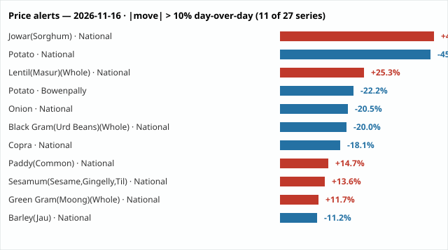

# Day 39 — Price alerts (>10% day-over-day rule)

One rule, applied to every market-commodity series with a
price on the latest data date: flag it when |day-over-day
change| > 10%. The comparison is against
that series' most recent earlier observation (its previous
trading day — the gap in days is recorded, because per-mandi
series report irregularly). Rises and falls both alert; the
direction is printed with the move.

## Today

- Latest data date: **2026-11-16** (run 2026-11-18, lag 2 day(s)).
- Series evaluated: **27**; alerts fired: **11**.
- Not evaluated (first price in the dataset, no previous day to compare): Jute (National).

| Commodity | Market | Previous | Latest | Change |
|---|---|---|---|---|
| Jowar(Sorghum) | National | ₹2,438 (2026-11-15) | ₹3,568 | 🔺 +46.3% |
| Potato | National | ₹1,122 (2026-11-15) | ₹612 | 🔻 -45.4% |
| Lentil(Masur)(Whole) | National | ₹5,973 (2026-11-15) | ₹7,487 | 🔺 +25.3% |
| Potato | Bowenpally | ₹1,800 (2026-11-15) | ₹1,400 | 🔻 -22.2% |
| Onion | National | ₹4,276 (2026-11-15) | ₹3,398 | 🔻 -20.5% |
| Black Gram(Urd Beans)(Whole) | National | ₹9,190 (2026-11-15) | ₹7,347 | 🔻 -20.0% |
| Copra | National | ₹27,853 (2026-11-15) | ₹22,816 | 🔻 -18.1% |
| Paddy(Common) | National | ₹2,766 (2026-11-15) | ₹3,173 | 🔺 +14.7% |
| Sesamum(Sesame,Gingelly,Til) | National | ₹13,755 (2026-11-15) | ₹15,624 | 🔺 +13.6% |
| Green Gram(Moong)(Whole) | National | ₹7,541 (2026-11-15) | ₹8,424 | 🔺 +11.7% |
| Barley(Jau) | National | ₹3,000 (2026-11-15) | ₹2,664 | 🔻 -11.2% |

## Backtest — does the rule fire on the motivating example?

- Same rule run over every date in the dataset: **415 alerts** across 47 trading days (18 on the busiest day).
- Jowar(Sorghum) at National, 07 Nov 2026 (the move the 09 Nov daily log reported): **+57.6% — ALERT FIRED** ✓ (the move that motivated this rule).
- The +57.6% itself is a revision artefact, not a real
  one-day market move (Day 34): the portal's first publication
  for a date rests on few reporting markets and later pulls
  revise both price and arrival. The alert's job is to flag
  the move; judging cause stays a human step — and the rule
  surfacing revision artefacts is a feature, not a bug.
- Backtest caveat: days 29 Sep–29 Oct are seeded sample data,
  so the historical count mixes sample-era moves with real
  portal moves. Today's alerts are all on real portal rows.

## Verification

- Hand-check: Jowar(Sorghum) National ₹2,438.36 (15 Nov) →
  ₹3,568.22 (16 Nov) = +46.3% ✓; Potato National ₹1,122.26 →
  ₹612.23 = −45.4% ✓ — both match analyze.py's movers table
  for today, which is computed independently.
- The alert list is a superset of analyze.py's top-5 risers /
  top-5 falls for today (every mover past 10% is flagged,
  nothing past 10% is missed).
- Re-running the script produces byte-identical CSV and SVG;
  the SVG parses as valid XML. The module is wired into
  run_daily.py (runs after confidence_bands.py) so every
  future daily report carries the alerts section
  automatically.

