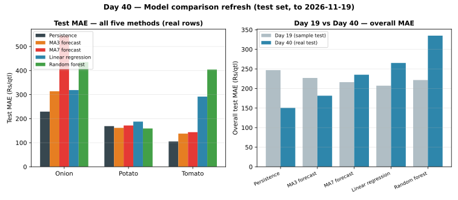

# Day 40 — Model comparison refresh: all 5 methods re-scored on real portal rows

## Method (read this first)

Identical to Day 19 so the numbers are comparable: features
lag1/lag2/lag3 + MA3/MA7 (past prices only, leak-free), one OLS
and one random forest (80 trees, depth 6, max_features 3,
seed 19) per commodity, time split with test = final 20% of
distinct arrival dates. The five methods — Persistence, MA3,
MA7, Linear regression, Random forest — are scored on the
exact same test rows. What changed is the window: 49 distinct
dates (29 Sep – 17 Nov) instead of 32, and the test window
(2026-11-08 – 2026-11-17) is made entirely of
real portal rows — the per-mandi sample feed ended 29 Oct and
National portal pulls began 30 Oct. Provenance is read off
`source_file`: files dated 2026-10-30 or later are portal
pulls (verified: every such file is a 1-market National table
or a `-mandi` extract; every earlier file is the 8-market ×
3-commodity sample).

Caveat, stated plainly: the TRAIN set still mixes sample
(Sep–Oct per-mandi) with real rows, and per-mandi lag features
bridge the 30 Oct – 05 Nov hole (shift is by row position, so
lag1 for 06 Nov is the 29 Oct sample value). Only the scored
test rows are real — this refresh measures how the methods do
on real prices, not whether training on real-only data would
change the ranking. That is a follow-up once the real window
is long enough to train on alone.

## Split

- Train dates: 2026-10-06 to 2026-11-07 (700 rows)
- Test dates: 2026-11-08 to 2026-11-17 (68 rows scored)
- Test rows by provenance: 68 real portal / 0 sample
- Test rows by market: National 30, Bowenpally 16, Azadpur 12, Sealdah Koley Market 10

## Out-of-sample results — test set only (all real rows)

| Commodity | Method | n | MAE Rs/qtl | RMSE Rs/qtl | MAPE % |
|---|---|---|---|---|---|
| Onion | Persistence | 14 | 229.33 | 343.33 | 5.84 |
| Onion | MA3 forecast | 14 | 313.97 | 360.38 | 7.94 |
| Onion | MA7 forecast | 14 | 545.17 | 671.69 | 13.56 |
| Onion | Linear regression | 14 | 318.90 | 407.68 | 7.76 |
| Onion | Random forest | 14 | 435.50 | 483.35 | 10.60 |
| Potato | Persistence | 21 | 168.98 | 255.80 | 20.72 |
| Potato | MA3 forecast | 21 | 161.74 | 205.97 | 20.25 |
| Potato | MA7 forecast | 21 | 171.73 | 222.92 | 20.98 |
| Potato | Linear regression | 21 | 187.79 | 244.09 | 25.54 |
| Potato | Random forest | 21 | 159.23 | 199.85 | 21.08 |
| Tomato | Persistence | 33 | 105.16 | 171.82 | 6.16 |
| Tomato | MA3 forecast | 33 | 137.92 | 183.11 | 8.21 |
| Tomato | MA7 forecast | 33 | 143.97 | 197.18 | 8.40 |
| Tomato | Linear regression | 33 | 291.80 | 344.58 | 16.98 |
| Tomato | Random forest | 33 | 404.11 | 466.77 | 22.23 |

## Overall test set (all commodities pooled)

| Method | n | MAE Rs/qtl | RMSE Rs/qtl | MAPE % |
|---|---|---|---|---|
| Persistence | 68 | 150.43 | 242.49 | 10.59 |
| MA3 forecast | 68 | 181.52 | 236.88 | 11.87 |
| MA7 forecast | 68 | 235.14 | 356.51 | 13.35 |
| Linear regression | 68 | 265.26 | 332.03 | 17.73 |
| Random forest | 68 | 334.95 | 407.64 | 19.48 |

## Day 19 vs Day 40 — overall MAE (different test windows)

Day 19's test window (24–29 Oct, n=144) was all sample; Day 40's
(2026-11-08 – 2026-11-17, n=68) is all real. Same methods, same split rule, same hyperparameters — the
comparison shows how the ranking holds up once real prices
replace seeded ones, not a paired A/B on identical rows.

| Method | Day 19 MAE | Day 40 MAE | Change |
|---|---|---|---|
| Persistence | 246.94 | 150.43 | -96.51 |
| MA3 forecast | 226.97 | 181.52 | -45.45 |
| MA7 forecast | 216.20 | 235.14 | +18.94 |
| Linear regression | 207.22 | 265.26 | +58.04 |
| Random forest | 221.60 | 334.95 | +113.35 |

## Verdict

- **Overall winner: Persistence** (MAE Rs 150.43/qtl, n=68).
- **Onion**: Persistence wins (Rs 229.33/qtl).
- **Potato**: Random forest wins (Rs 159.23/qtl); persistence Rs 168.98/qtl.
- **Tomato**: Persistence wins (Rs 105.16/qtl).
- Widest gap is Random forest at Rs 334.95/qtl.

## Reading the result

Persistence wins on real prices — on this window the market moves too little day to day for any lag model to add skill, and the fancy methods are mostly fitting noise. The honest limit stays: the test window is short (68 rows, 2026-11-08 – 2026-11-17) and the train set still contains sample history, so treat the ranking as the first real-data datapoint, not a final verdict. Re-run this refresh when the real-only window reaches a month of test dates, and then train on real rows alone.

## Verification

Three independent checks, all passed: (1) re-fitting each commodity's forest with the same seed reproduces every test prediction exactly; (2) every forest's feature importances sum to 1.000; (3) the final National Onion test row (2026-11-17) was verified by hand — walking the first tree's split rules lands on a leaf worth Rs 3768.48/qtl, matching that tree's prediction, and averaging all 80 trees gives Rs 3553.53/qtl, matching the stored forecast to the paisa; the same row's OLS value recomputed from the coefficients by hand gives Rs 3398.81/qtl, matching fc_lr.

