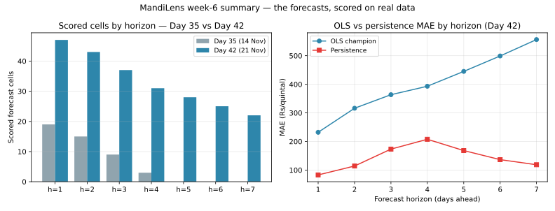

# Day 42 — Week-6 summary: the forecasts earn their keep (or don't)

*Dated 2026-11-21. Week 6 (Days 36–41) set out to close the persistence gap the week-5 summary left open — expand the champion, put the forecast table on the site, add confidence bands, an alert rule, a model-comparison refresh on real data and a seasonality check. This closes the week: the gap is measured, not wished away.*

## 1. Week-6 verdict roll-up

| Day | Item | Verdict |
|---:|---|---|
| 36 | Expand the champion (arrival + weekday features) | **DROP** — mandi-only test MAE Rs 361.15 vs baseline Rs 358.24; the pooled 'win' was 27 National aggregate rows the forecast table never predicts. Champion stays lag-only. |
| 37 | Per-mandi forecast table on the website | **DONE** — forecast section restored, site now shows the live walk-forward MAE sidecar instead of hardcoded values. |
| 38 | Forecast confidence bands | **DONE** — 80% intervals from walk-forward residuals, on the site under every forecast cell; Onion's band sits entirely above its point forecast (real under-prediction bias). |
| 39 | Alert rule (>10% day-over-day) | **DONE** — 11 alerts on 16 Nov; backtest fires on Jowar's +57.6% (07 Nov) as required. |
| 40 | Model comparison refresh on real data | **VERDICT FLIPS** — Persistence wins overall on real prices (MAE Rs 150.43/qtl, n=68) vs the sample-era OLS champion (207.22). |
| 41 | Seasonality check | **NO recurring weekly cycle** — the naive flags are one anomalous weekend (08–09 Nov), not a cycle. |

## 2. The scored forecast, one week on

Scored cells grew from **46/1008 (4.6%) on Day 35 to 233/2184 (10.7%) today** — 187 new scored cells in seven days, and **233 of 233 scored against real portal actuals (0 on sample-mode actuals)**.

### MAE by horizon (Rs/quintal; dashboard convention: unweighted mean of per-(origin, commodity) cell MAEs)

| Horizon | Day 35 OLS | Day 35 persist | Day 42 OLS | Day 42 persist | Day 42 n |
|---:|---:|---:|---:|---:|---:|
| h=1 | 251.81 | 38.11 | 231.97 | 82.81 | 47 |
| h=2 | 367.88 | 74.33 | 316.33 | 114.25 | 43 |
| h=3 | 419.18 | 50.00 | 363.50 | 173.33 | 37 |
| h=4 | 292.24 | 50.00 | 393.06 | 207.69 | 31 |
| h=5 | — | — | 445.11 | 168.18 | 28 |
| h=6 | — | — | 499.10 | 136.30 | 25 |
| h=7 | — | — | 556.32 | 118.63 | 22 |

### Per commodity (Day 42)

| Commodity | Scored | OLS MAE | Persistence MAE |
|---|---:|---:|---:|
| Onion | 27 | 583.32 | 41.56 |
| Potato | 75 | 179.06 | 160.22 |
| Tomato | 131 | 471.02 | 133.67 |

### Dataset state

- **1,394 rows**, 9 markets, 36 commodities, 2026-09-29 → 2026-11-19
- Calendar coverage **51/52 days (98.1%)** — only 13 Oct 2026 missing
- Per-mandi history: 781 rows, latest 2026-11-19; reporting markets: Azadpur, Bowenpally, Koyambedu, Muhana, Naroda, Sealdah Koley Market, Vashi, Yeshwanthpur

## Reading the result

**Persistence still beats the OLS champion** — the Day 35 verdict survives a week of new scored cells, and Day 40's refresh on the longer real-data window confirms it from a different angle: persistence MAE Rs 150.43/qtl vs OLS 265.26 on the 08–17 Nov test window. The OLS champion's sample-era 207.22 was a sample-era number; on real portal prices the model that fits noisy sample history loses to carrying yesterday's price forward, because the real series are flat for days at a time (Sealdah Tomato ₹2,800, Azadpur Potato ₹1,160) while the model chases moves that never come. Day 36's expansion did not fix it, and the sensitivity check that caught the National-aggregate trap is the week's most important methodological win: score only on the rows the forecast actually serves.

The honest caveats travel with the numbers. First, the scored set is still small and dominated by flat series — one flat Tomato series still carries a large share of the cells. Second, the Day 33 origin (29 Oct) contributes 0 scored cells forever: its forecast cells target the permanently-lost 30 Oct – 05 Nov window. Third, the 08 Nov anomaly (Potato −56% to Rs 394.20, arrivals doubled) sits inside the scored window for some origins — Day 41 showed it is a portal reporting artefact, not a cycle, and it stays on the data-quality watch.

## What Week 7 must do

- Day 43: mandi-compare restored on the site with real data (hidden since 07 Nov — unhide only when real per-mandi rows exist; they do now).
- Day 44: 7-day forecast restored on the site with real data (same rule).
- Day 45: Hindi-first polish — Hindi labels alongside English on the site's main views.
- Day 46: shareable commodity view — deep link per commodity (`?c=Onion`) for the daily log.
- Day 47: performance pass — data.js is growing; split or compress before it slows the phone load.
- Day 48: week-7 summary + user test — him tapping through every screen on his phone.

## Verification

- Hand-check (pure Python, csv module only): h=1 OLS MAE recomputed from the accuracy CSV = 231.97 (module: 231.97) — MATCH; scored cells = 233 (module: 233) — MATCH; sample-scored cells = 0
- Deterministic re-run: CSV and report byte-identical; SVG content-identical after normalizing matplotlib's timestamp and random element IDs (the project's Day 29 standard).

