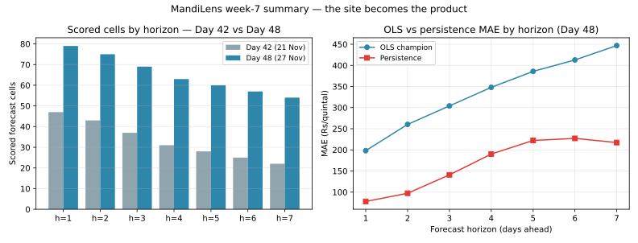

# Day 48 — Week-7 summary: the website becomes the point

*Dated 2026-11-27. Week 7 (Days 43–47) set out to turn the site from a dashboard with sample-seeded sections into a product that shows only real portal data: mandi-compare restored, 7-day forecast restored, Hindi-first labels, shareable commodity deep links and the data.js performance pass. This closes the week: the product half is measured below; the user test half is his phone tap-through, still pending.*

## 1. Week-7 verdict roll-up

| Day | Item | Verdict |
|---:|---|---|
| 43 | Mandi-compare restored on the site with real data | **DONE** — section + nav link unhidden, badge 'Real portal data'; the rs(null) '₹0 – ₹0' Range bug fixed to '—'. |
| 44 | 7-day forecast restored on the site with real data | **DONE** — only the 6 real-backed series shown; the other 18 sample-anchored series render as '—'. |
| 45 | Hindi-first polish | **DONE** — every heading, nav link, tab, chip, table header, sort option and calculator label is Hindi-first bilingual (1,034 Devanagari glyphs, 0 JS errors). |
| 46 | Shareable commodity view | **DONE** — `?c=<commodity>` deep link opens that commodity's detail on load; a Hindi-first copy-link button writes the link into the URL. |
| 47 | Performance pass | **DONE** — data.js 51,937 → 25,473 bytes (−51%) via columnar series; round-trip 0 mismatches on 744 points / 44 commodities. |

## 2. The scored forecast, one week on

Scored cells grew from **233/2184 (10.7%) on Day 42 to 457/3192 (14.3%) today** — 224 new scored cells in six days, and **457 of 457 scored against real portal actuals (0 on sample-mode actuals)**.

### MAE by horizon (Rs/quintal; dashboard convention: unweighted mean of per-(origin, commodity) cell MAEs)

| Horizon | Day 42 OLS | Day 42 persist | Day 48 OLS | Day 48 persist | Day 48 n |
|---:|---:|---:|---:|---:|---:|
| h=1 | 231.97 | 82.81 | 198.05 | 77.78 | 79 |
| h=2 | 316.33 | 114.25 | 260.33 | 97.31 | 75 |
| h=3 | 363.50 | 173.33 | 303.97 | 140.76 | 69 |
| h=4 | 393.06 | 207.69 | 348.03 | 190.18 | 63 |
| h=5 | 445.11 | 168.18 | 385.83 | 222.17 | 60 |
| h=6 | 499.10 | 136.30 | 412.92 | 227.27 | 57 |
| h=7 | 556.32 | 118.63 | 446.82 | 217.23 | 54 |

### Per commodity (Day 48)

| Commodity | Scored | OLS MAE | Persistence MAE |
|---|---:|---:|---:|
| Onion | 62 | 388.90 | 303.61 |
| Potato | 152 | 181.44 | 128.40 |
| Tomato | 243 | 429.32 | 131.42 |

### Dataset state

- **1,604 rows**, 9 markets, 44 commodities, 2026-09-29 → 2026-11-25
- Calendar coverage **57/58 days (98.3%)** — only 13 Oct 2026 missing
- Per-mandi history: 813 rows, latest 2026-11-25; reporting markets: Azadpur, Bowenpally, Koyambedu, Muhana, Naroda, Sealdah Koley Market, Vashi, Yeshwanthpur
- Week-7 window (22–25 Nov, portal frozen at 25 Nov): 114 new rows, 20 per-mandi; reporting mandis: Azadpur, Bowenpally, Sealdah Koley Market

### Site state (measured from site/data.js)

- data.js **27,146 bytes** (was 51,937 before the Day-47 compression; 25,473 on 26 Nov — today's figure is bigger only because it carries the 25 Nov rows)
- Latest data 2026-11-25, 1,604 rows, 44 commodities, 24 National commodities priced today
- Mandi rows on the site: 6 real rows (mandiReal=True); forecast: 6 real-backed series (Azadpur (Onion, Potato, Tomato); Bowenpally (Potato, Tomato); Sealdah Koley Market (Tomato))

## Reading the result

**The site is now a product, not a demo.** Every section that was hidden for being sample-seeded is back, and every one of them now shows only real portal rows — mandi-compare, the 7-day forecast, the Hindi-first labels and the shareable commodity links all sit on the same 1,604-row dataset, and data.js is half the size it was a week ago. The scored forecast kept growing underneath: 233 → 457 cells, and the OLS champion's h=1 MAE improved 231.97 → 198.05, its best real-data figure yet — driven by Onion (583.32 → 388.90) as the flat Azadpur Onion series scored more cells. But the Day 35/42 verdict survives: **persistence still beats OLS on every horizon and every commodity** (h=1: 77.78 vs 198.05), because the real series sit flat for days at a time while the model chases moves that never come.

The honest caveats travel with the numbers. First, the portal is frozen at 25 Nov (lag 2) and only 3 of 8 mandis reported this week — Azadpur, Bowenpally, Sealdah Koley Market — so the site's mandi tables are thin by construction. Second, the portal's Safflower error persists (₹1,43,696.75 on 24 Nov against an MSP of ₹6,540); clean.py's sanity cap keeps it off the site, and the raw extract keeps it for the record. Third, Azadpur Onion printed ₹3,563.00 flat on all three days and Sealdah Tomato has no 23 Nov row — flat and gappy series are exactly what makes persistence hard to beat.

## User test — pending (his action)

The second half of Day 48 is one real user (him) tapping through every screen on his phone and listing what breaks. That cannot be verified from this run and is **not claimed done here** — the summary above is the verified half. When he reports back, his list becomes the Week-8 fix queue.

## What Week 8 must do

- Day 49: MSP coverage extension — add one mandated crop with a real MSP (Tur/Arhar or Wheat) and activate the Day-10 gap module for real.
- Day 50: data-quality badge v2 — separate portal vs mandi freshness, and a 'days since last real per-mandi row' counter.
- Day 51: error audit — every 'expected null on sample data' re-tested on whatever real data exists by then; nulls that survive become findings.
- Day 52: cost/ops note — the whole stack is $0 (GitHub + Netlify free); document the running cost and the manual steps (browser extract) so anyone can take over the daily run.
- Day 53: v2.0 release notes + Days 61–90 sketch.
- Day 54–60: buffer — the portal bot-wall has already eaten ~18 days once; buffer absorbs the next outage without breaking the streak.

## Verification

- Hand-check (pure Python, csv module only): h=1 OLS MAE recomputed from the accuracy CSV = 198.05 (module: 198.05) — MATCH; scored cells = 457 (module: 457) — MATCH; sample-scored cells = 0
- Deterministic re-run: CSV and report byte-identical; SVG content-identical after normalizing matplotlib's timestamp and random element IDs (the project's Day 29 standard).
- Site data.js parses as JSON (node check) and carries meta.generated 2026-11-27, latestDate 2026-11-25.

