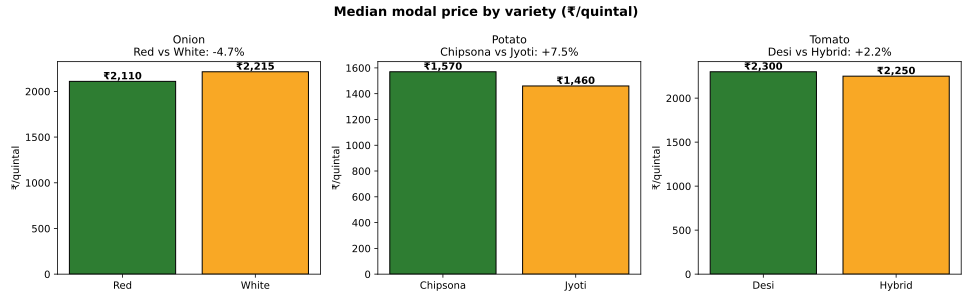

# Day 6 — variety & grade price premiums (2026-10-16)

Do varieties of the same commodity trade at systematically different prices? Red vs White onion, Jyoti vs Chipsona potato, Desi vs Hybrid tomato — compared on median modal price, with a market-adjusted check that strips out mandi-level price differences.

## Variety premiums

| Commodity | Pair | Median ₹/q (V1 / V2) | n (V1 / V2) | Raw premium | Market-adjusted premium (median across mandis, IQR) |
|---|---|---|---|---|---|
| Onion | Red vs White | ₹2,110 / ₹2,215 | 72 / 64 | -4.7% | -1.6% [-5.9%, +2.9%] (8 mandis) |
| Potato | Chipsona vs Jyoti | ₹1,570 / ₹1,460 | 57 / 79 | +7.5% | -0.1% [-1.3%, +3.2%] (8 mandis) |
| Tomato | Desi vs Hybrid | ₹2,300 / ₹2,250 | 61 / 75 | +2.2% | +3.4% [-0.0%, +8.2%] (8 mandis) |

## Grade audit

Distinct grades in the feed: **Faq**. With a single grade (FAQ) reported across every row, a grade-based premium cannot be measured from this feed — a grade premium study needs data that actually varies grade.

## Reading the result

The raw premium is the simple median-to-median gap; the market-adjusted premium compares the two varieties *inside each mandi first* (each mandi's own mean for V1 vs V2), then takes the median of those per-mandi premiums — so a mandi that is simply expensive for everything can't fake a variety effect.

