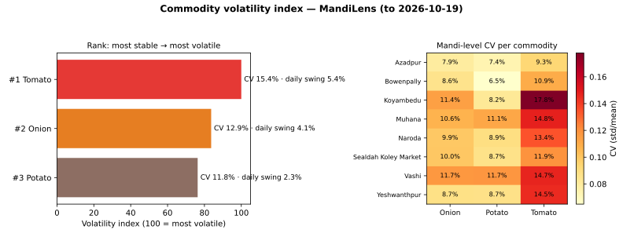

# Day 9 — Commodity volatility index: rank commodities by price stability

Volatility index = 100 × CV / max(CV), where CV = std/mean of modal
prices pooled across all mandis and days. Rank #1 = most stable.
Two cross-checks: robust spread IQR/median, and mean absolute daily
percentage change of the all-mandi median series (day-to-day swing).

| Rank | Commodity | n | Median (Rs/qtl) | CV | Volatility index | Robust IQR/median | Daily swing |
|---|---|---|---|---|---|---|---|
| #1 | Potato | 160 | 1,510 | 11.8% | 76 | 20.0% | 2.3% |
| #2 | Onion | 160 | 2,170 | 12.9% | 84 | 21.8% | 4.1% |
| #3 | Tomato | 160 | 2,275 | 15.4% | 100 | 23.8% | 5.4% |

## Reading the result

**Potato is the most price-stable commodity** (index 76), **Tomato the most volatile** (index 100). The robust spread (IQR/median) agrees with the CV ranking for all three commodities, so the ranking is not an artefact of a few extreme points.

The day-to-day swing shows how much a typical daily headline move is:
around 2.3% for Potato vs 5.4% for Tomato. Week-3 forecasting baselines should budget proportionally more uncertainty for the volatile end of the ranking.

## Mandi-level view

| Market | Potato | Onion | Tomato |
|---|---|---|---|
| Azadpur | 7.4% | 7.9% | 9.3% |
| Bowenpally | 6.5% | 8.6% | 10.9% |
| Koyambedu | 8.2% | 11.4% | 17.8% |
| Muhana | 11.1% | 10.6% | 14.8% |
| Naroda | 8.9% | 9.9% | 13.4% |
| Sealdah Koley Market | 8.7% | 10.0% | 11.9% |
| Vashi | 11.7% | 11.7% | 14.7% |
| Yeshwanthpur | 8.7% | 8.7% | 14.5% |

CV at mandi level mixes local supply shocks with the national
seasonal pattern — the commodity ranking above pools all of it,
which is the right denominator for a stability comparison.

